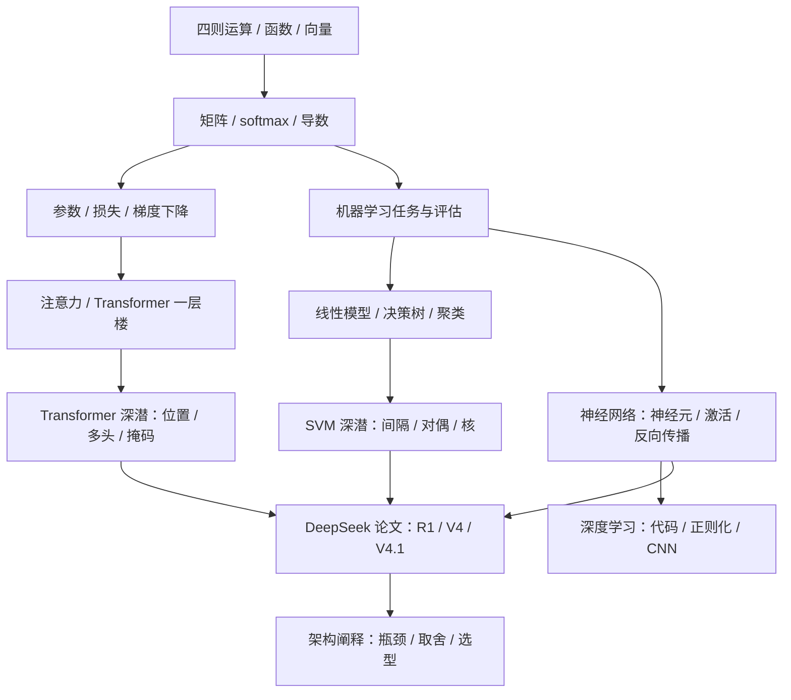

# 学习节点地图

这张表把整套材料的节点摊开，方便你判断“我现在在哪、下一步该学什么”。节点数按各书 `manifest.json` 统计，深潜课按原课章节统计。

## 节点总览

| 轨道 | 节点 | 规模 | 核心节点 |
|---|---|---|---|
| 数学与 Transformer 骨架 | 基础篇 | 6 章（含手算附录）/ 16 概念 | 向量、矩阵、softmax、参数、损失、梯度、注意力、QKV、残差、RMSNorm、FFN、自回归、MLA、MoE、MTP、KV cache |
| 机器学习 | 机器学习基础 | 16 章 / 72 术语 | 监督/无监督、模型评估、线性模型、决策树、神经网络、SVM、贝叶斯、集成、聚类、降维、特征选择、半监督、概率图、强化学习 |
| 神经网络 | 神经网络从零 | 13 章 / 12 概念 | 函数、斜率、导数、链式法则、点积、神经元、激活函数、前向、损失、梯度下降、反向传播、过拟合 |
| 深度学习 | 深度学习入门 | 8 章 / 38 术语 | Python、感知机、两层网络、反向传播、正则化、CNN、深度学习 |
| Transformer 深潜 | 标准 Transformer | 15 节 / 179 推导步骤 | 词嵌入、位置编码、注意力、多头、残差、归一化、前馈、编码器、解码器、掩码、训练、推理、BERT/GPT、代码 |
| SVM 深潜 | 支持向量机 | 16 节 | 最大间隔、硬间隔、对偶、KKT、软间隔、hinge、核技巧、核函数、交叉验证、统计学习理论 |
| DeepSeek 论文 | 论文拆解 | 5 章（含公式附录）/ 15 概念 | GRPO、规则奖励、冷启动、拒绝采样、蒸馏、CSA、HCA、mHC、Muon、CED、CSA2、SWA、Engram、DSpark、FP4 |
| DeepSeek 架构 | 架构阐释 | 5 章（含选型算例）/ 5 概念 | 瓶颈迁移、组件演进、训练路线、推理 FLOPs、架构取舍 |

## 依赖主线

看图说明：左侧是数学与经典 ML，中间是神经网络与 Transformer，右侧是 DeepSeek 论文与架构。SVM 是一条独立分支，不挡主线；想先读论文的人可以从“注意力”直接跳到 Transformer 深潜。

## 每类节点怎么练

- **数学节点**：每个公式自己代一次数字；算不通就回基础篇对应概念页。
- **ML 节点**：每个算法回答三问——优化什么目标、用什么数据、失败时怎么诊断。
- **神经网络节点**：手算一层前向和一次反向，不依赖框架。
- **Transformer 节点**：画出张量形状变化，标出每个矩阵乘法的维度。
- **SVM 节点**：从最大间隔写到对偶，再用手算示例核对符号。
- **DeepSeek 节点**：每个机制回答“替代了什么、代价是什么、什么负载下不划算”。

## 节点与测验的对应

每本书的 `quiz.md` 与 `manifest.json` 里的 `quizzes[].relatedConceptId` 一一对应。答题错误时，诊断页会沿 `prerequisites` 链倒推；如果倒推到的节点不在当前书，说明你需要先回前置分册补课。
