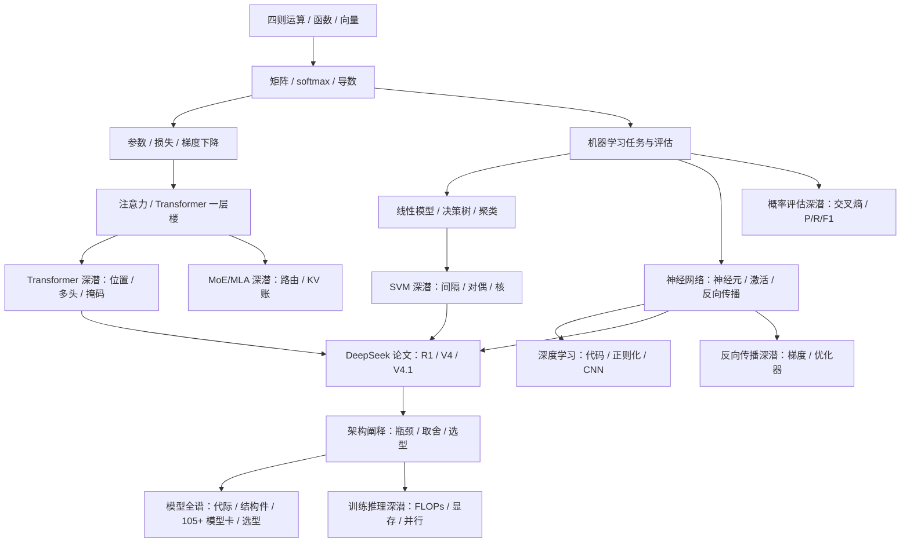

# 学习节点地图

这张表把整套材料的节点摊开，方便你判断“我现在在哪、下一步该学什么”。节点数按各书 `manifest.json` 统计，深潜课按原课章节统计。

## 节点总览

| 轨道 | 节点 | 规模 | 核心节点 |
|---|---|---|---|
| 数学与 Transformer 骨架 | 基础篇 | 6 章（含手算附录）/ 16 概念 | 向量、矩阵、softmax、参数、损失、梯度、注意力、QKV、残差、RMSNorm、FFN、自回归、MLA、MoE、MTP、KV cache |
| 机器学习 | 机器学习基础 | 16 章 / 72 术语 | 监督/无监督、模型评估、线性模型、决策树、神经网络、SVM、贝叶斯、集成、聚类、降维、特征选择、半监督、概率图、强化学习 |
| 神经网络 | 神经网络从零 | 13 章 / 12 概念 | 函数、斜率、导数、链式法则、点积、神经元、激活函数、前向、损失、梯度下降、反向传播、过拟合 |
| 深度学习 | 深度学习入门 | 8 章 / 38 术语 | Python、感知机、两层网络、反向传播、正则化、CNN、深度学习 |
| Transformer 深潜 | 标准 Transformer | 15 节 / 179 推导步骤 | 词嵌入、位置编码、注意力、多头、残差、归一化、前馈、编码器、解码器、掩码、训练、推理、BERT/GPT、代码 |
| SVM 深潜 | 支持向量机 | 16 节 | 最大间隔、硬间隔、对偶、KKT、软间隔、hinge、核技巧、核函数、交叉验证、统计学习理论 |
| 反向传播深潜 | 梯度与优化器 | 10 节 | 计算图、链式法则、多路径、2-2-1 手算、形状、梯度消失、SGD/Momentum/Adam |
| MoE/MLA 深潜 | 省算力结构 | 10 节 | FFN 参数占比、top-k、负载均衡、共享专家、KV cache、MLA、MTP、DSA |
| 概率评估深潜 | 概率与指标 | 10 节 | 贝叶斯、交叉熵、平方损失、偏差/方差、正则化、P/R/F1、AUC、数据泄漏 |
| 训练推理深潜 | 系统账本 | 9 节 | 显存、6ND、KV 公式、prefill/decode、DP/TP/PP/EP、FP16/FP8/FP4、选型 |
| DeepSeek 论文 | 论文拆解 | 5 章（含公式附录）/ 15 概念 | GRPO、规则奖励、冷启动、拒绝采样、蒸馏、CSA、HCA、mHC、Muon、CED、CSA2、SWA、Engram、DSpark、FP4 |
| DeepSeek 架构 | 架构阐释 | 5 章（含选型算例）/ 5 概念 | 瓶颈迁移、组件演进、训练路线、推理 FLOPs、架构取舍 |
| DeepSeek 全家族 | DeepSeek 模型全谱 | 14 章 / 13 概念 / 42 测验 | dense、MoE、MLA、MTP、GRPO、DSA、CSA/HCA、mHC、CED、CSA2、Engram、DSpark、VL2、Janus、OCR2、Prover-V2、Math-V2 |

## 依赖主线

看图说明：左侧是数学与经典 ML，中间是神经网络与 Transformer，右侧是 DeepSeek 论文、架构与全家族。SVM 是一条独立分支，不挡主线；想先读论文的人可以从“注意力”直接跳到 Transformer 深潜。模型全谱是最后一本，不建议在没读论文拆解前硬啃。六套深潜课是旁支，卡在哪块补哪块，不必按顺序全读。

## 12 周推进表

按每周 8–10 小时排。进度快的人可以压到 8 周，慢的人拉到 16 周；不要跳检查点。

| 周次 | 节点 | 读什么 | 检查点 |
|---|---|---|---|
| 1 | 数学起步 | 基础篇 ch01（向量、矩阵、softmax） | 手算一次矩阵乘向量与 softmax |
| 2 | 学习与梯度 | 基础篇 ch02（参数、损失、梯度） | 手算一次梯度更新，误差下降 |
| 3 | 注意力 | 基础篇 ch03 + Transformer 深潜第 1–5 节 | 手算 3 个 token 的注意力权重 |
| 4 | Transformer 一层楼 | 基础篇 ch04–ch05 + 附录 ch06 | 画出一次前向的 shape 变化；说出 MLA/MoE/MTP 各解决什么 |
| 5 | 机器学习评估与线性模型 | 机器学习 ch01–ch05 | 能解释训练/验证/测试集的分工，手推线性回归损失 |
| 6 | 经典 ML 分支 | 机器学习 ch06–ch10（决策树、神经网络、SVM、贝叶斯、集成） | 每个算法回答“优化什么、用什么数据、怎么诊断” |
| 7 | 无监督与概率图 | 机器学习 ch11–ch16 | 能区分聚类、降维、半监督、强化学习的任务边界 |
| 8 | 神经网络 | 神经网络 13 章 | 手算一层前向与一次反向传播 |
| 9 | 深度学习 | 深度学习入门 8 章 | 用 NumPy 写一个两层网络并跑通训练 |
| 10 | Transformer 深潜 | Transformer 深潜第 6–15 节 | 能解释多头、残差、归一化、掩码、解码器 |
| 11 | SVM 深潜 + 论文 | SVM 深潜第 1–8 节；论文拆解 ch06–ch07 | 从最大间隔写到对偶；复述 GRPO 与 R1 四阶段 |
| 12 | V4/V4.1 与架构 | 论文拆解 ch08–ch10；架构阐释 ch10–ch14 | 复算 1M 上下文 KV；写一份选型报告 |

如果只想尽快读 DeepSeek 论文，走压缩路线：第 1–4 周 → 第 10 周 → 第 11–12 周 → 模型全谱 1.5 周，跳过机器学习与经典 ML 分支。代价是读到 SVM、评估、过拟合这些词时会缺少背景。

模型全谱不想按 14 章全读，就走 7 步主线：先会读模型卡 → dense → MoE → V2/MLA → V3/R1 → V3.2/V4/V4.1 → 多模态与选型。每一步只读一章或一小节，详见 `09-deepseek-family/paths/learn.md`。

## 每类节点怎么练

- **数学节点**：每个公式自己代一次数字；算不通就回基础篇对应概念页。
- **ML 节点**：每个算法回答三问——优化什么目标、用什么数据、失败时怎么诊断。
- **神经网络节点**：手算一层前向和一次反向，不依赖框架。
- **Transformer 节点**：画出张量形状变化，标出每个矩阵乘法的维度。
- **SVM 节点**：从最大间隔写到对偶，再用手算示例核对符号。
- **DeepSeek 节点**：每个机制回答“替代了什么、代价是什么、什么负载下不划算”。

## 节点与测验的对应

每本书的 `quiz.md` 与 `manifest.json` 里的 `quizzes[].relatedConceptId` 一一对应。答题错误时，诊断页会沿 `prerequisites` 链倒推；如果倒推到的节点不在当前书，说明你需要先回前置分册补课。
