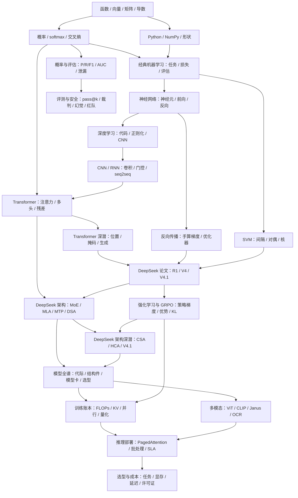

# 学习节点地图

这张表把整套材料的节点摊开，方便你判断“我现在在哪、下一步该学什么”。节点数按各书 `manifest.json` 统计，深潜课按实际节数统计。

## 节点总览

| 轨道 | 材料 | 规模 | 核心节点 |
|---|---|---|---|
| 数学与 Python | 数学基础（深潜） | 12 节 | 函数、向量、矩阵、导数、链式法则、梯度、概率、期望/方差、softmax、交叉熵、范数 |
| 数学与 Python | Python 与 NumPy（深潜） | 10 节 | 变量、列表/字典、函数、NumPy 形状、广播、矩阵乘、线性层、手写梯度下降 |
| 机器学习 | 经典机器学习（深潜） | 12 节 | 任务与泛化、线性回归、逻辑回归、决策树、随机森林/GBDT、KMeans、PCA、偏差方差、交叉验证、数据泄漏 |
| 机器学习 | 机器学习基础（分册） | 16 章 / 72 术语 | 监督/无监督、评估、线性模型、决策树、神经网络、SVM、贝叶斯、集成、聚类、降维、半监督、概率图、强化学习 |
| 神经网络 | 神经网络从零（分册） | 13 章 / 12 概念 | 函数、斜率、导数、链式法则、点积、神经元、激活、前向、损失、梯度下降、反向传播、过拟合 |
| 神经网络 | 反向传播与优化器（深潜） | 10 节 | 计算图、链式法则、多路径、2-2-1 手算、形状、梯度消失、SGD/Momentum/Adam |
| 深度学习 | 深度学习入门（分册） | 8 章 / 38 术语 | Python、感知机、两层网络、反向传播、正则化、CNN |
| CNN / RNN | CNN 与 RNN（深潜） | 10 节 | 卷积、通道、池化、感受野、CNN 结构、残差、RNN、LSTM/GRU、seq2seq、注意力过渡 |
| Transformer | 基础篇（分册） | 6 章 / 16 概念 | 向量、矩阵、softmax、参数、损失、梯度、注意力、QKV、残差、RMSNorm、FFN、自回归、MLA、MoE、MTP、KV cache |
| Transformer | Transformer 深潜 | 15 节 / 179 推导步骤 | 词嵌入、位置编码、注意力、多头、残差、归一化、前馈、编码器、解码器、掩码、训练、推理、BERT/GPT、代码 |
| SVM | SVM 深潜 | 16 节 | 最大间隔、硬间隔、对偶、KKT、软间隔、hinge、核技巧、核函数、交叉验证、统计学习理论 |
| DeepSeek 论文 | 论文拆解（分册） | 5 章 / 15 概念 | GRPO、规则奖励、冷启动、拒绝采样、蒸馏、CSA、HCA、mHC、Muon、CED、CSA2、SWA、Engram、DSpark、FP4 |
| DeepSeek 架构 | 架构阐释（分册） | 5 章 / 5 概念 | 瓶颈迁移、组件演进、训练路线、推理 FLOPs、架构取舍 |
| DeepSeek 架构 | MoE 与 MLA（深潜） | 10 节 | FFN 参数占比、top-k、负载均衡、共享专家、KV cache、MLA、MTP、DSA |
| DeepSeek 架构 | DeepSeek 架构深潜 | 13 节 | 家族时间线、MoE、MLA、MTP、DSA、CSA、HCA、mHC/Muon、Engram/DSpark、V4.1 CED/CSA2、选型 |
| DeepSeek 家族 | 模型全谱（分册） | 14 章 / 13 概念 / 42 测验 | dense、DeepSeekMoE、MLA、MTP、GRPO、DSA、CSA/HCA、mHC、CED、CSA2、Engram、DSpark、VL/VL2、Janus、OCR2、Prover-V2、Math-V2 |
| 强化学习 | 强化学习与 GRPO（深潜） | 10 节 | MDP、回报、策略梯度、基线、优势、PPO、奖励模型、KL/熵、GRPO、R1 映射 |
| 多模态 | 多模态模型（深潜） | 9 节 | ViT、CLIP、VL 三段式、DeepSeek-VL/VL2、Janus、OCR/OCR2、Prover/Math-V2 |
| 概率与评测 | 概率、损失与评估（深潜） | 10 节 | 贝叶斯、交叉熵、平方损失、偏差/方差、正则化、P/R/F1、AUC、数据泄漏 |
| 评测与安全 | 评测与安全（深潜） | 9 节 | 任务指标、pass@k、LLM 裁判、幻觉、对齐/拒答、红队、数据污染 |
| 训练系统 | 训练与推理账本（深潜） | 9 节 | 显存、6ND、KV 公式、prefill/decode、DP/TP/PP/EP、FP16/FP8/FP4 |
| 推理部署 | 推理部署（深潜） | 9 节 | 请求生命周期、KV cache、PagedAttention、continuous batching、并行、量化、SLA |
| 全球开放模型 | 全球开源模型全谱（分册） | 16 章 / 12 概念 / 53 测验 | Llama、Qwen、Mistral、Gemma、Phi、Falcon、OLMo、DBRX、GLM、Kimi、MiniMax、InternLM、MoE、RWKV/Mamba/Jamba、多模态、许可证、config |
| 机制与公式 | AI 机制与公式总库（分册） | 11 章 / 8 概念 / 23 测验 / 114 机制 / 104 公式 | 分词、注意力、MoE、并行、RLHF/DPO/RLVR、KV、PagedAttention、量化、TTFT/TPOT、RAG、Agent、提示注入 |

| AI 导论 | Hello, AI（分册） | 20 章 / 50 概念 / 60 测验 | AI 全景、搜索/规则/强化、神经网络、语言模型、对齐、RAG、多模态、智能体 |
| AI 全景 | AIMA 现代方法（分册） | 28 章 / 2 概念 / 56 测验 | 搜索、逻辑、规划、不确定性、决策、机器学习、深度学习、强化学习、部署 |
| 深度学习教材 | 动手学深度学习（分册） | 11 章 / 2 概念 / 29 测验 | 张量、自动求导、MLP、CNN、RNN、注意力、优化、计算性能 |
| 强化学习教材 | Sutton & Barto（分册） | 17 章 / 2 概念 / 46 测验 | MDP、贝尔曼、DP、MC、TD、n 步、规划、策略梯度、探索 |
| LLM 从零实现 | LLM 从零实现（分册） | 14 章 / 14 概念 / 28 测验 | BPE、位置编码、注意力、GPT、预训练、SFT、LoRA、DPO/GRPO、KV、RAG、评测、可复现路线 |

合计：14 本分册 184 章、155 个概念、476 道测验、602 张抽认卡、751 条术语；15 套深潜课 164 节、75 道自测题。

## 依赖主线

看图说明：左侧是数学与 Python，中间是经典 ML、神经网络、Transformer，右侧是 DeepSeek 论文、架构、全家族和多模态，底部是训练、评测、部署。SVM 是独立分支，不挡主线；强化学习是论文的前置，不是可选项。15 套深潜课是旁支，卡在哪块补哪块。

## 16 周推进表

按每周 8–10 小时排。进度快的人可以压到 10 周，慢的人拉到 20 周；不要跳检查点。

| 周次 | 节点 | 读什么 | 检查点 |
|---|---|---|---|
| 1 | 数学起步 | 数学基础 1–6 节 | 手算矩阵乘向量、链式法则 |
| 2 | 概率与 NumPy | 数学基础 7–12 节；Python 1–5 节 | 手算 softmax/交叉熵；写一个函数 |
| 3 | NumPy 与经典 ML | Python 6–10 节；经典 ML 1–4 节 | 手写 `(4,3)@(3,2)`；解释过拟合 |
| 4 | 经典 ML 与评估 | 经典 ML 5–12 节 | 手算混淆矩阵 P/R/F1；设计无泄漏验证 |
| 5 | 神经网络 | 神经网络 1–7 章；反向传播 1–5 节 | 手算一层前向与一次反向 |
| 6 | 深度学习与 CNN | 深度学习 1–8 章；CNN/RNN 1–5 节 | 用 NumPy 写两层网络；手算卷积尺寸 |
| 7 | RNN 与注意力过渡 | CNN/RNN 6–10 节；基础篇 1–3 章 | 画 LSTM 门控；手算 3 token 注意力 |
| 8 | Transformer 一层 | 基础篇 4–6 章；Transformer 深潜 1–6 节 | 画出一次前向 shape；解释多头/残差 |
| 9 | Transformer 完整 | Transformer 深潜 7–15 节 | 解释掩码、训练目标、prefill/decode |
| 10 | SVM 分支 | SVM 深潜 1–10 节 | 从最大间隔写到对偶；手算一个核 |
| 11 | 论文 R1 | 论文拆解 1–7 章；强化学习 1–7 节 | 复述 GRPO 与 R1 四阶段 |
| 12 | 论文 V4/V4.1 | 论文拆解 8–10 章；架构阐释 1–5 章 | 说出 CSA/HCA/CED/CSA2 解决什么 |
| 13 | MoE / MLA / DSA | MoE 与 MLA 10 节；架构深潜 1–6 节 | 手算 MLA KV；解释 top-k 与共享专家 |
| 14 | V4.1 与全家族 | 架构深潜 7–13 节；模型全谱 1–7 章 | 画家族时间线；复算 1M KV |
| 15 | 多模态与训练账本 | 模型全谱 8–14 章；多模态 9 节；训练账本 9 节 | 算 patch 数；算一次训练 FLOPs |
| 16 | 评测、安全与上线 | 概率评估 10 节；评测与安全 9 节；推理部署 9 节 | 算 pass@k；设计评测集；估并发 |

如果只想尽快读 DeepSeek 论文，走压缩路线：第 1–2 周 → 第 5 周 → 第 7–9 周 → 第 11–14 周，跳过经典 ML 与 SVM 分支。代价是读到评估、过拟合、对偶这些词时会缺少背景。

## 每类节点怎么练

- **数学节点**：每个公式自己代一次数字；算不通就回数学基础对应节。
- **Python 节点**：每段代码自己跑一遍，先改 shape 再改参数，观察报错。
- **ML 节点**：每个算法回答三问——优化什么目标、用什么数据、失败时怎么诊断。
- **神经网络节点**：手算一层前向和一次反向，不依赖框架。
- **Transformer 节点**：画出张量形状变化，标出每个矩阵乘法的维度。
- **SVM 节点**：从最大间隔写到对偶，再用手算示例核对符号。
- **DeepSeek 节点**：每个机制回答“替代了什么、代价是什么、什么负载下不划算”。
- **部署节点**：给定模型、卡、上下文，估算权重显存、KV 显存、并发上限。

## 节点与测验的对应

每本书的 `quiz.md` 与 `manifest.json` 里的 `quizzes[].relatedConceptId` 一一对应。答题错误时，诊断页会沿 `prerequisites` 链倒推；如果倒推到的节点不在当前书，说明你需要先回前置分册补课。

深潜课不参与总入口的诊断链，但每套课末尾有 5 道自测；做完再回主手册做对应章节测验，能看出“单点会了”和“放进体系里还会不会”的差别。

## 全球线节点（第八本 / 主线第 6 步）

这条线不按公司背，按“可比较的架构选择”走：

| 节点 | 对应章节 | 学到什么 |
|---|---|---|
| 边界 | 第 1 章 | 开放权重/开源/许可证三层，不被“开源”二字误导 |
| 六种骨架 | 第 2 章 | decoder-only、encoder-decoder、MoE、混合、线性/SSM、多模态 |
| Llama 基线 | 第 3 章 | RoPE、SwiGLU、RMSNorm、GQA、Llama 4 MoE |
| Qwen 全尺寸 | 第 4 章 | dense/MoE/线性混合三条子线，2.4T-A95B 的账 |
| Mistral/Gemma/Phi | 第 5–7 章 | 滑窗、局部/全局、小模型数据路线 |
| 北美/中国其他 | 第 8–9 章 | Falcon/BLOOM/OLMo/DBRX；GLM/Kimi/MiniMax/InternLM |
| 非 Transformer | 第 10 章 | RWKV、Mamba、Jamba、Griffin、xLSTM、Kimi Linear |
| MoE 账本 | 第 11 章 | 总参/激活、路由、共享专家、EP 通信 |
| 多模态 | 第 12 章 | ViT patch、连接器、早期/晚期融合、Janus |
| 注意力与长上下文 | 第 13 章 | MHA/GQA/MLA、滑窗、DSA、线性注意力、KV 公式 |
| 许可证与评测 | 第 14 章 | Apache/MIT/Llama/Gemma/CC-BY-NC、污染 |
| config 与索引 | 第 15–16 章 | 读字段、算参数、查 101 行家族索引 |
