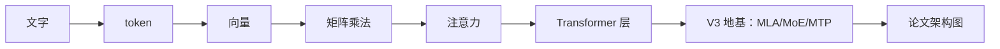

# 基础篇：从零到 Transformer

## 这个主题在讲什么

DeepSeek 的论文默认读者已经懂 Transformer。这本书把这道门槛拆掉：从“一串数字”开始，讲到向量、矩阵、softmax，再到注意力、Transformer 的一层楼，最后落到 DeepSeek-V3 的三块地基——MLA、DeepSeekMoE、MTP。学完这一本，论文里的架构图你可以自己读，不需要别人翻译。

## 全书心智模型

看图说明：这条链上每一环都只是前一环的“重新排列与加权”。没有突然冒出来的魔法，读论文时卡住，通常是因为某一环没接上。

## 学习路径（推荐顺序）

| 步骤 | 章节 | 主题 | 前置 | 检查点 |
|---|---|---|---|---|
| 01 | ch01 | 向量、矩阵、softmax | 无 | 通过 ch01 自测 |
| 02 | ch02 | 参数、损失、梯度 | ch01 | 通过 ch02 自测 |
| 03 | ch03 | 注意力机制 | ch01、ch02 | 能手算 3 个 token 的注意力权重 |
| 04 | ch04 | Transformer 一层楼 | ch03 | 能画出一次前向的 shape 变化 |
| 05 | ch05 | V3 的三块地基 | ch04 | 能说出 MLA、MoE、MTP 各解决什么问题 |

## 章节索引

- 第 1 章 数字怎么变成“意思”：向量、矩阵与 softmax（难度 ★☆☆）→ chapters/ch01-vectors-matrices-softmax.md
- 第 2 章 模型怎么学会：参数、损失、梯度（难度 ★☆☆）→ chapters/ch02-learning-parameters.md
- 第 3 章 注意力机制：一句话里谁该看谁（难度 ★★☆）→ chapters/ch03-attention.md
- 第 4 章 Transformer 一层一层拆（难度 ★★☆）→ chapters/ch04-transformer-block.md
- 第 5 章 DeepSeek-V3 的三块地基（难度 ★★★）→ chapters/ch05-v3-foundations.md

## 前置知识（零基础缺口补讲）

| 缺口 | 对应补讲位置 | 学完标志 |
|---|---|---|
| 没接触过向量和矩阵 | ch01 概念 1–2 | 能手算点积与矩阵乘向量 |
| 不知道模型怎么训练 | ch02 全章 | 能解释“损失变小”靠什么 |
| 没听过注意力 | ch03 全章 | 能说出 Q、K、V 各自负责什么 |
| 不知道 MoE / MLA | ch05 全章 | 能各用一句话说清它们省的是什么 |

## 术语表 / 模式库 / 速查表 入口

- 术语表：glossary.md
- 模式库：patterns.md
- 速查表：cheatsheet.md
- 测验：quiz.md
- 抽认卡：flashcards.md
