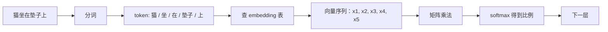

# 第 1 章：数字怎么变成“意思”：向量、矩阵与 softmax

- **难度**：★☆☆ | **预估学时**：2 小时 | **前置**：无

## 学习目标

学完本章，你能：
1. 用白话解释向量、矩阵、矩阵乘法分别是什么。
2. 手算一个 3 维向量的点积，以及一个 2×3 矩阵乘 3 维向量的结果。
3. 给定三个分数，手算 softmax，并解释它为什么输出一组“比例”。

## 一句话核心

模型不认字，它把每个词变成一串数字，再用矩阵乘法不断把这些数字重新组合。

## 零基础讲解

### 概念 1：向量就是一串有顺序的数字（难度：基础）

**向量**（vector）在模型里没有那么神秘，它就是“一串按顺序排好的数字”。比如描述一个人的三项体检指标，可以写成：

$$\mathbf{x} = [1.72,\ 70,\ 25]$$

三项分别是身高、体重、年龄。顺序不能乱：把 70 放到第一位，含义就变了。向量的长度叫**维度**（dimension），上面这个是 3 维。

模型处理一个词时也做同样的事：把“猫”映射成例如 `[0.2, -0.5, 1.1, 0.03]` 这样一串数。这串数叫**词向量**，也叫 **embedding**。每个位置的数字没有“身高体重”那么直白的含义，它们是训练过程中自己学出来的。

> 类比：向量像一张配料表。每种配料的用量是一个数字，整张表决定这道菜的味道。失效边界：配料表是人写的，词向量是模型自己学出来的，单个数字往往无法翻译成人话。

### 概念 2：矩阵乘法就是“按行做加权求和”（难度：基础）

**矩阵**（matrix）是数字排成的矩形表。一个 2×3 的矩阵有两行三列：

$$W = \begin{bmatrix} 1 & 0 & 2 \\ 0 & 1 & -1 \end{bmatrix}$$

它乘一个 3 维向量，会得到一个 2 维向量。规则只有一句：**结果的第 i 个数，等于矩阵第 i 行与向量对应位置相乘再相加。**

拿 $\mathbf{x} = [3, 1, 4]$ 来算：

- 第一行：$1\times 3 + 0\times 1 + 2\times 4 = 3 + 0 + 8 = 11$
- 第二行：$0\times 3 + 1\times 1 + (-1)\times 4 = 0 + 1 - 4 = -3$

所以结果是 $[11, -3]$。写成公式：

$$(W\mathbf{x})_i = \sum_j W_{ij}x_j$$

这里的 $\sum$ 是“把 j 取遍所有值后加起来”的意思，$\sum_j W_{ij}x_j$ 念作“第 i 行每个元素乘以对应输入，再全部相加”。

矩阵乘法有两种常见误读，先排除：
- 它不是“对应位置相乘”。对应位置相乘叫**逐元素乘法**，结果还是同样形状，不叫矩阵乘法。
- 它也不是“两个矩阵随便乘”。左矩阵的列数必须等于右矩阵的行数，否则无法配对。

> 类比：矩阵像一台有多条生产线的机器，每条生产线按自己的配方（一行权重）把同一批原料加工成一个输出。失效边界：真实模型的矩阵是成千上万行，配方不是人设计的，是训练出来的。

### 概念 3：softmax 把一堆分数变成一组比例（难度：基础）

模型经常需要对若干个候选打分，然后决定“各占多少份额”。**softmax** 就干这件事。给定三个分数 $z_1, z_2, z_3$，它先取指数，再归一化：

$$\text{softmax}(z_i) = \frac{e^{z_i}}{\sum_j e^{z_j}}$$

$e$ 是自然常数，约等于 2.718。取指数的目的，是把负数也变成正数，并且让高分和低分的差距被拉大。分母把所有指数加起来，保证输出总和为 1。

拿分数 $[2, 1, 0]$ 手算：

- $e^2 \approx 7.389$
- $e^1 \approx 2.718$
- $e^0 = 1$
- 总和 $= 7.389 + 2.718 + 1 = 11.107$
- 输出：$[7.389/11.107,\ 2.718/11.107,\ 1/11.107] \approx [0.665,\ 0.245,\ 0.090]$

三个数都为正，加起来正好是 1。这就是“比例”。注意，softmax 不改变大小顺序：原来最大的，输出仍然最大。

> 类比：三个人分一块蛋糕，softmax 按“表现分”决定每人切多少，总分归一。失效边界：蛋糕总量固定，softmax 的输出也确实固定为 1，这一点是它和普通归一化的共同点；但 softmax 会放大强者优势，不是简单的按比例平分。

### 概念 4：文字先进 token，再进向量（难度：基础）

模型读一句话，要经过两步：
1. **分词**：把句子切成一个个 **token**。中文可能一个字一个 token，也可能两个字的词一个 token；英文常见是一个词的一部分一个 token。
2. **查表**：每个 token 有一个整数编号，模型用这个编号去一张大表里取出对应的向量。

于是“猫坐在垫子上”最终变成一串向量。后面所有注意力、矩阵乘法，都是在这串向量上做运算。模型内部没有“猫”这个字，只有与它对应的那串数字。

## 图示

看图说明：从文字到向量是“查表”，从向量到新向量是“矩阵乘法”，需要分配权重时用 softmax。这三件事会贯穿整本书。

## 类比与实例

- **类比**：把一句话想成一张 Excel 表，每一行是一个 token，每一列是一个数字特征。模型做的事，就是不断用固定的公式重新计算这张表。
- **实例**：假设只有三个 token，它们的向量分别是 $[1,0]$、$[0,1]$、$[1,1]$。用矩阵

$$W = \begin{bmatrix} 2 & 1 \\ 0 & 3 \end{bmatrix}$$

乘第一个向量 $[1,0]$，得 $[2, 0]$；乘第三个向量 $[1,1]$，得 $[3, 3]$。同一个矩阵作用在不同 token 上，得到不同结果，这就是“共享一套参数，处理不同输入”。

## 常见误解

- **别以为向量一定是空间里的箭头**——在模型里它就是一串数字，箭头只是二维、三维时的几何解释。
- **别以为矩阵乘法是逐元素相乘**——逐元素相乘不改变形状；矩阵乘法会改变维度，并且要做“乘后求和”。
- **别以为 softmax 的输出可以随便解释**——它只是把分数变成比例，比例高不等于模型“真的理解”了那个 token。

## 自测题（答案）

1.（单选）一个 2×3 矩阵乘一个 3 维向量，结果是什么形状？
A. 2×3 矩阵 B. 3 维向量 C. 2 维向量 D. 一个数
**答案：C**；解析：左矩阵两行，每行与 3 维向量做一次加权求和，得到两个数。

2.（填空）对分数 $[0, 0, 0]$ 做 softmax，输出是 ______。
**答案：$[1/3, 1/3, 1/3]$**；解析：三个 $e^0=1$，总和 3，各自占三分之一。

3.（简答）用一句话解释“embedding 表”在模型里做什么。
**答案要点**：把 token 的整数编号映射成一串固定长度的向量，让后续层可以对它做数值运算。

## 复习锚点

- 向量是一串有顺序的数字，维度就是数字的个数。
- 矩阵乘法等于“每行做一次加权求和”，会改变维度。
- softmax 先取指数再归一化，输出非负且总和为 1。
