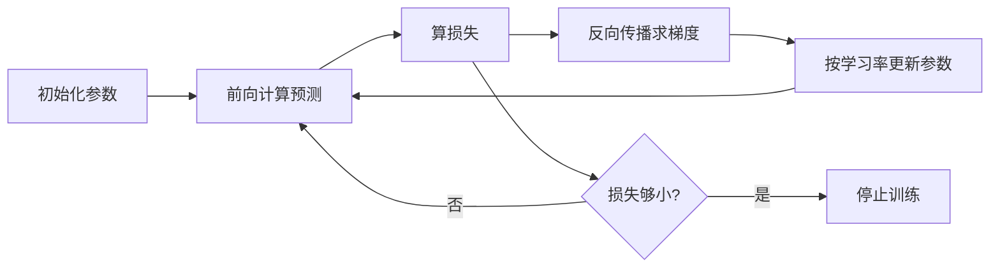

# 第 2 章：模型怎么学会：参数、损失、梯度

- **难度**：★☆☆ | **预估学时**：2 小时 | **前置**：第 1 章

## 学习目标

学完本章，你能：
1. 说清“参数”“预测”“损失”三个词分别在训练里扮演什么角色。
2. 用一个单参数例子手算一次梯度下降更新。
3. 解释学习率过大和过小分别会发生什么。

## 一句话核心

训练就是反复做三件事：拿当前参数去预测，算预测和答案差多少，再沿着让差距变小的方向挪一点参数。

## 零基础讲解

### 概念 1：参数是模型身上“可调的旋钮”（难度：基础）

**参数**（parameter）就是模型里那些会被训练改变的数值。第 1 章里的矩阵 $W$，每一个位置都是一个参数；一个 671B 参数的模型，就有 6710 亿个这样的旋钮。

训练开始前，这些旋钮随机初始化，模型输出基本是胡猜。训练的过程，就是一点点拧旋钮，让输出越来越接近正确答案。

> 类比：老式收音机的调台旋钮。拧到某个位置，声音最清楚；训练就是自动找这个位置。失效边界：收音机通常只有几个旋钮，大模型有几千亿个，而且它们互相影响，不能一个一个独立调。

### 概念 2：预测就是一次前向计算（难度：基础）

给定输入 $x$，模型用当前参数算出输出 $\hat{y}$，这一步叫**前向传播**（forward pass）。最简单的模型只有一个参数 $w$：

$$\hat{y} = wx$$

如果 $w=2$、$x=3$，预测就是 6。真实答案 $y=5$，预测偏大。训练要做的就是根据这个偏差去改 $w$。

### 概念 3：损失是一个“差距分数”（难度：基础）

**损失**（loss）把“预测和答案差多少”变成一个数字。回归问题常用平方误差：

$$L = (\hat{y} - y)^2$$

代入 $\hat{y}=6$、$y=5$，损失是 $(6-5)^2=1$。预测越准，损失越小；完全预测对，损失为 0。

分类问题常用**交叉熵**，它衡量的是“模型给正确答案分配的概率有多低”。这一章不展开公式，只要记住：损失是一个标量，越小越好。

> 类比：考试扣分。差距越大，扣分越多。失效边界：考试的扣分规则是人定的，损失函数是数学上选的，不同任务用不同损失。

### 概念 4：梯度告诉你“往哪边拧、拧多猛”（难度：基础）

**梯度**（gradient）是损失对参数的导数，记作 $\frac{\partial L}{\partial w}$。它回答一个问题：参数增大一点点，损失会变大还是变小，变化有多快。

还是上面的例子，$L=(wx-y)^2$。对 $w$ 求导，用链式法则：

$$\frac{\partial L}{\partial w} = 2(wx-y)\cdot x$$

代入 $w=2$、$x=3$、$y=5$：$2(6-5)\cdot 3 = 6$。梯度为正，说明 $w$ 增大时损失会增大，所以应该把 $w$ 往小的方向挪。

### 概念 5：梯度下降就是“往下坡走一步”（难度：基础）

**梯度下降**（gradient descent）的更新规则：

$$w \leftarrow w - \eta \frac{\partial L}{\partial w}$$

$\eta$ 是**学习率**（learning rate），控制每一步走多大。取 $\eta=0.1$：

- 新 $w = 2 - 0.1\times 6 = 1.4$
- 新预测 $= 1.4\times 3 = 4.2$，更接近 5
- 新损失 $= (4.2-5)^2 = 0.64$，比原来的 1 小

一次更新，损失从 1 降到 0.64。把这一步重复几千几万次，参数就会慢慢逼近让损失最小的位置。

> 类比：蒙着眼睛下山，只能用脚感受哪边是下坡，然后朝那个方向迈一小步。失效边界：山可能是凹凸不平的，会卡在局部低点；深度学习的损失面维度极高，不能画成一座山。

### 概念 6：学习率是最难调的旋钮之一（难度：基础）

- 学习率太小：每步挪一点，训练慢得让人怀疑人生。
- 学习率太大：一步跨过谷底，损失可能反而越来越大，甚至变成 NaN（数值溢出）。
- 常见做法：先用较大的学习率快速下降，后期逐渐调小，叫**学习率衰减**。

DeepSeek-V4 的预训练学习率从 $2.7\times 10^{-4}$ 开始，训练末期按余弦曲线降到 $2.7\times 10^{-5}$，就是同一个思路。

## 图示

看图说明：这个循环叫**训练步**。模型不是“看懂”了数据，而是每走一步都让损失小一点。图里没有“理解”这个环节。

## 类比与实例

- **类比**：调淋浴水温。手先试一下（前向），觉得太凉（损失），往热的方向拧一点（梯度方向），再试一次。拧的幅度就是学习率。
- **实例**：$w=2$、$x=3$、$y=5$、$\eta=0.1$，一次更新后 $w=1.4$、损失从 1 降到 0.64。再算一次：梯度 $=2(4.2-5)\times 3=-4.8$，新 $w=1.4-0.1\times(-4.8)=1.88$，预测 5.64，损失 0.41。两次更新，参数已经越过 1.67（理论最优）附近。

## 常见误解

- **别以为梯度就是误差**——误差是预测和答案的差，梯度是“误差对参数的变化率”，方向和信息不同。
- **别以为学习率越大收敛越快**——太大会震荡甚至发散。
- **别以为损失为 0 就代表模型“学会了”**——它只代表在这批训练数据上拟合得很好，换一批数据可能很差，这叫过拟合。

## 自测题（答案）

1.（单选）梯度为正时，梯度下降会把参数往哪个方向更新？
A. 增大 B. 减小 C. 不变 D. 随机
**答案：B**；解析：更新规则是减去 $\eta$ 乘以梯度，梯度为正就减。

2.（填空）$w=1$、$x=2$、$y=3$，损失 $L=(wx-y)^2$，对 $w$ 的梯度是 ______。
**答案：$-4$**；解析：$2(2-3)\times 2=-4$。

3.（简答）学习率取得过大，训练曲线通常会出现什么现象？
**答案要点**：损失震荡、飙升，严重时数值溢出变成 NaN，无法收敛。

## 复习锚点

- 参数是可调旋钮，前向计算产生预测，损失衡量差距。
- 梯度给出“往哪边调、调多快”，更新规则是参数减去学习率乘梯度。
- 学习率决定步子大小，过小慢，过大震荡。
