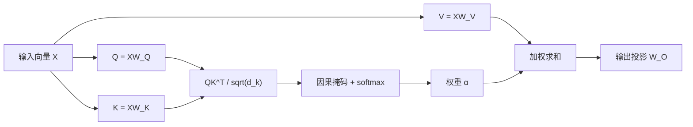

# 第 3 章：注意力机制：一句话里谁该看谁

- **难度**：★★☆ | **预估学时**：3 小时 | **前置**：第 1 章、第 2 章

## 学习目标

学完本章，你能：
1. 用白话解释 Query、Key、Value 各自负责什么。
2. 手算 3 个 token 的注意力分数、softmax 权重和加权输出。
3. 说清“多头注意力”和“因果掩码”分别在解决什么问题。

## 一句话核心

注意力就是：当前 token 拿自己的 Query 去和所有 token 的 Key 比相似度，再按相似度把它们的 Value 加权混合。

## 零基础讲解

### 概念 1：为什么需要注意力（难度：基础）

如果模型把一句话里每个词都独立处理，“猫追老鼠”和“老鼠追猫”在它眼里没有区别。模型需要一种机制，让每个词都能参考句子里其他词的信息。注意力就是这套机制。

### 概念 2：Q、K、V 是同一份输入的三次投影（难度：进阶）

每个 token 的向量 $x$ 会分别乘三个矩阵，得到三个新向量：

- **Query**（查询，$q$）：我想找什么信息。
- **Key**（键，$k$）：我能提供什么信息。
- **Value**（值，$v$）：如果被选中，我实际交出的内容。

写成公式：

$$q = xW_Q,\quad k = xW_K,\quad v = xW_V$$

$W_Q$、$W_K$、$W_V$ 都是训练出来的参数矩阵。注意，Q、K、V 不是三份不同的输入，而是同一份输入经过三种不同的“翻译”。

> 类比：去图书馆找书。Query 是你心里的检索词，Key 是每本书的标签，Value 是书里的正文。你拿检索词和标签比，匹配度高的书，正文被借走的比重就大。失效边界：图书馆的标签是人写的，模型的 Key 是学出来的，不一定对应人能读懂的关键词。

### 概念 3：相似度用点积算（难度：进阶）

两个向量的**点积**（dot product）是对应位置相乘再相加：

$$q\cdot k = \sum_i q_i k_i$$

点积越大，说明两个向量方向越接近。注意力用点积当相似度分数。分数还要除以 $\sqrt{d_k}$，$d_k$ 是向量维度。原因很实在：维度越高，点积的数值容易变得很大，softmax 之后会变成“一家独大”，梯度几乎消失。除以 $\sqrt{d_k}$ 把数值拉回可控范围。

$$s_{ij} = \frac{q_i \cdot k_j}{\sqrt{d_k}}$$

### 概念 4：softmax 把分数变成权重（难度：基础）

对第 $i$ 个 token 的所有分数做 softmax，得到它给每个 token 的权重：

$$\alpha_{ij} = \frac{e^{s_{ij}}}{\sum_{l} e^{s_{il}}}$$

权重非负，加起来为 1。最后把每个 token 的 Value 按权重加起来：

$$o_i = \sum_j \alpha_{ij} v_j$$

这就是注意力的输出。

### 概念 5：手算一个 3 token 的例子（难度：进阶）

假设三个 token 的 Query、Key、Value 已经算好（为了好算，只用 2 维）：

- $q_1=[1,0]$
- $k_1=[1,0]$，$k_2=[0,1]$，$k_3=[1,1]$
- $v_1=[10,0]$，$v_2=[0,10]$，$v_3=[5,5]$

先算点积分数（忽略 $\sqrt{d_k}$ 的缩放，取 $d_k=1$ 方便演示）：

- $q_1\cdot k_1 = 1$
- $q_1\cdot k_2 = 0$
- $q_1\cdot k_3 = 1$

softmax：$e^1\approx 2.718$，$e^0=1$，总和 $6.436$，权重约为 $[0.422, 0.155, 0.422]$。

加权输出：

$$o_1 = 0.422[10,0] + 0.155[0,10] + 0.422[5,5] = [6.33,\ 3.66]$$

第一个 token 的输出里，混进了第一个和第三个 token 的 Value，第二个 token 贡献很小。谁和它的 Query 更相似，谁的 Value 占比就更高。

### 概念 6：多头注意力：同时用几套不同的眼光看（难度：进阶）

一套 Q/K/V 只能捕捉一种关系。**多头注意力**（multi-head attention）让模型并行做 $h$ 组，每组有自己的 $W_Q$、$W_K$、$W_V$，各自算出一份输出，最后拼起来再乘一个输出矩阵：

$$\text{MultiHead}(X) = [\text{head}_1;\ \text{head}_2;\ \ldots;\ \text{head}_h]W_O$$

每个头可以关注不同的东西：有的盯相邻词，有的盯标点，有的盯主语。DeepSeek-V3 的注意力有 128 个头，每头维度 128。

> 类比：同一场会议派几个记录员，一个记谁说了什么，一个记语气，一个记时间顺序，最后把几份笔记合并。失效边界：记录员是分工好的，模型的多头分工没有明确标签，是训练中自发形成的。

### 概念 7：因果掩码：不许看未来（难度：进阶）

语言模型的任务是“根据前面的词预测下一个词”。训练时如果把整句话一次性喂进去，第 3 个 token 就能看到第 4、第 5 个 token，等于提前偷看答案。**因果掩码**（causal mask）把每个 token 对“未来 token”的注意力分数设成负无穷，softmax 之后权重变成 0。这样每个位置只能看自己和左边。

## 图示

看图说明：Q 和 K 只负责“算匹配分数”，真正被混合的是 V。掩码加在 softmax 之前，未来位置的分数被压到负无穷。

## 类比与实例

- **类比**：投票。每个 token 拿自己的提案（Q）去和其他 token 的竞选纲领（K）比对，相似度决定票数，最后按票数分配资源（V）。
- **实例**：上面的 3 token 计算，输出 $[6.33, 3.66]$。如果把 $q_1$ 改成 $[0,1]$，分数变成 $[0,1,1]$，权重变成 $[0.155,0.422,0.422]$，输出会变成 $[3.66, 6.33]$，第一个 token 的关注点从“和自己像的”转向“和第二个维度像的”。

## 常见误解

- **别以为注意力权重就是“模型解释”**——权重高只说明这个头的数值匹配度高，不代表模型真的在用这个 token 做决策。多头叠加后更难直接解释。
- **别以为多头只是把同一个计算重复几次**——每个头有独立的投影矩阵，学到的关系不同。
- **别以为因果掩码会让模型变笨**——它只是禁止偷看答案，推理时本来也只能看到已经生成的词。

## 自测题（答案）

1.（单选）注意力里真正被加权混合的是哪一项？
A. Query B. Key C. Value D. 掩码
**答案：C**；解析：Q 和 K 只用于算分数，输出是 V 的加权和。

2.（填空）分数 $[1,1,1]$ 经过 softmax 后的权重是 ______。
**答案：$[1/3,1/3,1/3]$**；解析：三个 $e^1$ 相等，各占三分之一。

3.（简答）为什么点积要除以 $\sqrt{d_k}$？
**答案要点**：维度越高点积数值越大，softmax 会过度集中，梯度变小；缩放让分数回到可控范围。

## 复习锚点

- Q 找信息、K 提供标签、V 提供内容，输出是 V 的加权和。
- 注意力分数是 Q 与 K 的点积，softmax 后变成权重。
- 多头并行捕捉不同关系，因果掩码禁止看未来。

## 想继续深入

标准 Transformer 的位置编码、多头、掩码和训练目标，见 [Transformer 从零推导深潜课](../07-transformer-deep/index.html)。
