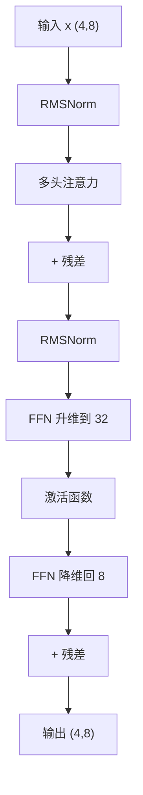

# 第 4 章：Transformer 一层一层拆

- **难度**：★★☆ | **预估学时**：3 小时 | **前置**：第 3 章

## 学习目标

学完本章，你能：
1. 按顺序说出一个 Transformer 层里有哪些部件。
2. 跟踪一个 4 token、8 维的输入经过一层后的形状变化。
3. 解释残差连接、RMSNorm、前馈网络各自的作用。

## 一句话核心

一个 Transformer 层就是“注意力 + 前馈网络”两段计算，每段外面都套着残差和归一化，然后把同样的层重复几十次。

## 零基础讲解

### 概念 1：token 向量进层之前先加位置信息（难度：基础）

第 1 章说过，每个 token 被查表变成一个向量。但查表只给出“这个词是什么”，没给出“它在第几个位置”。词序很重要，“猫追老鼠”和“老鼠追猫”的 token 完全一样，顺序不同意思就反了。

常见做法是给向量加**位置编码**（positional encoding）。DeepSeek 系列用的是 **RoPE**（旋转位置编码），它不直接把位置向量加进去，而是把向量按位置“旋转”一个角度。第 5 章讲 MLA 时会再遇到它，这里只要知道：位置信息必须显式注入，否则模型分不清词序。

### 概念 2：一层的第一段是注意力（难度：基础）

输入是一张表，形状是 `[序列长度, 隐藏维度]`。比如 4 个 token、每个 8 维，就是 `[4, 8]`。

注意力对这张表做三件事：
1. 用三个矩阵把每个 token 投影成 Q、K、V，形状仍是 `[4, 8]`（如果只有 1 个头）。
2. 算 Q 与所有 K 的分数，softmax 得到 `[4, 4]` 的权重矩阵。
3. 用权重把 V 加权求和，输出 `[4, 8]`。

多头时，8 维会拆成几个头，比如 2 个头各 4 维，各自算完再拼回 `[4, 8]`。

### 概念 3：残差连接：给信息留一条直通车道（难度：基础）

如果每层都只做“注意力”或“前馈”，深层的输入会被反复改写，原始信息容易丢失，梯度也很难传回去。**残差连接**（residual connection）把层的输入直接加到层的输出上：

$$y = x + \text{Layer}(x)$$

这样即使这一层什么都没学到（输出接近 0），信息也能原样穿过去。反向传播时，梯度可以沿着这条直通车道直接流回前面的层，深层网络才训得动。

> 类比：楼层之间除了楼梯，还有一部直达电梯。楼梯负责加工，电梯保证原始包裹不会被弄丢。失效边界：残差不是“复制一份”，它是逐元素相加，维度和形状必须完全一致。

### 概念 4：RMSNorm：把数值拉回稳定范围（难度：进阶）

层与层之间，数值可能越算越大，最后溢出。**归一化**（normalization）把每个 token 的向量缩放一下，让整体 magnitude 稳定。

DeepSeek 用的是 **RMSNorm**（均方根归一化）。它只算向量的均方根，不减去均值：

$$\text{RMSNorm}(x) = \frac{x}{\sqrt{\frac{1}{d}\sum_i x_i^2 + \epsilon}} \odot g$$

$\epsilon$ 是一个很小的数，防止除零；$g$ 是可学习的缩放参数。它比 LayerNorm 少一次求均值的计算，速度更快，效果在大模型上够用。

### 概念 5：前馈网络：真正存知识的地方（难度：进阶）

注意力负责“在 token 之间搬运信息”，**前馈网络**（Feed-Forward Network，FFN）负责“对每个 token 单独做一次变换”。典型结构是两层线性变换加一个激活函数：

$$\text{FFN}(x) = W_2\ \sigma(W_1x)$$

中间维度通常比隐藏维度大 4 倍左右。比如 8 维输入，先升到 32 维，再降回 8 维。第一个矩阵有 $8\times 32$ 个权重，第二个有 $32\times 8$ 个，加起来 512 个参数（忽略偏置）。

大模型里，FFN 往往占了总参数的绝大部分。DeepSeek 把 FFN 换成 MoE（第 5 章），就是为了在参数很多的同时，每个 token 只算一小部分。

### 概念 6：一层完整走一遍（难度：进阶）

以 4 个 token、8 维、2 个头为例：

| 步骤 | 形状 | 说明 |
|---|---|---|
| 输入 | `[4, 8]` | 4 个 token，每个 8 维 |
| Q/K/V 投影 | `[4, 8]` 各一份 | 每个头 4 维，2 头拼回 8 |
| 注意力分数 | `[4, 4]` | 每个 token 对其他 4 个的分数 |
| 注意力输出 | `[4, 8]` | V 的加权和 |
| 残差相加 | `[4, 8]` | 输入 + 注意力输出 |
| RMSNorm | `[4, 8]` | 数值缩放 |
| FFN 升维 | `[4, 32]` | 中间层放大 4 倍 |
| FFN 降维 | `[4, 8]` | 回到隐藏维度 |
| 残差相加 | `[4, 8]` | 归一化后的值 + FFN 输出 |

这就是一个**Transformer 层**。DeepSeek-V3 有 61 层，V4-Pro 也是 61 层，V4-Flash 43 层，V4.1-Flash 40 层。层数越多，模型能做的抽象层级越高，但计算和显存也越贵。

### 概念 7：最后一层怎么变成下一个词（难度：基础）

整条网络跑完，每个 token 得到一个 8 维（实际是几千维）的向量。最后接一个**输出头**（LM head），把隐藏向量映射到词表大小。词表有 128K 个 token，输出就是一个 128K 维的分数向量，softmax 之后得到下一个词的概率分布。

训练时，答案 token 的概率越高，交叉熵损失越小；推理时，按这个分布采样或选最大概率，生成下一个 token，再把它接回输入，重复这个过程，叫**自回归生成**。

## 图示

看图说明：注意残差是从 Norm 之前分出来的，和这一段的输出相加。一个层里有两段这样的结构：注意力一段、FFN 一段。

## 类比与实例

- **类比**：一条流水线。注意力是“跨工位协调”，FFN 是“本工位深加工”，残差是“传送带”，归一化是“每道工序后校准仪器”。
- **实例**：8 维输入、4 倍 FFN，单个 token 的 FFN 计算量是 $8\times 32 + 32\times 8 = 512$ 次乘加；4 个 token 就是 2048 次。层数 61 时，仅 FFN 一项就是 $2048\times 61 \approx 12.5$ 万次乘加/token（未计 MoE 稀疏化）。

## 常见误解

- **别以为 Transformer 是一个词一个词串行处理的**——训练时整句话并行进层，因果掩码保证每个位置只看左边；只有推理生成时才一个 token 一个 token 地产出。
- **别以为残差只是“防止梯度消失”的口号**——它还保证深层网络至少能学到“什么都不做”，不会比浅层更差。
- **别以为 FFN 不重要**——注意力负责搬运，FFN 负责存储和变换知识，参数大头在 FFN。

## 自测题（答案）

1.（单选）一个 Transformer 层里，残差连接加在哪两处？
A. 只在注意力后 B. 只在 FFN 后 C. 注意力和 FFN 后各一次 D. 每一小步都加
**答案：C**；解析：标准结构是两段子层，各自带残差。

2.（填空）输入 `[6, 16]` 经过 4 倍 FFN 后，中间层形状是 ______。
**答案：`[6, 64]`**；解析：隐藏维度 16 放大 4 倍是 64，token 数不变。

3.（简答）为什么位置信息必须显式注入 Transformer？
**答案要点**：查表得到的 token 向量不含顺序信息，没有位置编码时，模型无法区分不同词序。

## 复习锚点

- 一层 = 注意力 + FFN，两段都带残差和归一化。
- 形状在层内基本保持 `[序列长度, 隐藏维度]`，FFN 中间会临时放大。
- 输出头把隐藏向量映射到词表，自回归逐个生成 token。

## 想继续深入

把编码器/解码器、残差、层归一化和训练过程逐段推完，见 [Transformer 从零推导深潜课](../07-transformer-deep/index.html)。
