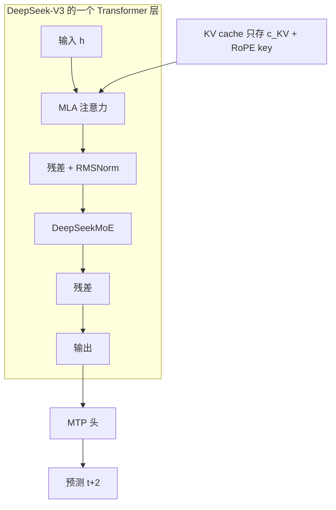

# 第 5 章：DeepSeek-V3 的三块地基

- **难度**：★★★ | **预估学时**：4 小时 | **前置**：第 3 章、第 4 章

## 学习目标

学完本章，你能：
1. 用一句话说清 MLA 省的是什么、怎么省。
2. 解释 DeepSeekMoE 的“共享专家 + 细粒度路由专家”结构。
3. 说出 MTP 在训练和推理里各有什么用。

## 一句话核心

DeepSeek-V3 用 MLA 把 KV cache 压小，用 DeepSeekMoE 把参数量做大但每次只算一小部分，用 MTP 让每个 token 多学一个未来位置。

## 零基础讲解

### 概念 1：先有 V3，才有 R1 和 V4（难度：基础）

DeepSeek-R1 不是从零训练的新模型，它是在 **DeepSeek-V3-Base** 上做强化学习得到的。DeepSeek-V4 则继承了 V3 的 DeepSeekMoE 和 MTP，只改注意力、残差和优化器。所以读 R1 和 V4 的论文，绕不开 V3 这三块地基：

- **MLA**：多头潜在注意力，解决长文本的 KV cache 显存问题。
- **DeepSeekMoE**：混合专家，解决“参数要多、计算要省”的矛盾。
- **MTP**：多 token 预测，让训练信号更密，顺便给推理加速。

V3 本身是 671B 总参数、37B 激活参数的 MoE 模型，预训练用了 14.8T token。

### 概念 2：KV cache 是什么，为什么它贵（难度：进阶）

生成文本时，每生成一个新 token，都要拿它的 Query 和前面所有 token 的 Key、Value 做注意力。前面 token 的 K、V 不会变，可以缓存起来重复用，这份缓存叫 **KV cache**。

问题在于它有多大。标准多头注意力（MHA）每个 token 的缓存是：

$$2 \times n_h \times d_h \times \text{字节数}$$

$n_h$ 是头数，$d_h$ 是每头维度，系数 2 表示 K 和 V 各一份。V3 有 128 个头、每头 128 维，用 FP16 存（每数 2 字节），每个 token 就是：

$$2 \times 128 \times 128 \times 2 = 65{,}536\ \text{字节} \approx 64\ \text{KB}$$

一条 100 万 token 的上下文，光 KV cache 就是 64 GB。还没算模型权重和其他开销，单卡已经放不下。

### 概念 3：MLA 怎么把 KV cache 压小（难度：高难）

MLA 的思路不是“少存几个头”，而是“存的不是完整的 K 和 V，而是一个压缩后的潜向量”。

标准做法里，每个 token 的 K、V 是所有头拼起来的高维矩阵。MLA 先把输入 $h$ 压到一个低维潜向量 $c^{KV}$：

$$c^{KV} = h W^{DKV}$$

$W^{DKV}$ 是降维矩阵，把几千维压到比如 512 维。需要 K、V 时，再从 $c^{KV}$ 升维回去：

$$k = c^{KV} W^{UK},\quad v = c^{KV} W^{UV}$$

推理时缓存的是 $c^{KV}$，不是完整的 K、V 拼接。每个 token 只存 512 个数，而不是 128 个头各 128 维的两份。DeepSeek-V3 报告给出的结果是：相比标准 MHA，KV cache 减少约 93.3%，推理吞吐提升到 5.76 倍。

**解耦 RoPE** 是 MLA 的另一个关键。位置信息不能直接塞进低维潜向量再升维，因为旋转位置编码对每个头的位置敏感，压缩再还原会破坏它。MLA 额外保留一小段专门承载 RoPE 的 key（每个头 64 维），这部分不参与低秩压缩，和压缩后的内容 key 拼在一起使用。

> 类比：不把整本账本复印一份带走，只带一个压缩包，需要哪页再解压哪页。失效边界：压缩不是无损的，低秩表示会丢信息；MLA 靠训练让压缩后的表示保留对任务有用的部分。

### 概念 4：DeepSeekMoE：专家很多，但每次只叫几个（难度：高难）

普通 Transformer 的 FFN 是全参激活：每个 token 都要过同一个 FFN，参数越多算得越久。**混合专家**（Mixture-of-Experts，MoE）把 FFN 拆成很多个“专家”，每个 token 只选其中几个。

DeepSeekMoE 有两个和经典 MoE 不一样的设计：

1. **细粒度专家**：把一个大 FFN 切成很多小专家。V3 有 256 个路由专家，每个专家中间维度 2048；每个 token 只激活其中 8 个。专家多而小，组合更灵活。
2. **共享专家**：额外保留 1 个“永远激活”的共享专家，所有 token 都过它。它负责兜住通用知识，路由专家负责细分知识，减少专家之间的重复学习。

路由分数用 Sigmoid 算，取 top-k 个专家。这里有个副作用：如果不管，模型会总挑少数几个专家，其他专家“饿死”，叫**专家塌缩**。传统做法是加一个负载均衡辅助损失，但辅助损失会干扰语言建模目标。DeepSeek 用的是**无辅助损失的负载均衡**：给每个专家一个可学习的偏置，训练时根据负载调整偏置，偏置只影响“选谁”，不影响“权重多大”。

V3 的配置是 1 个共享专家 + 256 个路由专家，激活 8 个；V4-Flash 改成 6 个激活，V4-Pro 384 个路由专家、激活 6 个。参数总量因此可以做得很大，但每个 token 的计算量只按激活参数算：V3 是 671B 总参数、37B 激活；V4-Pro 是 1.6T 总参数、49B 激活。

> 类比：一家大医院，有几百个专科医生，但每个病人只挂号 6 个最对口的，外加一个全科医生。失效边界：病人可以自己选科室，token 的路由是模型学出来的，选错专家就会丢信息。

### 概念 5：MTP：让每个 token 多预测一个未来（难度：进阶）

标准语言模型在每个位置只预测下一个 token。**多 token 预测**（Multi-Token Prediction，MTP）在每个位置额外预测下下个 token：

- 主损失：预测 $t+1$。
- MTP 损失：用 $t$ 位置的隐藏状态，加上 $t+1$ 的 token 嵌入，去预测 $t+2$。

V3 的 MTP 深度是 1，也就是多预测一个。好处有两个：训练时每个位置获得更密的信号，逼模型学更长的依赖；推理时可以把这个 MTP 头当**投机解码**的草稿模型，先猜几个 token，再用主模型验证，猜对就一次接受多个，加快生成。

> 类比：下棋时不仅想下一步，还顺带想下下步。失效边界：多预测的那一步不一定准，推理时仍要用主模型校验，不能无条件相信草稿。

## 图示

看图说明：MLA 改变的是注意力里“缓存什么”，MoE 改变的是 FFN 里“激活哪些专家”，MTP 是挂在主干旁边的额外预测头。三块互不替代。

## 类比与实例

- **类比**：MLA 像把整本词典压成索引卡，MoE 像按问题叫专科医生，MTP 像下棋多想一步。
- **实例**：一个 100 万 token 的请求，标准 MHA 每 token 64 KB，KV cache 约 64 GB；MLA 若压到每 token 约 4 KB，同样的上下文只要 4 GB 左右（具体数值随配置变化，这里只做量级演示）。这就是 V3 能长文本推理的基础。

## 常见误解

- **别以为 MoE 是“每个 token 只用一个专家”**——通常是 top-k，V3 激活 8 个，V4 激活 6 个，共享专家始终参与。
- **别以为 MLA 是量化或剪枝**——它是改变 K/V 的表示方式，用低秩潜向量替代完整缓存，精度损失靠训练补偿。
- **别以为 MTP 只是为了推理加速**——它首先是一个训练目标，主要收益在训练阶段；投机解码只是附带用途。

## 自测题（答案）

1.（单选）MLA 推理时缓存的核心内容是什么？
A. 每个头的完整 K 和 V B. 低维潜向量和 RoPE key C. 只有 Query D. 整个隐藏层输出
**答案：B**；解析：MLA 缓存压缩后的 $c^{KV}$ 和承载位置的 RoPE key，不缓存完整 K/V。

2.（填空）DeepSeekMoE 中始终激活、负责通用知识的专家叫 ______。
**答案：共享专家**；解析：共享专家对所有 token 生效，路由专家按 top-k 选择。

3.（简答）MTP 的损失在训练时预测的是哪个位置？
**答案要点**：在位置 $t$ 额外预测 $t+2$，用 $t$ 的隐藏状态和 $t+1$ 的 token 嵌入作为输入。

## 复习锚点

- MLA 用低秩潜向量压缩 KV cache，并用解耦 RoPE 保留位置信息。
- DeepSeekMoE = 共享专家 + 细粒度路由专家 + 无辅助损失负载均衡。
- MTP 在训练时多预测一个未来 token，推理时可做投机解码草稿。
