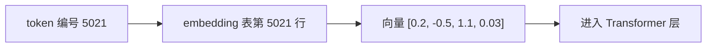

# 向量

- **难度**：基础 | **涉及章节**：第 1 章、第 3 章

## 一句话定义

向量是一串有顺序的数字，在模型里用来表示一个 token、一个词或一个中间状态。

## 为什么重要

模型的所有输入、输出、中间结果都是向量。不懂向量，后面的矩阵乘法、注意力、KV cache 都无从谈起。

## 图示

## 详解

一个向量可以写成 $\mathbf{x} = [x_1, x_2, \ldots, x_d]$，$d$ 是维度。模型里常见的隐藏维度是 4096、5120、7168，V3 是 7168。每个位置的数字没有独立的人类含义，它们共同表示一个 token 在当前层的状态。

两个向量可以做点积：

$$\mathbf{a}\cdot\mathbf{b} = \sum_i a_i b_i$$

点积衡量方向相似度，是注意力分数的来源。向量还可以逐元素相加，残差连接就是这种运算。

## 常见误解

- 向量不一定是空间箭头，高维向量无法直观画出来。
- 单个维度一般不对应可解释的概念，别试图把某一维翻译成“猫”。

## 在书中出现的脉络

| 章节 | 语境 | 关键结论 |
|---|---|---|
| ch01 | 文字变成数字 | token 查表得到词向量 |
| ch03 | 注意力 | Q/K/V 都是向量，点积算相似度 |
| ch05 | MLA | 潜向量 $c^{KV}$ 是压缩后的缓存 |

## 相关概念

- 前置：无
- 后续：矩阵乘法、softmax、注意力
