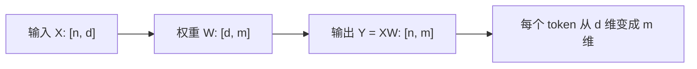

# 矩阵乘法

- **难度**：基础 | **涉及章节**：第 1 章、第 4 章

## 一句话定义

矩阵乘法是“左矩阵每一行与右矩阵每一列做点积”，结果是新矩阵；在模型里它负责把一批向量整体变换。

## 为什么重要

Transformer 里几乎所有参数都是矩阵：Q/K/V 投影、输出投影、FFN 的升降维、MoE 专家的门控。不会矩阵乘法，就看不懂参数量的来源。

## 图示

## 详解

设 $X$ 是 $n\times d$ 的矩阵（$n$ 个 token，每个 $d$ 维），$W$ 是 $d\times m$。乘积 $Y=XW$ 是 $n\times m$：

$$Y_{ij} = \sum_{k=1}^{d} X_{ik}W_{kj}$$

每一行是一个 token，每一列是一个输出特征。参数量就是 $d\times m$（忽略偏置）。一个 7168 维到 18432 维的 FFN 升维矩阵，参数量是 $7168\times 18432 \approx 1.32$ 亿。

矩阵乘法的计算量也是 $n\times d\times m$ 次乘加。MoE 之所以省算力，是因为每个 token 只乘少数几个专家的矩阵，而不是全部。

## 常见误解

- 不是对应位置相乘，那叫逐元素乘法。
- 维度不匹配就不能乘，左矩阵列数必须等于右矩阵行数。

## 在书中出现的脉络

| 章节 | 语境 | 关键结论 |
|---|---|---|
| ch01 | 基础运算 | 矩阵乘法按行加权求和 |
| ch04 | Transformer | 投影、FFN 都是矩阵乘法 |
| ch05 | MoE | 每个 token 只走 top-k 专家的矩阵 |

## 相关概念

- 前置：向量
- 后续：注意力、FFN、MoE
