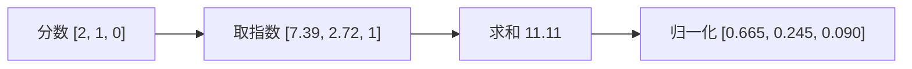

# softmax

- **难度**：基础 | **涉及章节**：第 1 章、第 3 章、第 5 章

## 一句话定义

softmax 把一组任意实数分数转成一组非负、总和为 1 的权重。

## 为什么重要

注意力权重、MoE 路由权重、下一个 token 的概率分布，全都靠 softmax。它决定“资源怎么分配”。

## 图示

## 详解

$$\text{softmax}(z_i)=\frac{e^{z_i}}{\sum_j e^{z_j}}$$

三个性质：
1. 输出为正，因为指数恒正。
2. 总和为 1，因为分母是所有指数之和。
3. 保序：原来大的分数，输出仍然大。

温度参数可以调节“尖锐程度”。除以温度 $T$ 后再 softmax，$T$ 小则分布更集中，$T$ 大则更平缓。语言模型采样时常用温度控制随机性。

## 常见误解

- softmax 不改变排序，它只改变数值比例。
- softmax 输出高不代表“正确”，它只是当前模型认为的概率。

## 在书中出现的脉络

| 章节 | 语境 | 关键结论 |
|---|---|---|
| ch01 | 基础 | 分数变比例 |
| ch03 | 注意力 | 分数矩阵按行 softmax 成权重 |
| ch05 | MoE | 路由分数决定专家权重 |

## 相关概念

- 前置：向量
- 后续：注意力、MoE 路由、采样
