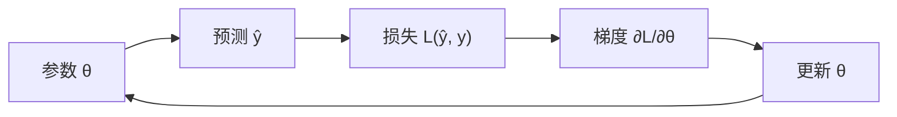

# 参数与损失

- **难度**：基础 | **涉及章节**：第 2 章、第 5 章

## 一句话定义

参数是模型里可训练的数字，损失是衡量模型输出与正确答案差距的标量。

## 为什么重要

训练的全部动作，就是围绕“调参数让损失变小”。模型规模、激活参数、预训练 token 数，最终都要落到这两个词上。

## 图示

## 详解

参数包括矩阵元素、偏置、归一化的缩放因子等。V3 有 671B 参数，V4-Pro 有 1.6T，V4.1-Flash 主干 552B 加 196B Engram。

损失常见两类：
- 回归：平方误差 $L=(\hat{y}-y)^2$。
- 分类/语言模型：交叉熵 $L=-\log p(y)$，正确答案概率越低，损失越大。

训练不是一次算完，而是把数据分成 batch，反复前向、求损失、反向传播、更新。一个 epoch 表示把训练集过一遍。

## 常见误解

- 损失小不等于模型能力强，可能只是记住了训练集。
- 参数多不等于每次计算都用上，MoE 只有激活参数参与当前 token 的计算。

## 在书中出现的脉络

| 章节 | 语境 | 关键结论 |
|---|---|---|
| ch02 | 训练基础 | 参数、损失、梯度构成训练循环 |
| ch05 | V3 规模 | 671B 总参数，37B 激活 |
| ch07 | R1 训练 | 奖励信号代替部分监督损失 |

## 相关概念

- 前置：向量、矩阵乘法
- 后续：梯度下降、强化学习
