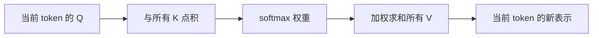

# 注意力

- **难度**：进阶 | **涉及章节**：第 3 章、第 4 章

## 一句话定义

注意力是让每个 token 根据与其他 token 的相似度，从它们那里按权重收集信息的机制。

## 为什么重要

Transformer 的核心就是注意力。DeepSeek 三代架构的差异，一大半在“怎么算注意力、怎么存缓存”。

## 图示

## 详解

对第 $i$ 个 token：

$$o_i=\sum_j \alpha_{ij}v_j,\quad \alpha_{ij}=\text{softmax}\left(\frac{q_i\cdot k_j}{\sqrt{d_k}}\right)$$

注意力解决了“词与词之间怎么交换信息”。没有它，每个 token 只能独立变换，无法处理指代、语序、长距离依赖。

变体：
- **因果注意力**：只能看左边，用于生成模型。
- **双向注意力**：能看两边，用于编码器（如 BERT）。
- **滑动窗口注意力**（SWA）：只看附近固定窗口，省计算，V4.1 大量使用。
- **压缩注意力**：把远处的 K/V 压成少量表示，V4 的 CSA/HCA 属于这一类。

## 常见误解

- 注意力权重不是“人类可读的解释”。
- 注意力不是只能有一个头，多头可以并行捕捉不同关系。

## 在书中出现的脉络

| 章节 | 语境 | 关键结论 |
|---|---|---|
| ch03 | 基础 | Q/K/V 与加权求和 |
| ch04 | Transformer | 每层都有一段注意力 |
| ch05 | MLA | 缓存压缩后的潜向量 |
| ch08 | V4 | CSA/HCA 压缩远端上下文 |

## 相关概念

- 前置：向量、矩阵乘法、softmax
- 后续：Q/K/V、多头注意力、MLA、CSA
