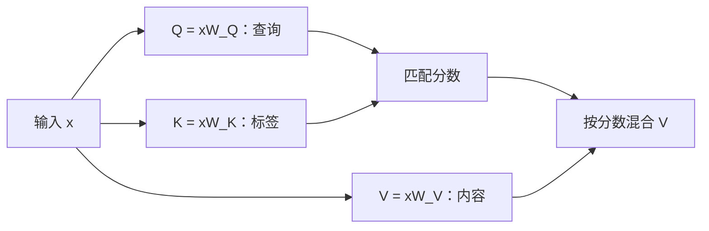

# Q / K / V

- **难度**：进阶 | **涉及章节**：第 3 章、第 5 章

## 一句话定义

Query 是“我想找什么”，Key 是“我有什么标签”，Value 是“我实际给出的内容”，三者都由同一个输入向量经不同矩阵投影得到。

## 为什么重要

所有注意力变体，包括 MLA、CSA、HCA，改的都是 Q/K/V 的计算与缓存方式。分不清三者，就无法理解“压缩 KV cache”到底压了什么。

## 图示

## 详解

- $q=xW_Q$：当前 token 用来“检索”的向量。
- $k=xW_K$：每个 token 对外展示的“标签”。
- $v=xW_V$：每个 token 被选中后贡献的“内容”。

输出只混合 V，Q 和 K 只参与打分。因此：
- 压缩 KV cache，压的是 K 和 V 的存储，不压 Q。
-  MLA 缓存 $c^{KV}$，需要时再升维出 K、V；Q 仍可每次现算。
-  CSA/HCA 压缩的是远端 token 的 K/V 表示。

## 常见误解

- Q、K、V 不是三份不同的输入，而是同一份输入的三次线性投影。
- V 的维度不一定和 Q/K 相同，但通常设计成相同以便拼接。

## 在书中出现的脉络

| 章节 | 语境 | 关键结论 |
|---|---|---|
| ch03 | 注意力 | Q/K/V 的分工与计算 |
| ch05 | MLA | 缓存的是压缩后的 K/V 来源 |
| ch08 | V4.1 | CSA2 复用 KV，跨层共享 |

## 相关概念

- 前置：注意力
- 后续：多头注意力、MLA、CSA/HCA
