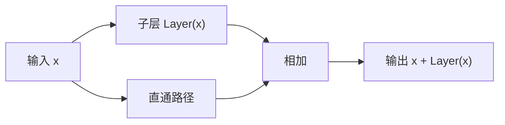

# 残差连接

- **难度**：基础 | **涉及章节**：第 4 章、第 7 章

## 一句话定义

残差连接把子层的输入直接加到子层的输出上，让信息和梯度有一条直通的路径。

## 为什么重要

没有残差，几十层的 Transformer 根本训不动。DeepSeek-V4 的 mHC 就是在残差连接上做文章，把它从“简单相加”升级成“流形约束的矩阵混合”。

## 图示

## 详解

$$y=x+\text{Layer}(x)$$

两个作用：
1. 信息保真：子层可以学到接近 0 的输出，此时 $y\approx x$，深层不会比浅层更差。
2. 梯度直通：反向传播时，梯度可以通过加法直接流回输入，不需要穿过整个子层。

形状要求：$x$ 与 $\text{Layer}(x)$ 必须同形状。若维度变化，需要额外的投影把 $x$ 映射到目标维度。

## 常见误解

- 残差不是“把输入复制一份”，而是逐元素相加。
- 残差不是只在最后加一次，每个子层都有自己的残差。

## 在书中出现的脉络

| 章节 | 语境 | 关键结论 |
|---|---|---|
| ch04 | Transformer | 注意力和 FFN 各带一次残差 |
| ch07 | V4 | mHC 用矩阵混合替代简单相加 |
| ch09 | V4.1 | 20 个 CED 块继承 mHC |

## 相关概念

- 前置：向量、矩阵乘法
- 后续：RMSNorm、mHC
