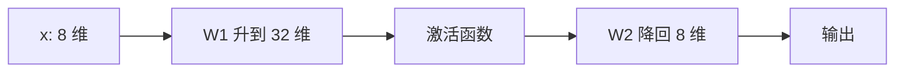

# 前馈网络（FFN）

- **难度**：进阶 | **涉及章节**：第 4 章、第 5 章

## 一句话定义

FFN 是对每个 token 独立做“升维—激活—降维”的两层线性变换，负责存储和变换知识。

## 为什么重要

FFN 通常占模型参数的绝大部分。DeepSeekMoE 就是把 FFN 拆成多个专家，从而在不增加单 token 计算量的前提下扩大参数。

## 图示

## 详解

$$\text{FFN}(x)=W_2\,\sigma(W_1x)$$

中间维度通常是隐藏维度的 4 倍。激活函数早期用 ReLU，现代大模型多用 SwiGLU：

$$\text{SwiGLU}(x)=\text{Swish}(xW_1)\odot(xW_3)$$

它有两个升维矩阵，参数量比普通 FFN 多，但效果更好。V3 的专家中间维度是 2048，隐藏维度 7168。

MoE 把 FFN 换成多个专家后，每个 token 只走 top-k 个专家，计算量按激活专家算，参数量按全部专家算。

## 常见误解

- FFN 不是“可有可无的附加层”，它承担了大部分知识存储。
- MoE 不是把注意力也拆成专家，通常只拆 FFN。

## 在书中出现的脉络

| 章节 | 语境 | 关键结论 |
|---|---|---|
| ch04 | Transformer | FFN 升维再降维 |
| ch05 | DeepSeekMoE | FFN 拆成共享 + 路由专家 |
| ch07 | V4 | 专家数 256，激活 6 |

## 相关概念

- 前置：矩阵乘法、RMSNorm
- 后续：DeepSeekMoE、负载均衡
