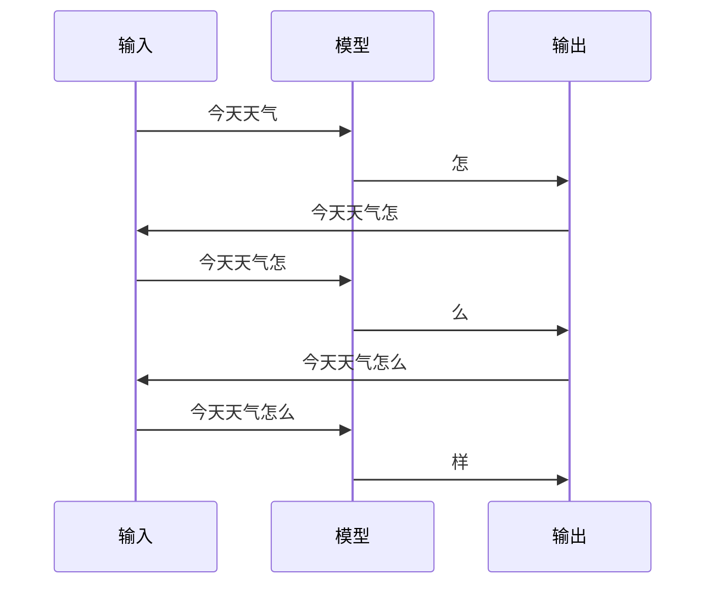

# 自回归生成

- **难度**：基础 | **涉及章节**：第 4 章、第 6 章

## 一句话定义

自回归生成是每次根据已有 token 预测下一个 token，把它接回输入，再预测下一个，循环直到结束。

## 为什么重要

所有对话模型、推理模型都用这种方式输出。理解它，才能理解为什么推理分“预填充”和“解码”两个阶段，为什么 KV cache 重要。

## 图示

## 详解

两个阶段：
1. **预填充**（prefill）：把整段输入一次性送进模型，并行计算所有位置的 K/V，建立 KV cache。计算密集，GPU 利用率高。
2. **解码**（decode）：每次只生成一个 token，读已有 KV cache，算新 token 的 Q 和输出。显存带宽密集，延迟受限于搬运速度。

生成长度越长，解码阶段占比越高。投机解码、MTP、DSpark 都是在解码阶段做加速。

## 常见误解

- 训练时不是自回归串行，而是整句并行、用因果掩码防偷看。
- 生成不是每次重算全部 token，KV cache 让历史只算一次。

## 在书中出现的脉络

| 章节 | 语境 | 关键结论 |
|---|---|---|
| ch04 | Transformer | 输出头产生下一个 token 分布 |
| ch06 | R1 | 长思维链让解码 token 数暴涨 |
| ch09 | V4.1 | DSpark 加速解码 |

## 相关概念

- 前置：softmax、Transformer 层
- 后续：KV cache、投机解码
