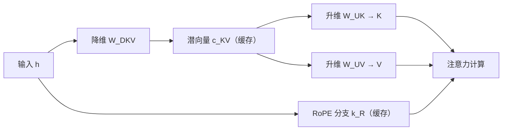

# MLA（多头潜在注意力）

- **难度**：高难 | **涉及章节**：第 5 章、第 10 章

## 一句话定义

MLA 把每个 token 的 K/V 压缩成一个低维潜向量再缓存，需要时升维还原，并用解耦 RoPE 保留位置信息。

## 为什么重要

MLA 是 DeepSeek-V2 提出、V3 继承的关键技术。它让长上下文推理的 KV cache 从“每 token 几十 KB”降到“几 KB”，是 DeepSeek 能把上下文拉到 128K 甚至 1M 的基础。

## 图示

## 详解

标准 MHA 缓存每个 token 的全部 K、V，大小是 $2n_hd_h$ 个数。MLA 缓存：
- 内容潜向量 $c^{KV}$，维度 $d_c$，V3 取 512。
- 解耦 RoPE 的 key $k^R$，每头 64 维。

需要 K、V 时：
$$k^C=c^{KV}W^{UK},\quad v^C=c^{KV}W^{UV}$$

K 由内容部分 $k^C$ 和位置部分 $k^R$ 拼接。V 只用内容部分。

为什么解耦：RoPE 是旋转操作，对每个头的位置敏感。如果把位置信息压进低维潜向量，升维后旋转关系会被破坏。解耦后，位置信息走单独的小通道，压缩通道只存内容。

代价：MLA 的计算图比 MHA 复杂，训练时需要同时学降维和升维矩阵；但推理时缓存大幅减少，吞吐提升。

## 常见误解

- MLA 不是简单地把 K/V 量化到低比特，它是改变表示维度。
- 解耦 RoPE 不是“不用位置编码”，而是把位置编码单独保留。

## 在书中出现的脉络

| 章节 | 语境 | 关键结论 |
|---|---|---|
| ch05 | V3 地基 | KV cache 减少约 93.3% |
| ch08 | V4 | 被 CSA/HCA 取代，但低秩压缩思想保留 |
| ch10 | 架构对比 | MLA 是“压缩缓存”路线的起点 |

## 相关概念

- 前置：Q/K/V、KV cache
- 后续：CSA、HCA、CSA2
