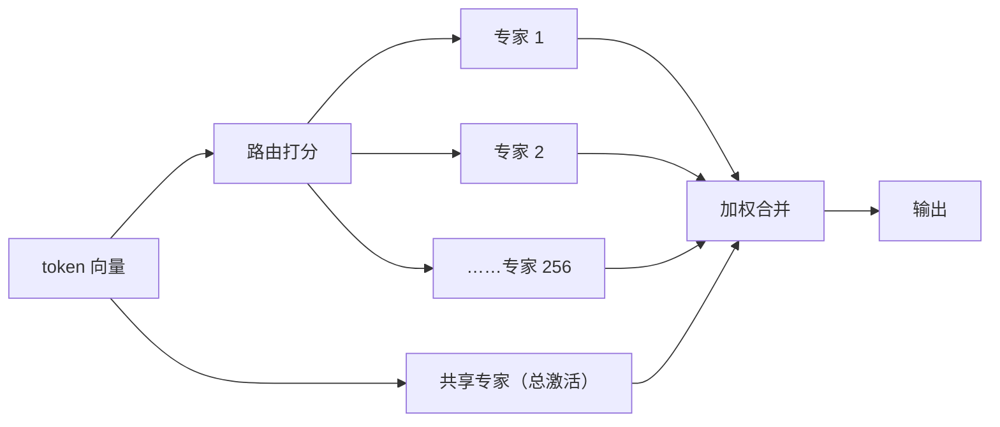

# DeepSeekMoE

- **难度**：高难 | **涉及章节**：第 5 章、第 7 章

## 一句话定义

DeepSeekMoE 把 FFN 拆成大量细粒度路由专家和一个共享专家，每个 token 只激活少数专家。

## 为什么重要

它让模型总参数可以做到 671B、1.6T，而单 token 计算只按 37B、49B 的激活参数算。没有 MoE，DeepSeek 的规模故事不成立。

## 图示

## 详解

V3 配置：1 个共享专家 + 256 个路由专家，每个 token 激活 8 个路由专家。V4-Flash 激活 6 个，V4-Pro 384 个路由专家、激活 6 个。

路由分数：
$$s_i=\text{Sigmoid}(x\cdot e_i)$$

取 top-k 后归一化，得到每个被选中专家的权重。共享专家不参与路由，所有 token 都过它。

为什么细粒度：一个大专家只能整体激活或整体不激活；拆成很多小专家后，组合空间更大，不同 token 可以调用不同的知识片段。

为什么共享专家：路由专家会被不同 token 轮流使用，容易重复学习通用知识。共享专家专门兜住通用部分，让路由专家更专注细分。

## 常见误解

- MoE 不是“每个 token 只用一个专家”，是 top-k 加共享专家。
- 专家不是按学科划分的，训练不会给每个专家打上“数学专家”“语法专家”的标签。
- 总参数大不等于计算量大，只有激活参数参与当前 token 的计算。

## 在书中出现的脉络

| 章节 | 语境 | 关键结论 |
|---|---|---|
| ch05 | V3 地基 | 1 共享 + 256 路由，激活 8 |
| ch07 | V4 | 256 路由，激活 6 |
| ch09 | V4.1 | 256 路由，激活 6，专家中间维度 2048 |

## 相关概念

- 前置：FFN、softmax
- 后续：负载均衡、专家塌缩
