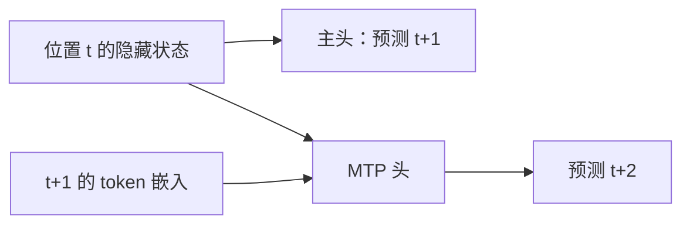

# MTP（多 token 预测）

- **难度**：进阶 | **涉及章节**：第 5 章、第 8 章

## 一句话定义

MTP 在训练时让每个位置额外预测未来第 2 个 token，增加训练信号密度，也可用于推理时的投机解码。

## 为什么重要

它是 DeepSeek-V3 的三大地基之一，V4 继续保留。理解 MTP，才能理解“为什么训练 token 数不算多，模型却学得快”。

## 图示

## 详解

标准语言模型在每个位置只监督下一个 token。MTP 增加一条支路：
1. 取位置 $t$ 的隐藏状态 $h_t$。
2. 把位置 $t+1$ 的 token 嵌入 $e_{t+1}$ 投影后与 $h_t$ 结合。
3. 用结合后的表示预测 $t+2$。

损失是主损失加 MTP 损失的加权和。V3 的 MTP 深度为 1。

推理时，MTP 头可以当草稿模型：先猜出若干个 token，再让主模型并行验证，接受匹配的前缀。这叫投机解码。

## 常见误解

- MTP 不是“推理时一次输出两个 token”，输出仍由主模型验证。
- MTP 的主要收益在训练，不在推理；推理加速是附带用途。

## 在书中出现的脉络

| 章节 | 语境 | 关键结论 |
|---|---|---|
| ch05 | V3 | MTP 深度 1，训练信号更密 |
| ch07 | V4 | 保留 MTP，用于投机解码 |
| ch09 | V4.1 | 用 DSpark 替代 MTP 做推理加速 |

## 相关概念

- 前置：自回归生成、softmax
- 后续：投机解码、DSpark
