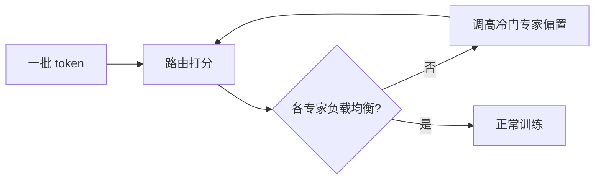

# 负载均衡

- **难度**：进阶 | **涉及章节**：第 5 章

## 一句话定义

负载均衡是防止 MoE 路由器总把 token 送给少数专家、导致其他专家“饿死”的训练技巧。

## 为什么重要

MoE 训练最常见的失败模式就是专家塌缩。DeepSeek 的无辅助损失方案是 V3 论文的亮点之一，也是后续 V4 继承的关键设计。

## 图示

## 详解

问题：路由分数由 token 和专家向量的内积决定，训练初期某些专家可能碰巧得分高，越来越多 token 涌向它们。结果少数专家过载，多数专家得不到梯度。

传统方案：加辅助损失，惩罚负载不均。但辅助损失和语言建模目标冲突，权重难调，还会损害模型效果。

DeepSeek 方案：给每个专家一个可学习偏置 $b_i$，路由分数变成 $s_i+b_i$。训练时统计每个专家的负载，负载高的调低偏置，负载低的调高偏置。偏置只影响“选不选”，不影响被选中后的权重。

$$s_i=\text{Sigmoid}(x\cdot e_i)+b_i$$

这样负载均衡通过调整选择偏好实现，不往主损失里塞额外项。

## 常见误解

- 负载均衡不是“平均分配所有 token”，而是防止极端失衡。
- 无辅助损失不是“完全不管均衡”，而是用偏置调节代替损失项。

## 在书中出现的脉络

| 章节 | 语境 | 关键结论 |
|---|---|---|
| ch05 | V3 | 无辅助损失负载均衡 |
| ch07 | V4 | 继承该方案 |
| ch09 | V4.1 | 继承该方案 |

## 相关概念

- 前置：DeepSeekMoE、softmax
- 后续：训练稳定性
