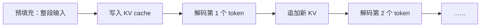

# KV cache

- **难度**：进阶 | **涉及章节**：第 5 章、第 8 章、第 10 章

## 一句话定义

KV cache 是推理时缓存历史 token 的 Key 和 Value，避免每生成一个新 token 都重算全部历史。

## 为什么重要

长上下文推理的显存瓶颈几乎全在 KV cache。DeepSeek 三代架构的注意力改动，本质上都在想办法把这份缓存压小。

## 图示

## 详解

标准 MHA 每 token 缓存：

$$2\times n_h\times d_h\times \text{字节数}$$

V3 的 128 头、128 维、FP16：每 token 约 64 KB。100 万 token 就是 64 GB。

压缩路线：
- **MLA**：缓存低维潜向量 + RoPE key，V3 报告减少约 93.3%。
- **CSA**：把每 4 个 token 压成一条 KV 记录（V4）。
- **HCA**：每 128 个 token 压成一条（V4）。
- **CSA2**：跨层复用 KV，进一步减少重复存储（V4.1）。

## 常见误解

- KV cache 不是模型参数，它是推理时的临时状态。
- 量化 KV cache 能省显存，但会损失精度；MLA/CSA 是改变表示结构，不是单纯量化。

## 在书中出现的脉络

| 章节 | 语境 | 关键结论 |
|---|---|---|
| ch05 | MLA | 压缩潜向量替代完整 K/V |
| ch08 | V4 | CSA 4:1、HCA 128:1 |
| ch09 | V4.1 | CSA2 跨层复用 |
| ch10 | 架构对比 | 所有路线都在压同一份缓存 |

## 相关概念

- 前置：Q/K/V、自回归生成
- 后续：MLA、CSA、HCA、CSA2
