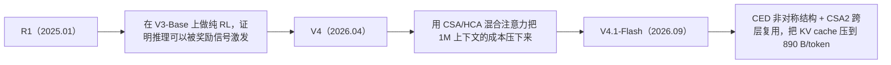

# 论文拆解：R1 / V4 / V4.1

## 这个主题在讲什么

这本书按“问题—方法—数据—实验—局限”五步，逐篇拆三篇论文：DeepSeek-R1、DeepSeek-V4、DeepSeek-V4.1-Flash。先把每篇论文自己说了什么弄清楚，再判断哪些结论有证据、哪些只是作者的解释。架构的横向比较留到第三本，这里不做提前总结。

## 全书心智模型

看图说明：三篇论文不是同一个问题的三个答案。R1 解决“怎么让模型会推理”，V4 解决“长上下文太贵”，V4.1 解决“智能体场景输入太重、KV cache 太占内存”。读的时候不要把它们混成一条“模型越来越大”的叙事。

## 学习路径（推荐顺序）

| 步骤 | 章节 | 主题 | 前置 | 检查点 |
|---|---|---|---|---|
| 01 | ch06 | R1 上：问题、R1-Zero、GRPO | 基础篇 ch05 | 能复述 GRPO 的采样与优势计算 |
| 02 | ch07 | R1 下：四阶段流水线与蒸馏 | ch06 | 能画出 R1 的完整训练流程 |
| 03 | ch08 | V4：CSA/HCA、mHC、Muon | 基础篇 ch05 | 能说出 1M 上下文省的是哪两项成本 |
| 04 | ch09 | V4.1：CED、CSA2、Engram、DSpark | ch08 | 能解释 prefill 8B 与 decode 16B 的来源 |

## 章节索引

- 第 6 章 R1 论文拆解（上）：先学会读论文，再看 R1-Zero（难度 ★★☆）→ chapters/ch06-r1-part1.md
- 第 7 章 R1 论文拆解（下）：四阶段流水线、蒸馏与局限（难度 ★★★）→ chapters/ch07-r1-part2.md
- 第 8 章 V4 论文拆解：百万上下文的成本怎么砍（难度 ★★★）→ chapters/ch08-v4.md
- 第 9 章 V4.1 论文拆解：非对称 CED 与 KV cache 极限（难度 ★★★）→ chapters/ch09-v41.md

## 前置知识（零基础缺口补讲）

| 缺口 | 对应补讲位置 | 学完标志 |
|---|---|---|
| 不懂强化学习 | ch06 概念 1–2 | 能说出策略、奖励、优势分别是什么 |
| 不懂 MoE/MLA | 基础篇 ch05 | 能说出 V3 的三块地基 |
| 不懂 KV cache | 基础篇 ch05、概念 c16 | 能算一个 token 的缓存大小 |
| 不懂论文实验表 | ch06 “读论文五问” | 能分辨 ablation 与主结果 |

## 术语表 / 模式库 / 速查表 入口

- 术语表：glossary.md
- 模式库：patterns.md
- 速查表：cheatsheet.md
- 测验：quiz.md
- 抽认卡：flashcards.md
