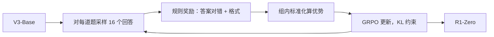

# 第 6 章：R1 论文拆解（上）：先学会读论文，再看 R1-Zero

- **难度**：★★☆ | **预估学时**：4 小时 | **前置**：基础篇第 5 章

## 学习目标

学完本章，你能：
1. 用“五问”框架拆一篇大模型论文：问题、方法、数据、实验、局限。
2. 说清 R1-Zero 和标准 SFT 模型的区别。
3. 复述 GRPO 的一次完整计算：采样、奖励、组内优势、更新。

## 一句话核心

R1-Zero 证明了一件事：不给推理过程做人工示范，只给“答案对不对”和“格式合不合规”两种规则奖励，强化学习也能把长链推理逼出来。

## 零基础讲解

### 先给论文建一张档案卡

| 项目 | 内容 |
|---|---|
| 标题 | DeepSeek-R1: Incentivizing Reasoning Capability in LLMs via Reinforcement Learning |
| 编号 | arXiv:2501.12948 |
| 发表 | 2025 年 1 月，DeepSeek-AI |
| 基座 | DeepSeek-V3-Base（671B 总参数，37B 激活） |
| 关键词 | 纯强化学习、GRPO、规则奖励、R1-Zero、冷启动、蒸馏 |

读论文先填这张卡，比一上来啃公式有用。卡片填完，你就知道它站在什么基础上、想解决什么。

### 读论文五问

**一问：它解决什么问题？** 不是“提升性能”这种空话，要具体到“此前的做法贵在哪、差在哪”。

**二问：方法的核心改动是什么？** 用一句话说清，再展开细节。说不清一句话，说明还没读懂。

**三问：数据从哪来、规模多大？** 大模型论文的结论高度依赖数据。数据来源不清，实验数字就要打折。

**四问：实验证明了什么、没证明什么？** 主结果、消融、对比基线要分开看。作者没做的实验，往往就是局限。

**五问：作者自己承认的局限是什么？** 论文的 Limitations 节通常比摘要诚实，值得逐条读。

### 概念 1：R1 之前，大家怎么做推理（难度：基础）

在 R1 之前，让模型“一步步想”主要靠两种办法：

1. **监督微调**：人工写出大量带推理步骤的答案，让模型模仿。问题是：写的人得自己会解题，成本高；模型学到的是“像人那样写”，不一定是“真的会推”。
2. **过程奖励模型**：训练一个裁判，给推理的每一步打分，再用强化学习优化。问题是：什么叫“这一步推理正确”很难定义，裁判本身也会被模型钻空子，规模一大就难维护。

R1 的论文问了一个更激进的问题：如果只给最终答案的对错，模型能不能自己学会推理？

### 概念 2：R1-Zero 的做法：没有冷启动，直接 RL（难度：进阶）

**R1-Zero** 的流程很短：

1. 拿 DeepSeek-V3-Base 当初始策略。
2. 对每道题，让模型生成一组回答（论文里每组 16 个）。
3. 用规则给每个回答打分：
   - **准确性奖励**：最终答案是否和标准答案一致。数学题做精确匹配，代码题跑测试用例。
   - **格式奖励**：推理过程是否放在 `...` 标签里，答案是否放在 `<answer>...`</answer>` 标签里。
4. 用 **GRPO** 根据组内相对好坏更新模型。
5. 重复，不做任何人工推理示范。

注意，这里没有“过程奖励模型”。奖励只看最终结果和格式，不看中间步骤。这就是“纯 RL”。

### 概念 3：GRPO 怎么算（难度：高难）

**GRPO**（Group Relative Policy Optimization，组相对策略优化）是 PPO 的省内存版本。PPO 需要一个和策略模型差不多大的价值模型（critic）来估计“这个状态值多少”，GRPO 用同一道题的一组回答互相比较，省掉 critic。

对一道题 $q$，采样 $G$ 个回答，得到奖励 $r_1,\ldots,r_G$。第 $i$ 个回答的优势：

$$A_i=\frac{r_i-\text{mean}(r_1,\ldots,r_G)}{\text{std}(r_1,\ldots,r_G)}$$

意思是：比组内平均好的回答，优势为正；比平均差的，优势为负。标准差做归一化，让不同题目的奖励尺度可比。

目标函数（简化版）：

$$J(\theta)=\mathbb{E}\left[\frac{1}{G}\sum_{i=1}^{G}\min\left(\frac{\pi_\theta(o_i|q)}{\pi_{\theta_{\text{old}}}(o_i|q)}A_i,\ \text{clip}\left(\frac{\pi_\theta}{\pi_{\theta_{\text{old}}}},1-\epsilon,1+\epsilon\right)A_i\right)-\beta D_{\text{KL}}\right]$$

逐项翻译：
- $\pi_\theta(o_i|q)$：当前模型生成这个回答的概率。
- 分子分母的比值：新模型相对旧模型，对这个回答的偏好变化了多少。
- $\min$ 与 clip：限制一次更新的幅度，防止模型一步走太远。
- $D_{\text{KL}}$：惩罚新模型偏离旧模型太远，保持训练稳定。$\beta$ 控制惩罚强度。

论文的训练配置：学习率 $3\times10^{-6}$，KL 系数 0.001，每题采样 16 个回答，最大长度 32768，每个 RL 步 8192 道题，微批 256 道题。

### 概念 4：R1-Zero 的结果：分数涨了，但话说不清（难度：进阶）

论文报告的主要数字（pass@1）：

| 基准 | V3-Base | R1-Zero |
|---|---|---|
| AIME 2024 | 15.6% | 71.0% |
| MATH-500 | 58.8% | 90.2% |
| GPQA Diamond | 30.8% | 62.1% |
| LiveCodeBench | 29.6% | 50.8% |
| Codeforces 百分位 | 31.4 | 78.9 |

AIME 从 15.6 涨到 71.0，涨幅非常大。论文还记录了一个“aha moment”：训练中模型会突然停下来重新检查前面的步骤，输出“Wait, let me reconsider...”这类反思。这不是人教出来的，是奖励信号逼出来的。

但 R1-Zero 不能直接拿来用：
- 推理过程可读性差，常常混用中英文。
- 格式经常不合规。
- 有些回答绕来绕去，答案却错了。

所以论文在 R1-Zero 之后，又做了一版“R1”，加入冷启动和多阶段训练。这是下一章的内容。

### 概念 5：怎么读 R1-Zero 的实验表（难度：进阶）

看实验表，先分清三类数字：
- **主结果**：和基线比，证明方法有效。比如 AIME 15.6 → 71.0。
- **消融**：去掉某个组件，看掉多少。R1 论文里对比了“加冷启动”“加多阶段”等版本。
- **训练曲线**：看随训练步数怎么变，能发现“aha moment”和长度增长。曲线比单点数字更能说明机制。

不要只看最高分。要看：
- 基线是不是同一个基座？R1-Zero 的基线是 V3-Base，不是 V3 正式版。
- 评测是不是 pass@1？pass@1 表示只给一次机会，比 pass@k 严格。
- 有没有挑题？AIME 只有 30 道题，波动大，单次分数不能当绝对结论。

## 图示

看图说明：这个循环里没有人类写的推理步骤，只有答案对错和格式。GRPO 的作用是把“组内谁更好”变成更新方向。

## 类比与实例

- **类比**：老师只告诉你“这道题答案对不对”，不给你讲步骤。你交 16 份卷子，老师圈出最好的几份，让你往那个方向调整。重复很多次，你自己摸索出一套解题流程。
- **实例**：一道题采样 4 个回答，奖励分别是 $[1, 0, 1, 0]$。均值 0.5，标准差 0.5。优势是 $[1, -1, 1, -1]$。两个答对的回答被鼓励，两个答错的被抑制。下一轮模型会更倾向于生成类似前两个的回答。

## 常见误解

- **别以为 R1-Zero 没有任何监督**——它用了规则奖励，规则是人设计的，只是没有人工写推理步骤。
- **别以为 GRPO 完全不需要价值函数就“更简单”**——它省掉 critic，但要用一组采样，采样成本更高；是拿计算换显存。
- **别以为分数涨了就代表“推理能力”全面变强**——论文只测了数学、代码、科学问答等基准，通用对话、工具调用并没有提升。

## 自测题（答案）

1.（单选）R1-Zero 的奖励由哪两部分组成？
A. 过程奖励 + 结果奖励 B. 准确性奖励 + 格式奖励 C. 人类偏好 + 长度惩罚 D. 价值模型 + 策略模型
**答案：B**；解析：论文明确只用规则化的准确性奖励和格式奖励，不用神经奖励模型。

2.（填空）GRPO 中第 $i$ 个回答的优势等于该回答奖励减去组内均值，再除以 ______。
**答案：组内标准差**；解析：优势是组内标准化后的相对好坏。

3.（简答）为什么 R1-Zero 不能直接上线？
**答案要点**：推理过程可读性差、中英文混用、格式不合规，答案也可能绕远后出错。

## 复习锚点

- 读论文五问：问题、方法、数据、实验、局限。
- R1-Zero = V3-Base + GRPO + 规则奖励，没有冷启动 SFT。
- GRPO 用组内相对优势替代 critic，靠 clip 和 KL 保持稳定。
