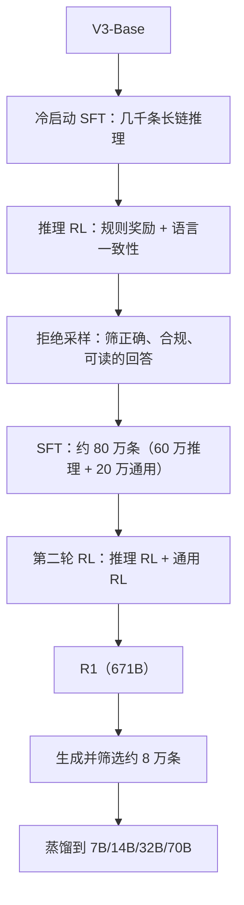
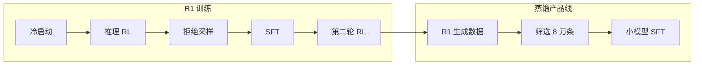

# 第 7 章：R1 论文拆解（下）：四阶段流水线、蒸馏与局限

- **难度**：★★★ | **预估学时**：4 小时 | **前置**：第 6 章

## 学习目标

学完本章，你能：
1. 按顺序画出 R1 的四个训练阶段。
2. 说清冷启动、拒绝采样、第二轮 RL 各自解决什么问题。
3. 解释蒸馏为什么能把大模型的推理能力搬到小模型，以及它的边界。

## 一句话核心

R1 不是“一个 RL 技巧”，而是一条四阶段流水线：冷启动 SFT → 推理 RL → 拒绝采样 SFT → 通用 RL，最后把 80 万条数据蒸馏给小模型。

## 零基础讲解

### 概念 1：为什么需要冷启动（难度：基础）

R1-Zero 的纯 RL 能涨分，但输出不像人话。**冷启动**（cold start）的做法是：先人工写几千条高质量、格式规范、可读性好的长链推理，做一次监督微调，把模型“领进门”，再交给 RL。

论文的冷启动数据有几千条，特点是：
- 每条都有完整的逐步推理。
- 格式统一，推理放 `...`，答案放 `<answer>...</answer>`。
- 语言一致，不中英混杂。

这一步不是要让模型背答案，而是给它一个“输出长什么样”的初始分布。没有这个初始分布，RL 探索空间太大，容易学出奇怪格式。

### 概念 2：第一轮推理 RL（难度：进阶）

冷启动之后，做推理 RL。数据和奖励与 R1-Zero 类似，但加了两点：
- **语言一致性奖励**：统计推理过程中目标语言词的比例，比例高就给奖励，缓解中英混杂。
- **更长的训练数据**：覆盖数学、代码、科学、逻辑等可验证任务。

这一轮的目标是让模型在“格式已经像样”的前提下，把答案正确率继续往上推。

### 概念 3：拒绝采样与 SFT（难度：进阶）

RL 训完后，模型能生成很多正确答案。接下来做**拒绝采样**（rejection sampling）：
1. 对每道题让模型生成多个回答。
2. 只保留答案正确、格式合规、可读性达标的回答。
3. 把这些高质量回答当作监督数据，做一次 SFT。

论文最终用了约 80 万条 SFT 数据，其中 60 万条是推理数据，20 万条是通用数据。通用数据包括写作、问答、翻译、角色扮演等，用来防止模型变成“只会做题的偏科生”。

拒绝采样的本质是“用模型自己产出的好答案，反过来教自己”。它比人工写答案便宜，但依赖模型已经能产出足够多的正确答案。

### 概念 4：第二轮 RL：推理与通用一起练（难度：进阶）

第二轮 RL 分两部分：
- **推理 RL**：继续用规则奖励，提升数学、代码、逻辑的准确率。
- **通用 RL**：用奖励模型给写作、问答、对话等任务打分，提升有用性和安全性。

两部分数据混合训练。论文用了约 1 万条通用 RL 提示，覆盖多种任务。这样做的目的是：不让推理训练把通用能力拉垮。

### 概念 5：蒸馏：把大模型的推理搬到小模型（难度：高难）

**知识蒸馏**（distillation）在这里的做法很直接：
1. 用 R1（671B）对大量题目生成回答。
2. 筛选出正确的、格式好的回答，约 8 万条。
3. 用这些回答微调小模型，比如 DeepSeek-V3、Qwen-7B/14B/32B、Llama-8B/70B。

注意，蒸馏阶段不再做 RL，只是监督微调。论文的结论是：小模型通过模仿大模型的长链推理，推理能力可以显著超过同等规模下直接做 RL 的模型。

论文报告的蒸馏结果（AIME 2024 pass@1）：

| 模型 | AIME 2024 |
|---|---|
| DeepSeek-R1-Distill-Qwen-7B | 55.5% |
| DeepSeek-R1-Distill-Qwen-32B | 72.2% |
| DeepSeek-R1-Distill-Llama-70B | 70.0% |

作为对比，论文提到 7B 蒸馏模型在 AIME 上超过 GPT-4o 的 31.4%。这个对比很抓眼球，但要注意评测设置、题目数量和统计波动。

### 概念 6：R1 的完整流程（难度：进阶）

看图说明：四阶段是串行的，不是可选模块。冷启动解决可读性，第一轮 RL 解决准确率，拒绝采样解决数据质量，第二轮 RL 解决通用能力。蒸馏是另一条并行的产品线，不是 R1 本身的训练阶段。

### 概念 7：论文自己承认的局限（难度：进阶）

R1 论文的局限写得很具体：
- **通用能力偏弱**：函数调用、工具使用、多轮对话、角色扮演不如专门优化的模型。
- **输出结构僵硬**：长链推理有时啰嗦，格式和语气不够灵活。
- **token 效率低**：简单问题也写很长，推理成本高。
- **软件工程任务弱**：SWE-bench 这类需要仓库级理解的任务，提升有限。
- **提示词敏感**：换一种问法，表现可能波动。
- **奖励黑客风险**：规则奖励可以被钻空子，比如格式对但答案错，或者靠猜测碰运气。

这些局限不是“以后会修”的客套话。它们直接决定 R1 适合什么场景：数学、代码、逻辑等有明确答案的任务强；开放域对话、工具编排、长程工程任务弱。

### 概念 8：论文里失败的尝试（难度：进阶）

论文专门写了一节“Unsuccessful Attempts”，这部分比成功经验更有信息量：

- **过程奖励模型（PRM）**：给每一步打分。问题是步骤粒度难定义，奖励模型容易被 hack，规模一大就难维护。论文试了，收益不稳定。
- **蒙特卡洛树搜索（MCTS）**：把推理拆成树搜索。问题是 token 空间巨大，价值模型难训，算力消耗高，最终没有成为主方案。
- **只用 SFT 不用 RL**：给大量推理数据做监督微调，分数能涨，但泛化不如 RL，遇到新题容易崩。

这三条失败说明：R1 的成功不是因为某个单点技巧，而是“冷启动 + 规则 RL + 拒绝采样 + 多阶段”这套组合在特定任务上跑通了。

## 图示

看图说明：上面是 R1 自己的训练，下面是拿 R1 当老师。两条线的优化目标不同：上面追求 671B 的极限，下面追求小模型的性价比。

## 类比与实例

- **类比**：冷启动是“先跟着范文练字”，RL 是“自己写，按得分改”，拒绝采样是“把写得好的挑出来当字帖”，蒸馏是“把大师的作品给小徒弟临摹”。
- **实例**：假设冷启动数据 5000 条，第一轮 RL 用 8.2 万道推理题，拒绝采样产出 80 万条 SFT 数据，蒸馏筛选 8 万条。每一步的数据规模都不同，不能混着说“R1 用了 80 万条数据训练”。

## 常见误解

- **别以为蒸馏需要 RL**——论文的蒸馏阶段只做 SFT，学生模型不跑 RL。
- **别以为冷启动是“人工教模型推理”**——冷启动只给几千条样例定格式和风格，真正的推理能力靠后面的 RL 探索。
- **别以为 R1 在所有任务上都强**——论文自己列了通用能力、工具调用、工程任务的短板。

## 自测题（答案）

1.（单选）R1 的冷启动阶段用的是什么数据？
A. 大规模无标注网页 B. 几千条人工写的高质量长链推理 C. 80 万条模型自生成数据 D. 只用了 RL 奖励
**答案：B**；解析：冷启动是几千条人工冷启动数据，用于稳定格式和可读性。

2.（填空）R1 的 SFT 数据约 80 万条，其中推理数据约 ______ 万条，通用数据约 20 万条。
**答案：60**；解析：论文报告 60 万推理 + 20 万通用。

3.（简答）论文为什么放弃过程奖励模型（PRM）作为主方案？
**答案要点**：步骤级正确性难定义、奖励模型易被 hack、规模扩展困难，收益不稳定。

## 复习锚点

- R1 四阶段：冷启动 SFT → 推理 RL → 拒绝采样 SFT → 推理+通用 RL。
- 蒸馏是拿 R1 生成的数据做 SFT，不再跑 RL。
- 论文的局限：通用能力、工具调用、token 效率、工程任务、提示词敏感、奖励黑客。
- 失败尝试：PRM、MCTS、纯 SFT。
