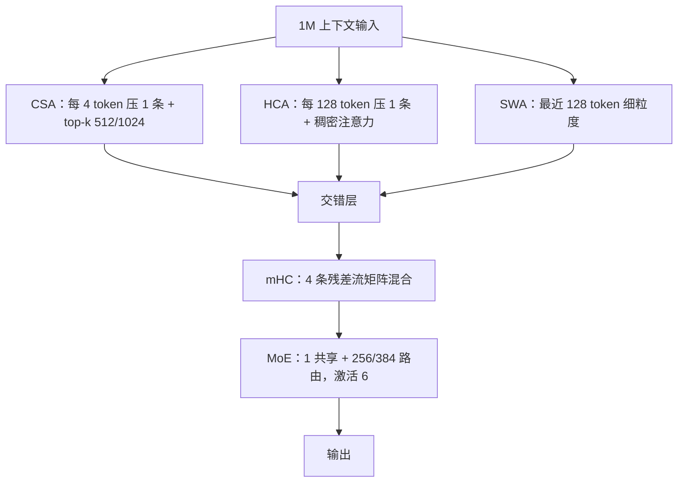

# 第 8 章：V4 论文拆解：百万上下文的成本怎么砍

- **难度**：★★★ | **预估学时**：5 小时 | **前置**：基础篇第 5 章、第 6 章

## 学习目标

学完本章，你能：
1. 说清 1M 上下文的成本由哪两部分构成：注意力 FLOPs 和 KV cache。
2. 解释 CSA 与 HCA 各自的压缩率、稀疏方式和分工。
3. 说出 mHC 和 Muon 各自解决什么训练问题。
4. 分辨“FLOPs 降到 27%”和“延迟降到 27%”不是一回事。

## 一句话核心

V4 用“CSA 压缩+稀疏”和“HCA 重压缩+稠密”的混合注意力，把 1M 上下文的单 token 推理 FLOPs 和 KV cache 同时压下来，再用 mHC 和 Muon 稳住训练。

## 零基础讲解

### 论文档案卡

| 项目 | 内容 |
|---|---|
| 标题 | DeepSeek-V4: Towards Highly Efficient Million-Token Context Intelligence |
| 编号 | arXiv:2606.19348 |
| 发表 | 2026 年 4 月，预览版 |
| 模型 | V4-Pro：1.6T 总参数，49B 激活；V4-Flash：284B 总参数，13B 激活 |
| 上下文 | 1M token |
| 关键词 | CSA、HCA、mHC、Muon、MoE、MTP、FP4 |

### 概念 1：1M 上下文到底贵在哪（难度：基础）

上下文变长，有两笔账同时涨：

1. **注意力计算**：标准注意力要让每个 token 和前面所有 token 算相似度，计算量随长度平方增长，记作 $O(n^2)$。
2. **KV cache**：每个历史 token 的 K、V 都要存，显存随长度线性增长，记作 $O(n)$。

短上下文时，这两笔账都不大。到 1M token，KV cache 可能到几十 GB，注意力计算更是天文数字。所以长上下文模型不是“把窗口调大”就行，必须改注意力结构。

### 概念 2：CSA：先压 4 倍，再稀疏选 512 条（难度：高难）

**CSA**（Compressed Sparse Attention，压缩稀疏注意力）做两件事：

**压缩**：每 4 个连续 token 的 KV 压成 1 条。压缩不是简单平均，而是用可学习的压缩权重做加权：

$$C_i^{\text{Comp}}=\sum_{j=4i}^{4i+3}S_j\odot C_j$$

$S_j$ 是 softmax 后的压缩权重，$C_j$ 是原始 KV 条目，$\odot$ 是逐元素乘。这样序列长度先变成原来的 1/4。

**稀疏**：压缩后仍有大量条目。CSA 用一个轻量索引器（lightning indexer）给每个 query 打分，只选 top-k 条参与核心注意力。V4-Flash 的 top-k 是 512，V4-Pro 是 1024。

压缩和稀疏是乘法关系：4 倍压缩 × 只选 512 条，计算量大幅下降。CSA 还保留一条滑动窗口分支，窗口 128 个 token，专门看最近的细粒度信息，防止压缩把局部细节抹掉。

### 概念 3：HCA：压 128 倍，但不做稀疏（难度：高难）

**HCA**（Heavily Compressed Attention，重度压缩注意力）把压缩率拉到 128:1：每 128 个 token 压成 1 条。它不做 top-k 稀疏，而是在压缩后的条目上做稠密注意力。

为什么需要 HCA：CSA 的 top-k 适合“从大量候选里挑重点”，但索引器本身也有成本。HCA 把候选数量直接压到 1/128，稠密算也不贵，适合承载“全局、粗粒度”的上下文。

V4 把 CSA 和 HCA 交错排布：
- V4-Flash：前 2 层纯滑动窗口，后面 CSA/HCA 交错。
- V4-Pro：前 2 层 HCA，后面 CSA/HCA 交错。

这样既有局部细节（滑动窗口），又有中距离重点（CSA top-k），还有全局粗览（HCA）。三种视野叠加，比单一压缩更稳。

### 概念 4：mHC：把残差连接从“加法”升级成“矩阵混合”（难度：高难）

标准残差是 $y=x+\text{Layer}(x)$，一条残差流。**mHC**（Manifold-Constrained Hyper-Connections，流形约束超连接）把残差流扩成 4 条，用一个小矩阵混合这 4 条流：

$$X_{\text{out}}=M X_{\text{in}}+\text{Layer}(X_{\text{in}})$$

$M$ 不是随便学的，它被约束在**双随机矩阵流形**上：每行和为 1，每列和为 1，所有元素非负。这样混合不会放大或缩小总信号，数值稳定。训练时用 Sinkhorn-Knopp 迭代（V4 用 20 次）把矩阵投影回这个约束。

为什么这么做：残差是深层网络的信息主干，简单加法容易让不同层的信息互相干扰。矩阵混合让模型可以学“哪些残差流该合并、哪些该保留”，提升知识传递效率。代价是显存和通信增加，V4 用融合核、重计算和 DualPipe 调整把开销压到流水线阶段的 6.7%。

### 概念 5：Muon：不是逐元素调，而是把梯度矩阵“正交化”（难度：高难）

AdamW 对每个参数单独算一阶、二阶矩，逐元素更新。**Muon** 把参数矩阵的梯度当成一个整体，先做 Newton-Schulz 迭代，把梯度矩阵的奇异值拉到接近 1，再做更新。直观效果是：更新方向更“正交”，不同方向之间不互相干扰，收敛更快、训练更稳。

V4 的配置：
- 大多数模块用 Muon，embedding、输出头、RMSNorm 用 AdamW。
- 动量 0.95，权重衰减 0.1，更新矩阵 RMS 缩放到 0.18。
- Newton-Schulz 分两段：前 8 步快速收敛，后 2 步把奇异值稳定在 1。
- 分布式训练用混合 ZeRO：稠密参数做背包分配，MoE 参数按专家展平分配。

### 概念 6：MoE 和 MTP 没有推倒重来（难度：进阶）

V4 保留 DeepSeekMoE 和 MTP，但改了配置：
- V4-Flash：1 共享 + 256 路由专家，激活 6 个，专家中间维度 2048。
- V4-Pro：1 共享 + 384 路由专家，激活 6 个，专家中间维度 3072。
- 前 3 个 MoE 层用 Hash 路由，不走学习路由，训练早期更稳。
- MTP 深度仍为 1，继续提供额外训练信号和投机解码草稿。

这说明 V4 的创新集中在注意力和训练稳定性，不是把 V3 的整体骨架换掉。

### 概念 7：效率数字怎么读（难度：进阶）

论文给出的对比基线是 DeepSeek-V3.2，在 1M 上下文下：

| 模型 | 单 token 推理 FLOPs | KV cache |
|---|---|---|
| V4-Pro | 27% | 10% |
| V4-Flash | 10% | 7% |

另外，相对 BF16 GQA8、头维度 128 的常见基线，V4 的 KV cache 可压到约 2%。

读这三个数字要分清：
- **FLOPs** 是计算量，不等于延迟。延迟还受显存带宽、kernel 效率、批大小影响。
- **KV cache** 是存储量，不等于显存占用峰值。峰值还包括模型权重、激活、临时缓冲区。
- 这些数字是“单 token、1M 上下文”的估算，短上下文时优势没那么大。

### 概念 8：训练与工程（难度：进阶）

- 预训练：V4-Flash 32T token，V4-Pro 33T token。
- 学习率：$2.7\times10^{-4}$，2000 步预热，末期余弦降到 $2.7\times10^{-5}$。
- 批大小：逐步升到 7550 万 token，大部分训练保持这个规模。
- 工程：MoE 融合核把计算、通信、访存重叠；TileLang 写算子；确定性 kernel 保证训练推理逐位一致；混合 ZeRO 支持 Muon；两阶段上下文并行处理压缩注意力的跨 rank 边界。
- 后训练：对 MoE 专家权重和索引器 QK 路径做 FP4 量化感知训练，降低显存和计算。

### 概念 9：论文的结论与局限（难度：进阶）

结论：
- 混合 CSA/HCA 让 1M 上下文“可 routinely 支持”，不是实验室 demo。
- mHC 和 Muon 提升训练稳定性，允许更大模型、更长训练。
- V4-Pro-Max 在核心任务上超过前代，官方称其重新定义了开放模型的 SOTA。

局限（论文提及与可从设计推出的）：
- 这是 preview 版本，能力和配置还会迭代。
- 1M 上下文仍不是免费：首 token 延迟、缓存存储、长文本检索精度都有代价。
- 评测集中在 reasoning、coding、long-context、agentic 等自建或公开基准，跨模型比较受评测设置影响。
- FP4 量化和压缩注意力都可能带来精度损失，论文用 QAT 和训练补偿，但极端任务仍需验证。

## 图示

看图说明：三种注意力视野并行，不是三选一。CSA 管中距离重点，HCA 管全局粗览，SWA 管局部细节。mHC 和 MoE 在注意力之后处理表示和知识。

## 类比与实例

- **类比**：读一本 100 万字的书。CSA 是每 4 页做一张摘要卡，再只挑 512 张最相关的；HCA 是每 128 页做一张目录卡；SWA 是手边最近 128 页的原书。三种卡一起用，既不全读，也不丢关键。
- **实例**：1M token、每 4 个压 1 条，CSA 候选从 100 万降到 25 万；再选 top-512，参与核心注意力的条目是 512 条，不是 25 万。HCA 把候选压到约 7812 条，稠密算也不贵。

## 常见误解

- **别以为 CSA 压缩后就不算注意力了**——压缩只是减少候选数量，核心注意力仍在压缩条目上做 Q/K/V 计算。
- **别以为 HCA 比 CSA 更“高级”**——两者分工不同，HCA 适合全局粗览，CSA 适合中距离精选，缺一不可。
- **别以为 27% FLOPs 就是 27% 延迟**——FLOPs 只是计算量，延迟还受带宽和 kernel 影响。
- **别以为 mHC 只是“多几条残差”**——关键是双随机约束和 Sinkhorn 投影，没有约束的矩阵混合会训练不稳。

## 自测题（答案）

1.（单选）V4 的 CSA 压缩率是多少？
A. 2:1 B. 4:1 C. 64:1 D. 128:1
**答案：B**；解析：CSA 每 4 个 token 压成 1 条，HCA 是 128:1。

2.（填空）V4-Pro 的总参数约 ______，激活参数约 ______。
**答案：1.6T，49B**；解析：论文摘要明确给出。

3.（简答）为什么 V4 要同时保留 CSA、HCA 和滑动窗口三种注意力？
**答案要点**：CSA 管中距离稀疏精选，HCA 管全局重压缩粗览，SWA 管最近局部细节，三者视野互补。

## 复习锚点

- 1M 上下文的两笔账：注意力 FLOPs 和 KV cache。
- CSA = 4:1 压缩 + top-k 稀疏 + SWA；HCA = 128:1 压缩 + 稠密。
- mHC 用双随机矩阵混合 4 条残差流，Sinkhorn 20 次迭代。
- Muon 正交化梯度矩阵，替代大部分 AdamW。
- 27% FLOPs ≠ 27% 延迟。
