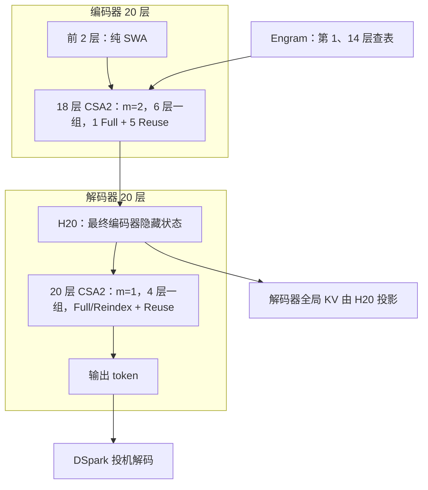

# 第 9 章：V4.1 论文拆解：非对称 CED 与 KV cache 极限

- **难度**：★★★ | **预估学时**：5 小时 | **前置**：第 8 章

## 学习目标

学完本章，你能：
1. 解释 CED 为什么能让 prefill 只激活 8B、decode 激活 16B。
2. 说清 CSA2 的三种模式：Full、Reindex、Reuse。
3. 区分“全局 KV cache”和“持久 KV cache”，以及 890 B/token 指的是哪一个。
4. 说出 Engram 和 DSpark 各自解决什么问题。

## 一句话核心

V4.1 把模型结构改成“编码器—解码器”非对称形态：前半段负责读输入、生成全局 KV，后半段只做轻量解码；再靠 CSA2 跨层复用和 FP4 把每个 token 的 KV cache 压到 890 字节。

## 零基础讲解

### 论文档案卡

| 项目 | 内容 |
|---|---|
| 标题 | DeepSeek-V4.1-Flash: Pushing the Limits of KV Cache Compression |
| 编号 | arXiv:2609.19969 |
| 发表 | 2026 年 9 月 |
| 模型 | 552B 主干 + 196B Engram 参数 |
| 激活 | prefill 8B / token，decode 16B / token |
| 上下文 | 1M token，多模态输入（图像+文本） |
| 关键词 | CED、CSA2、Engram、DSpark、FP4 KV、SWA Bounded Replay |

### 概念 1：为什么智能体场景要改结构（难度：基础）

普通聊天请求，输入短、输出长，decode 是主要成本。智能体（agent）不一样：它要反复读网页、读文件、读工具返回结果，输入很长，输出相对短。这类负载叫**输入密集**（input-heavy）。

输入密集时，**prefill**（把输入读一遍、建立 KV cache）成了主要成本。V4.1 的整个设计，就是围绕“怎么让读输入更便宜”展开的。

### 概念 2：CED：前 20 层读，后 20 层写（难度：高难）

**CED**（Causal Encoder-Decoder，因果编码器—解码器）把 40 层分成两半：
- **编码器**：前 20 层，正常逐层计算，产出最终隐藏状态 $H_{20}$。
- **解码器**：后 20 层，全局注意力的 KV 不再由本层隐藏状态逐层生成，而是直接从 $H_{20}$ 投影出来：

$$C_l=H_{20}W_l^{KV},\quad Z_l=H_{20}W_l^{Z},\quad l>20$$

$W_l^{KV}$、$W_l^{Z}$ 是每层独立的投影矩阵。这样 prefill 时只需要算前 20 层，后 20 层的全局 KV 一次性投影出来，计算量接近减半。

但滑动窗口注意力的 KV 仍要逐层算，否则局部细节不够。为了不让这部分抵消收益，V4.1 用 **Decoder SWA Bounded Replay**：只回放最近 $n_{\text{win}}=128$ 个 token，而不是整个窗口长度 × 层数。论文说这样精度损失可以忽略。

结果：prefill 只激活 8B 参数，decode 需要全部 16B 参数。为什么 decode 更多？因为生成每个 token 时，解码器 20 层都要参与，激活参数回到完整规模。

### 概念 3：CSA2：把 KV 和索引跨层复用（难度：高难）

V4 的 CSA 每层都算自己的压缩 KV 和索引。V4.1 发现：相邻层的全局 KV 高度相似，没必要每层存一份。**CSA2** 把层分成三种模式：

- **Full 模式**：完整计算。生成本层的主 KV、索引器 K，跑索引器，选出 top-k。
- **Reindex 模式**：复用前面某层的主 KV 和索引器 K，但用自己的索引器 Q 重新打分，选出新的 top-k。KV 共享，选择可以变。
- **Reuse 模式**：连 top-k 索引也复用，直接用前面层选好的条目做注意力，不跑索引器。

V4.1 的具体排布：
- 编码器 18 层 CSA2，压缩率 $m=2$，每 6 层一组：第 1 层 Full，后 5 层 Reuse。
- 解码器 20 层 CSA2，压缩率 $m=1$（不压缩序列），每 4 层一组：第一组 1 Full + 3 Reuse；后四组 1 Reindex + 3 Reuse。
- top-k 512，索引器 32 头、每头 128 维。

**分层稀疏索引器**（Hierarchical Sparse Indexer）只在解码器用：第一个 Full 层先选出 2048 个块、每块 8 个位置，共 16384 个候选；后面的 Reindex 层只在这个候选池里选 top-512，不再对全上下文打分。这样深层索引器的成本从“随上下文线性增长”变成“常数”。

### 概念 4：KV cache 的两本账（难度：进阶）

论文反复提两个不同的数字，必须分清：

1. **全局 KV cache**（global KV，始终在 HBM）：V4.1 是 **890 字节/token**，约是 V4-Flash（3514 字节/token）的 1/4，是 V3.2（48068 字节/token）的约 1/54，是 V1（389120 字节/token）的约 1/437。
2. **持久 KV cache**（persistent KV，放在 SSD 或主机内存）：V4.1 约是 V4-Flash 的 1/8。

怎么压到 890 字节：
- CSA2 跨层复用，减少重复存储。
- FP4 存主 KV（每个数 4 位），比 FP8 再减半。
- CED 让解码器全局 KV 从编码器输出投影，不再逐层存。
- SWA 不再持久化，靠 Bounded Replay 重建。

这四件事是乘法关系，不是加法。任何一项单独用，都到不了 1/4。

### 概念 5：Engram：把“记忆”从计算里拆出来（难度：进阶）

**Engram** 是一个条件记忆模块，参数量 196B，放在第 1 层和第 14 层。它做的事很像查表：
- 对输入 token 做 N-gram 压缩（2、3、4 阶）。
- 用 8 个哈希头，每个头查一张约 1600 万条目的表。
- 查到的嵌入经过门控，注入主干。

关键点：查表是 $O(1)$ 的，不需要矩阵乘法。模型可以把“记住固定搭配、事实、术语”这类任务交给 Engram，把计算留给推理。Engram 参数用 FP8 存，推理时可以从主机内存预取。

为什么放在第 1 层和第 14 层：平衡流水线各阶段的显存占用。放太前，后面层都要带着它；放太后，对早层表示影响小。

### 概念 6：DSpark：投机解码的新做法（难度：进阶）

**DSpark** 是一个独立的投机解码模块，在主干预训练之后单独训练。它有三个 Transformer 块，滑动窗口 128，一次前向并行给出 5 个草稿位置的 logits，再用置信度调度决定验证多少。

和 MTP 的区别：MTP 是训练时挂在主干的辅助头，DSpark 是后训练阶段单独训练的 drafter。V4.1 在主干预训练时干脆不用 MTP，把投机解码完全交给 DSpark。这样做的好处是主干训练更简单，drafter 可以单独优化。

### 概念 7：多模态与负载均衡（难度：进阶）

V4.1 原生支持图像输入：
- 视觉编码器 32 层，隐藏 1024，16 个注意力头，patch 14。
- 一个 2 层 MLP 把视觉特征映射到 5120 维，和文本嵌入拼接。
- 多模态数据从语言模型预训练一开始就混入，不是后期补的。

图像 token 和文本 token 的分布不同，MoE 路由偏好也不同。V4.1 给两种模态分别维护一套负载均衡偏置，路由时按 token 的模态选对应的偏置，更新时也分开统计。这样不会因为文本 token 多，就把图像 token 的专家挤掉。

### 概念 8：效率与结果（难度：进阶）

- 预训练：45T 多模态 token。
- 全局 KV：890 字节/token。
- 持久 KV：约 V4-Flash 的 1/8。
- 解码 FLOPs：从 4K 到 1M，只增长约 1/4，几乎不随上下文线性爆炸。
- prefill：约减半。

论文给出的智能体基准（V4.1-Flash vs 对比模型）：

| 基准 | V4.1-Flash | Kimi-K3 | GLM-5.3 | Opus5 | GPT5.6-Sol |
|---|---|---|---|---|---|
| Terminal-Bench 3.0 | 30.0 | 17.7 | 28.3 | 43.3 | 34.4 |
| DeepSWE v1.1 | 74.2 | 67.5 | 66.9 | 74.0 | 73.0 |
| CyberGym | 88.1 | 80.0 | 84.5 | 84.5 | — |
| Automation-Bench | 54.8 | 46.7 | 48.8 | 50.3 | 45.8 |

读表注意：V4.1 不是每项都第一。Terminal-Bench 上 Opus5（43.3）明显更高；DeepSWE 上 Opus5（74.0）与它接近。论文的主张是“比 V4-Flash 整体更强，且在部分智能体任务上有竞争力”，不是“全面超越所有前沿模型”。

### 概念 9：论文的局限（难度：进阶）

- 只有 Flash 版本，没有 V4.1-Pro；不能把 Flash 的成绩当成整个 V4.1 系列的上限。
- 多模态只覆盖图像和文本，不支持音频、视频。
- CED、CSA2、Engram、DSpark 叠加后结构复杂，训练和推理的工程门槛高。
- FP4 KV 和 FP4 权重有精度风险，论文用训练补偿，但极端任务仍需验证。
- 智能体基准多为自建或特定环境，跨论文比较要谨慎。
- 长上下文 decode 的 FLOPs 仍随长度增长（只是增长很慢），不是完全常数。

## 图示

看图说明：编码器负责“读”，解码器负责“写”。解码器的全局 KV 不自己逐层算，而是从编码器末端投影；局部 SWA 仍逐层算，用 Bounded Replay 控制成本。

## 类比与实例

- **类比**：一家翻译公司。前 20 个编辑把整本外文书读透，做出一份“全局术语卡”（H20 投影出的 KV）；后 20 个编辑不重读原书，只拿术语卡和最近 128 个词的原文来写译文。读输入的成本减半，写译文的成本不变。
- **实例**：1M token 输入，V4-Flash 全局 KV 约 3514 B/token，总计约 3.5 GB；V4.1 压到 890 B/token，总计约 0.89 GB。持久 KV 再降到 V4-Flash 的 1/8，SSD 压力大幅下降。

## 常见误解

- **别以为 prefill 8B 和 decode 16B 是“两个不同模型”**——同一个模型，不同阶段的激活路径不同：prefill 只跑编码器 + 投影，decode 要跑完整解码器。
- **别以为 CSA2 只是“KV 复用”**——它还复用索引器 K 和 top-k 索引，三种模式解耦了“KV 共享”和“选择共享”。
- **别以为 890 B/token 是全部缓存**——它指全局 KV；持久 KV、SWA 缓存、Engram 表是另外的账。
- **别以为 V4.1-Flash 全面超过 V4-Pro**——论文对标的基线是 V4-Flash，不是 Pro；Terminal-Bench 上也不如 Opus5。

## 自测题（答案）

1.（单选）V4.1 的 CED 中，解码器的全局 KV 来自哪里？
A. 每层自己的隐藏状态 B. 编码器第 20 层的隐藏状态 C. 输入 embedding D. Engram 查表
**答案：B**；解析：公式 $C_l=H_{20}W_l^{KV}$，$l>20$。

2.（填空）V4.1 的全局 KV cache 是 ______ 字节/token。
**答案：890**；解析：论文摘要与图 1 都给出这个数字。

3.（简答）CSA2 的 Reindex 模式和 Reuse 模式有什么区别？
**答案要点**：Reindex 复用主 KV 和索引器 K，但用自己的 Q 重新打分选 top-k；Reuse 连 top-k 索引也复用，不再跑索引器。

## 复习锚点

- V4.1 为输入密集的智能体负载设计：prefill 8B，decode 16B。
- CED 把 40 层分成 20 编码 + 20 解码，解码全局 KV 从 H20 投影，prefill 减半。
- CSA2 三模式 Full/Reindex/Reuse，跨层复用 KV 与索引；分层索引器把深层打分变常数。
- 全局 KV 890 B/token，持久 KV 约 V4-Flash 的 1/8。
- Engram 查表记忆，DSpark 投机解码，FP4 压 KV。
