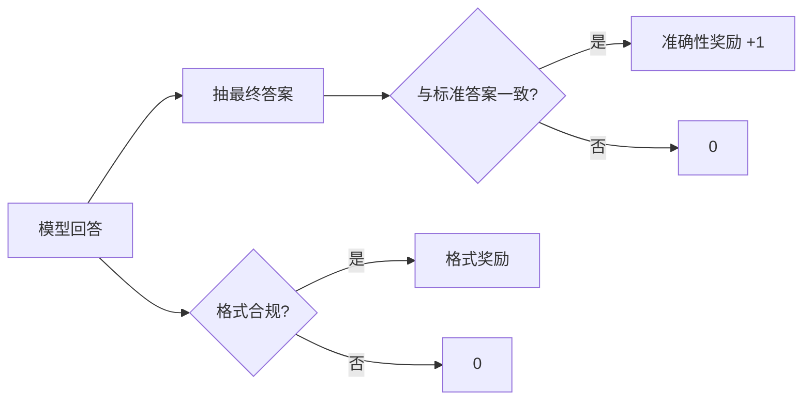

# 规则奖励

- **难度**：进阶 | **涉及章节**：第 6 章、第 7 章

## 一句话定义

规则奖励是用确定性规则给模型回答打分，不训练神经奖励模型；R1 主要用“答案对不对”和“格式合不合规”两条规则。

## 为什么重要

它是 R1-Zero 能成立的前提。没有规则奖励，纯 RL 就没有稳定信号；有了它，训练可以大规模跑，不怕奖励模型被 hack。

## 图示

## 详解

两类奖励：
1. **准确性奖励**：数学题做精确匹配（如 `\boxed{}` 里的答案），代码题跑单元测试，逻辑题比对选项。
2. **格式奖励**：推理是否放在 `...`，答案是否放在 `<answer>...</answer>`。

优点：
- 确定性，可复现，不受奖励模型偏好漂移影响。
- 可以大规模自动判分，成本低。
- 不容易被“讨好裁判”的写法 hack。

缺点：
- 只适用于有明确答案的任务。开放写作、对话、工具调用无法用规则判分。
- 规则本身可能被钻空子，比如格式对但答案错，或者靠猜测碰运气。
- 对推理过程的“质量”没有直接信号，只看结果。

R1 在通用 RL 阶段改用奖励模型，就是因为开放任务没有标准答案。

## 常见误解

- 规则奖励不是“没有奖励模型就完全客观”，规则也是人设计的，有盲区。
- 规则奖励不是“只能用于数学”，代码测试、格式检查、工具调用成功与否都可以规则化。

## 在书中出现的脉络

| 章节 | 语境 | 关键结论 |
|---|---|---|
| ch06 | R1-Zero | 准确性 + 格式两条规则 |
| ch07 | R1 | 推理 RL 继续用规则，通用 RL 用奖励模型 |
| ch11 | 训练对比 | 规则奖励适合可验证任务 |

## 相关概念

- 前置：GRPO
- 后续：奖励黑客、奖励模型
