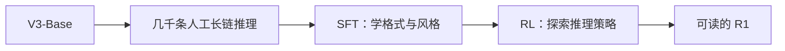

# 冷启动

- **难度**：基础 | **涉及章节**：第 7 章

## 一句话定义

冷启动是在 RL 之前，用少量高质量人工长链推理数据做一次 SFT，把模型的输出格式和可读性先“领进门”。

## 为什么重要

R1-Zero 证明纯 RL 能涨分，但输出不可读。冷启动是 R1 从“实验室能跑”变成“产品能用”的关键一步。

## 图示

## 详解

冷启动数据的特点：
- 量小：几千条，不是几百万。
- 质高：步骤完整、语言一致、格式统一。
- 目的不是教知识，是教“输出长什么样”。

为什么不能直接上大量 SFT：会把模型限制在人类写过的推理路径上，失去 RL 探索新策略的空间。为什么不能完全不要：纯 RL 的初始输出太乱，格式奖励很难把可读性拉回来。

论文在冷启动后还加了语言一致性奖励，进一步压制中英混杂。

## 常见误解

- 冷启动不是“人工教模型每一步怎么推”，它只给少量样例定格式。
- 冷启动不是“可有可无”，没有它 R1-Zero 的输出不能直接使用。

## 在书中出现的脉络

| 章节 | 语境 | 关键结论 |
|---|---|---|
| ch07 | R1 四阶段 | 冷启动是第一阶段 |
| ch06 | R1-Zero 对比 | 无冷启动导致可读性差 |
| ch11 | 训练流程 | 冷启动 + RL 的组合 |

## 相关概念

- 前置：监督微调
- 后续：推理 RL、拒绝采样
