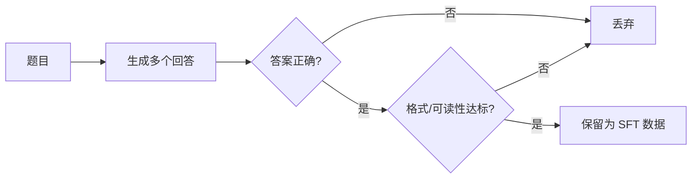

# 拒绝采样

- **难度**：进阶 | **涉及章节**：第 7 章

## 一句话定义

拒绝采样是让模型对每道题生成多个回答，只保留答案正确、格式合规、可读性达标的样本，作为下一轮 SFT 数据。

## 为什么重要

它是 R1 把 RL 探索出的能力“固化”成监督数据的关键环节。没有它，RL 的成果很难稳定传给下一阶段或小模型。

## 图示

## 详解

R1 的拒绝采样规模：
- 推理数据约 60 万条。
- 通用数据约 20 万条（用奖励模型和人工规则筛）。
- 合计约 80 万条 SFT 数据。

筛选标准不是只看答案：
- 答案必须正确。
- 推理过程格式合规。
- 语言一致、可读。
- 有些任务还要过奖励模型或人工抽检。

拒绝采样的前提是模型已经能产出足够多的正确答案。如果正确率太低，采样成本会爆炸，所以它通常放在 RL 之后，而不是训练一开始。

## 常见误解

- 拒绝采样不是“随机丢弃”，它是有明确标准的筛选。
- 拒绝采样不是“只留最高分”，通常保留所有达标样本，保证多样性。

## 在书中出现的脉络

| 章节 | 语境 | 关键结论 |
|---|---|---|
| ch07 | R1 第三阶段 | 筛出 80 万条 SFT 数据 |
| ch07 | 蒸馏 | 从 R1 生成数据中筛 8 万条 |
| ch11 | 数据工程 | 拒绝采样是数据闭环的一环 |

## 相关概念

- 前置：冷启动、GRPO
- 后续：SFT、知识蒸馏
