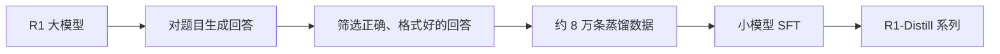

# 知识蒸馏

- **难度**：进阶 | **涉及章节**：第 7 章

## 一句话定义

知识蒸馏是让一个小模型学习大模型生成的输出，把大模型的能力以监督数据的形式迁移过去。

## 为什么重要

R1 的蒸馏让小模型在数学、代码上显著超过同规模直接训练，是“大模型能力下放”的典型做法。

## 图示

## 详解

两种蒸馏：
1. **数据蒸馏**（R1 采用）：大模型生成答案，筛出高质量样本，小模型做监督微调。学生只学最终输出，不学大模型的概率分布。
2. **logit 蒸馏**：学生同时拟合教师的输出概率分布，需要访问教师 logits，R1 论文没有采用。

R1 蒸馏的对象包括 DeepSeek-V3（未做 RL 的版本）、Qwen-7B/14B/32B、Llama-8B/70B。论文的结论是：蒸馏带来的提升，比在小模型上直接做 RL 更稳定、更便宜。

蒸馏的边界：
- 学生模型容量有限，长链推理会压缩或变形。
- 教师也会犯错，筛数据只能减少错误，不能消除。
- 蒸馏学到的是“教师怎么解这类题”，遇到全新领域不一定迁移。

## 常见误解

- 蒸馏不是“把大模型参数复制给小模型”，参数量完全不同。
- 蒸馏不是“学生一定超过教师”，学生的上限受容量限制。

## 在书中出现的脉络

| 章节 | 语境 | 关键结论 |
|---|---|---|
| ch07 | R1 蒸馏 | 8 万条数据，SFT 不再 RL |
| ch09 | V4.1 | 后训练也用到数据蒸馏/OPD |
| ch11 | 训练对比 | 蒸馏 vs 直接 RL |

## 相关概念

- 前置：拒绝采样、SFT
- 后续：OPD、模型压缩
