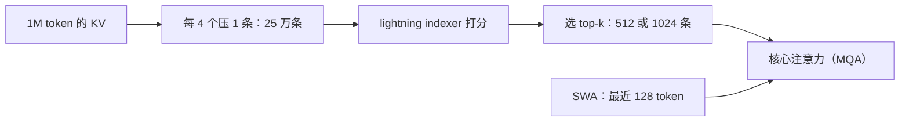

# CSA（压缩稀疏注意力）

- **难度**：高难 | **涉及章节**：第 8 章

## 一句话定义

CSA 先把每 4 个 token 的 KV 压成 1 条，再用轻量索引器选 top-k 条参与核心注意力，兼顾压缩与稀疏。

## 为什么重要

它是 V4 长上下文效率的第一根支柱。理解 CSA，才能理解 V4 为什么能把 1M 上下文的 KV cache 压到 10%。

## 图示

## 详解

压缩：每 $m=4$ 个连续 token 压成 1 条，压缩权重由 hidden state 算出，softmax 归一化后加权求和。相邻压缩块有重叠，减少边界信息损失。

稀疏：索引器用低秩的索引 Q/K 给每条压缩 KV 打分，选 top-k。V4-Flash k=512，V4-Pro k=1024。

核心注意力：被选中的压缩条目同时充当 K 和 V，用 MQA（多查询注意力）方式计算，多个 query 头共享同一份 KV。

局部分支：额外保留最近 128 个 token 的未压缩 KV，保证局部细节。

三个数字一起看：
- 1M → 25 万（压缩 4 倍）
- 25 万 → 512（稀疏选 top-k）
- 另外 128 条局部 KV

## 常见误解

- CSA 不是“只算 512 个 token”，它仍要看压缩后的候选，只是核心注意力只对 top-k 计算。
- CSA 的压缩不是平均池化，压缩权重是学出来的。

## 在书中出现的脉络

| 章节 | 语境 | 关键结论 |
|---|---|---|
| ch08 | V4 | m=4，top-k 512/1024 |
| ch09 | V4.1 | CSA2 在此基础上做跨层复用 |
| ch10 | 架构演进 | 压缩+稀疏路线 |

## 相关概念

- 前置：注意力、KV cache、softmax
- 后续：HCA、CSA2
