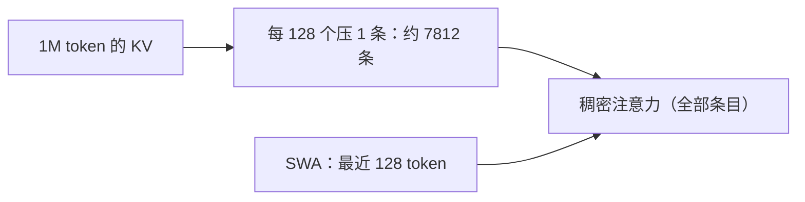

# HCA（重度压缩注意力）

- **难度**：高难 | **涉及章节**：第 8 章

## 一句话定义

HCA 把每 128 个 token 的 KV 压成 1 条，压缩后做稠密注意力，不跑稀疏索引器。

## 为什么重要

它是 V4 长上下文的第二根支柱。CSA 管中距离精选，HCA 管全局粗览，两者交错才覆盖完整视野。

## 图示

## 详解

压缩率 $m'=128$，比 CSA 的 4 大 32 倍。压缩方式与 CSA 类似：压缩权重 softmax 后加权求和，但不做重叠压缩。

为什么不做稀疏：压缩后只剩约 7812 条（1M 上下文），稠密算也可接受；省掉索引器的计算和存储，结构更简单。

为什么需要它：CSA 的 top-k 只能覆盖“最相关的 512 条”，对需要全局扫一遍的任务（比如长文档主题归纳）不够。HCA 保留一个粗粒度的全局视图，弥补这个缺口。

V4-Pro 前 2 层用 HCA，V4-Flash 前 2 层用纯 SWA；之后都是 CSA/HCA 交错。

## 常见误解

- HCA 不是“比 CSA 更弱”，它是不同分工。
- HCA 的 128:1 压缩不是“只保留 128 个 token”，是把每 128 个压成 1 条，总数仍是序列长度的 1/128。

## 在书中出现的脉络

| 章节 | 语境 | 关键结论 |
|---|---|---|
| ch08 | V4 | m'=128，稠密注意力 |
| ch09 | V4.1 | 改为纯 CSA2，不再用 HCA |
| ch10 | 架构演进 | 重压缩路线 |

## 相关概念

- 前置：CSA、注意力
- 后续：CSA2
