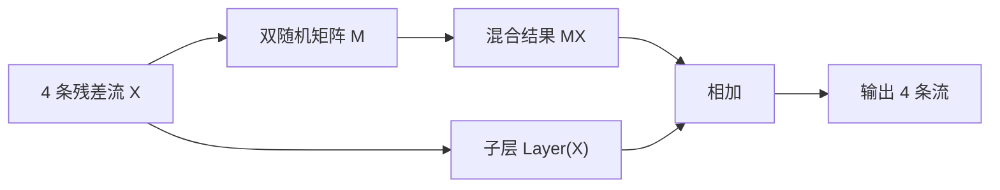

# mHC（流形约束超连接）

- **难度**：高难 | **涉及章节**：第 8 章、第 9 章

## 一句话定义

mHC 把 Transformer 的残差流从 1 条扩成 4 条，用一个受双随机约束的矩阵混合它们，替代简单的逐元素相加。

## 为什么重要

它是 V4 提升训练稳定性和深层信息传递的关键结构，V4.1 还升级成 Single-Pass mHC，降低显存开销。

## 图示

## 详解

标准残差：$y=x+\text{Layer}(x)$，只有一条流。

mHC：把隐藏状态复制成 $n=4$ 条残差流，用 $4\times4$ 矩阵 $M$ 混合：

$$X_{\text{out}}=M X_{\text{in}}+\text{Layer}(X_{\text{in}})$$

$M$ 约束为**双随机矩阵**：每行和 1、每列和 1、元素非负。这个约束保证混合是凸组合，不会放大信号，也不会让某条流吞掉其他流。训练时用 Sinkhorn-Knopp 迭代 20 次，把学到的矩阵投影回这个流形。

为什么有效：
- 多条流提供更多“信息通道”，不同层可以写不同流。
- 双随机约束让混合稳定，避免深层残差爆炸。
- 模型可以学“哪些流该合并”，比固定加法灵活。

代价：显存和通信增加。V4 用融合核、重计算、DualPipe 调整，把开销压到流水线阶段的 6.7%。V4.1 的 Single-Pass mHC 用一个融合核完成，激活访存减半。

## 常见误解

- mHC 不是“简单多加几条残差”，关键是矩阵约束。
- 双随机约束不是“随便归一化”，行列都要为 1，Sinkhorn 是迭代投影。

## 在书中出现的脉络

| 章节 | 语境 | 关键结论 |
|---|---|---|
| ch08 | V4 | n=4，Sinkhorn 20 次 |
| ch09 | V4.1 | Single-Pass mHC |
| ch10 | 架构对比 | 残差结构演进 |

## 相关概念

- 前置：残差连接、矩阵乘法
- 后续：Sinkhorn、训练稳定性
