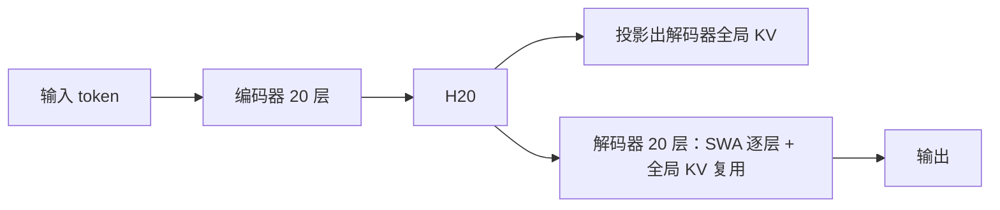

# CED（因果编码器—解码器）

- **难度**：高难 | **涉及章节**：第 9 章

## 一句话定义

CED 把 Transformer 分成前半编码器和后半解码器：解码器的全局 KV 直接从编码器末端隐藏状态投影，不再逐层计算。

## 为什么重要

它让 V4.1 的 prefill 只激活 8B 参数，decode 激活 16B，直接针对智能体“输入重、输出轻”的负载。

## 图示

## 详解

标准 Transformer 每层都用自己的隐藏状态生成 K/V。CED 规定，对 $l>L/2$ 的解码器层：

$$C_l=H_{L/2}W_l^{KV},\quad Z_l=H_{L/2}W_l^{Z}$$

$H_{L/2}$ 是编码器最后一层的隐藏状态，$W_l^{KV}$、$W_l^{Z}$ 是每层独立的投影。这样 prefill 只需算前一半层，后一半的全局 KV 一次投影出来。

局部 SWA 仍逐层算，因为局部细节依赖每层自己的表示。为避免回放成本，CED 用 Decoder SWA Bounded Replay：只回放最近 $n_{\text{win}}=128$ 个 token。

复杂度：prefill 从 $O(NL)$ 降到 $O(NL/2+n_{\text{win}}L/2)$，近似减半。

为什么 decode 激活更多：生成每个 token 时，解码器 20 层全部参与，参数回到完整规模。所以“prefill 8B / decode 16B”不是两个模型，是同一模型的不同阶段。

## 常见误解

- CED 不是“编码器只处理输入、解码器只处理输出”的简单分工，关键是 KV 的投影路径。
- CED 不是“完全不用算后 20 层”，decode 阶段后 20 层照常参与。

## 在书中出现的脉络

| 章节 | 语境 | 关键结论 |
|---|---|---|
| ch09 | V4.1 | 20 编码 + 20 解码 |
| ch10 | 架构对比 | 非对称计算 |
| ch11 | 部署 | prefill/decode 成本分离 |

## 相关概念

- 前置：Transformer 层、KV cache
- 后续：SWA Bounded Replay、CSA2
