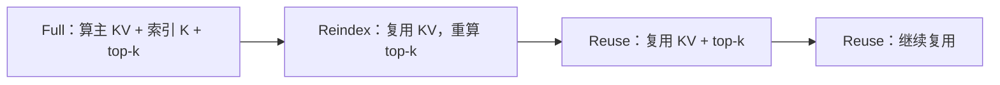

# CSA2（压缩稀疏注意力 2）

- **难度**：高难 | **涉及章节**：第 9 章

## 一句话定义

CSA2 在 CSA 的基础上增加跨层复用：主 KV、索引器 K、top-k 索引都可以从前面层继承，层与层之间不再各存一份。

## 为什么重要

它是 V4.1 把全局 KV 压到 890 B/token 的核心。没有跨层复用，FP4 和 CED 也到不了这个量级。

## 图示

## 详解

三种模式：
- **Full**：完整路径。生成本层主 KV、索引器 K，跑索引器，选 top-k。
- **Reindex**：复用前层主 KV 和索引器 K，用自己的索引 Q 重新打分，选新 top-k。KV 共享，选择可变。
- **Reuse**：复用前层主 KV 和 top-k 索引，不跑索引器，直接做注意力。

V4.1 的排布：
- 编码器：18 层 CSA2，m=2，每 6 层一组，1 Full + 5 Reuse。
- 解码器：20 层 CSA2，m=1，每 4 层一组，首组 1 Full + 3 Reuse，后四组 1 Reindex + 3 Reuse。

另外两个简化：去掉 CSA 的重叠压缩和绝对位置嵌入；索引器 K 直接从主 KV 投影，不再单独压缩。

分层稀疏索引器：解码器第一个 Full 层建 2048 块 × 8 位置的候选池（16384 个候选），后续 Reindex 只在池里选 top-512，成本从线性变常数。

## 常见误解

- CSA2 不是“每层都不算 KV”，Full 层仍然完整计算。
- Reuse 不是“完全复制前层输出”，每层仍算自己的 Q 和 SWA KV。

## 在书中出现的脉络

| 章节 | 语境 | 关键结论 |
|---|---|---|
| ch09 | V4.1 | 三模式 + 分层索引器 |
| ch10 | 架构演进 | 压缩从序列维扩展到层维 |
| ch11 | 部署 | 减少 KV 存储与索引计算 |

## 相关概念

- 前置：CSA、KV cache
- 后续：FP4 KV、持久缓存
