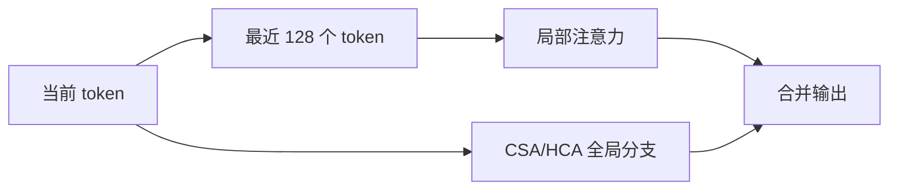

# SWA（滑动窗口注意力）

- **难度**：进阶 | **涉及章节**：第 8 章、第 9 章

## 一句话定义

SWA 让每个 token 只看最近固定窗口内的 token，窗口外的历史不参与注意力。

## 为什么重要

它是长上下文模型的“局部视野”分支。CSA/HCA 负责远端压缩，SWA 负责最近细节，两者缺一不可。

## 图示

## 详解

标准注意力看全部历史，SWA 只保留最近 $n_{\text{win}}$ 个 token 的 KV。V4/V4.1 的窗口都是 128。

作用：
- 保证局部细节不被压缩抹掉，比如相邻词、标点、代码缩进。
- 严格保持因果性：压缩块内的 token 互相看不见，SWA 补上这段局部信息。
- 降低缓存：只需存最近 128 个 token 的 KV，不用存全部。

V4.1 进一步用 **SWA Bounded Replay**：持久缓存不存 SWA，命中前缀时只回放最近 128 个 token 重建，不再回放整个窗口 × 层数。论文说精度损失可忽略。

## 常见误解

- SWA 不是“只看 128 个 token 就完了”，它和全局分支叠加使用。
- SWA 不是“不需要位置编码”，窗口内的位置关系仍要编码。

## 在书中出现的脉络

| 章节 | 语境 | 关键结论 |
|---|---|---|
| ch08 | V4 | 每层附加 128 窗口分支 |
| ch09 | V4.1 | 前 2 层纯 SWA，其余层叠加 |
| ch10 | 架构对比 | 局部视野的稳定角色 |

## 相关概念

- 前置：注意力、因果掩码
- 后续：SWA Bounded Replay、KV cache
