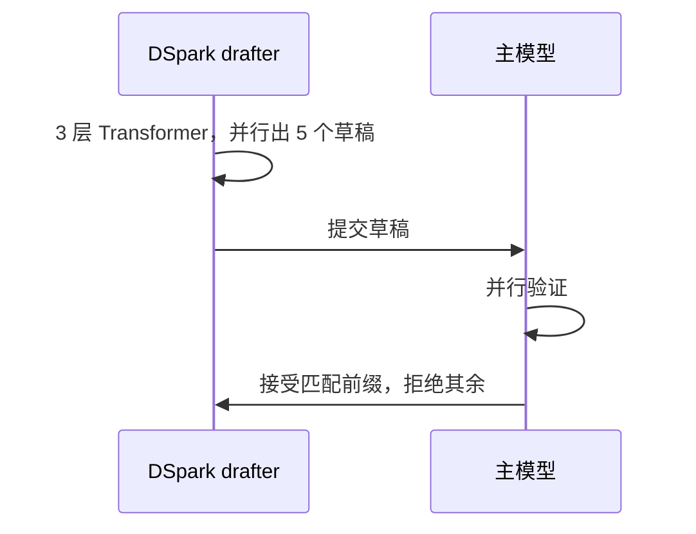

# DSpark（投机解码）

- **难度**：进阶 | **涉及章节**：第 9 章

## 一句话定义

DSpark 是 V4.1 独立训练的投机解码模块：用一个小 drafter 一次猜多个 token，再由主模型按置信度验证接受。

## 为什么重要

decode 阶段每步只生成一个 token，GPU 利用率低。DSpark 用“先猜后验”把多步合并，降低长上下文生成的延迟。

## 图示

## 详解

结构：3 个 Transformer 块，滑动窗口 128。一次前向并行给出 5 个草稿位置的 logits，半自回归生成草稿。

验证：主模型对草稿做并行前向，按置信度调度决定接受多少。匹配的前缀直接接受，第一个不匹配的位置由主模型纠正。

训练：DSpark 在主干预训练之后单独训练，不参与主干梯度。V4.1 主干预训练时甚至不用 MTP，把投机解码完全交给 DSpark。

为什么有效：decode 是显存带宽瓶颈，一次验证多个 token 能把带宽摊薄。草稿接受率越高，加速越明显。

## 常见误解

- DSpark 不是 MTP，MTP 是主干上的辅助训练头，DSpark 是独立 drafter。
- 投机解码不是“一定变快”，草稿接受率低时，验证成本会吃掉收益。

## 在书中出现的脉络

| 章节 | 语境 | 关键结论 |
|---|---|---|
| ch09 | V4.1 | 独立训练，5 个草稿位置 |
| ch10 | 架构对比 | 推理加速路线 |
| ch11 | 部署 | 长上下文 decode 优化 |

## 相关概念

- 前置：自回归生成、MTP
- 后续：投机解码、置信度验证
