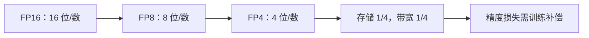

# FP4 量化

- **难度**：进阶 | **涉及章节**：第 9 章

## 一句话定义

FP4 用 4 位浮点数表示权重或 KV cache，把存储和带宽压到 FP16 的约四分之一，代价是精度损失。

## 为什么重要

V4.1 的 890 B/token 全局 KV，很大一部分来自 FP4。没有它，CSA2 的跨层复用也压不到这个量级。

## 图示

## 详解

V4.1 的使用位置：
- 主 KV cache 用 FP4。
- Engram 表和键值投影用 FP8。
- 视觉模块用 FP8。
- MoE 专家权重在 V4 后训练阶段做 FP4 量化感知训练。

为什么能压：浮点数的位宽决定动态范围和精度。FP4 只有 4 位，表示范围很窄，需要缩放因子（scale）把数值映射到合适区间。缩放因子的选择决定量化误差。

风险：长上下文里，KV 的微小误差会累积；注意力对异常值敏感。论文用训练补偿和混合精度（RoPE 维度保留 BF16）降低风险。

## 常见误解

- FP4 不是“把数直接截断”，需要缩放和量化策略。
- FP4 不是“所有部分都用”，关键位置仍保留更高精度。

## 在书中出现的脉络

| 章节 | 语境 | 关键结论 |
|---|---|---|
| ch08 | V4 | MoE 专家与索引器 QK 做 FP4 QAT |
| ch09 | V4.1 | 主 KV 用 FP4 |
| ch11 | 部署 | 精度与成本的取舍 |

## 相关概念

- 前置：KV cache、矩阵乘法
- 后续：量化感知训练、混合精度
