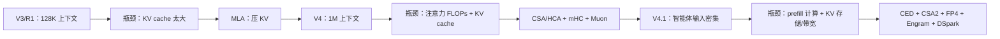

# 架构阐释：三代模型的设计逻辑

## 这个主题在讲什么

前一本按论文逐篇拆，这一本把三篇论文放到一张桌子上比较：V3/R1、V4、V4.1 各自被什么瓶颈逼着改架构，改了哪一块，付出了什么代价。重点不是背参数，而是学会用“瓶颈—机制—代价”三件事去解释任何一个架构改动。

## 全书心智模型

看图说明：每一代的核心创新，都能对应到一个具体的部署瓶颈。看不懂某个组件时，先问“它替谁还债”。

## 学习路径（推荐顺序）

| 步骤 | 章节 | 主题 | 前置 | 检查点 |
|---|---|---|---|---|
| 01 | ch10 | 三代总览与注意力演进 | 论文篇 ch06–ch09 | 能画出注意力演进线并说出每步解决什么 |
| 02 | ch11 | 效率组件的设计逻辑 | ch10 | 能解释 MoE、mHC、Muon、Engram 各自的分工 |
| 03 | ch12 | 训练与后训练 | ch11 | 能对比 R1 的 RL 与 V4/V4.1 的 OPD |
| 04 | ch13 | 综合检验：架构评审 | ch12 | 完成一份有数字支撑的选型报告 |

## 章节索引

- 第 10 章 三代架构总览：瓶颈迁移与注意力演进（难度 ★★★）→ chapters/ch10-overview.md
- 第 11 章 效率组件：MoE、mHC、Muon、Engram、DSpark（难度 ★★★）→ chapters/ch11-components.md
- 第 12 章 训练与后训练：预训练、RL、蒸馏、数据工程（难度 ★★★）→ chapters/ch12-training.md
- 第 13 章 综合检验：写一份架构评审报告（难度 ★★★）→ chapters/ch13-review.md

## 前置知识（零基础缺口补讲）

| 缺口 | 对应补讲位置 | 学完标志 |
|---|---|---|
| 不懂 KV cache | 基础篇 ch05、概念 c16 | 能算每 token 缓存字节数 |
| 不懂 MoE | 基础篇 ch05、概念 c13 | 能算总参数与激活参数 |
| 不懂 RL | 论文篇 ch06 | 能说出 GRPO 的优势计算 |
| 不懂 OPD | ch12、概念 c34 | 能说出学生采样、教师打分的过程 |

## 术语表 / 模式库 / 速查表 入口

- 术语表：glossary.md
- 模式库：patterns.md
- 速查表：cheatsheet.md
- 测验：quiz.md
- 抽认卡：flashcards.md
