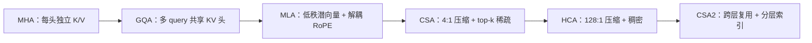
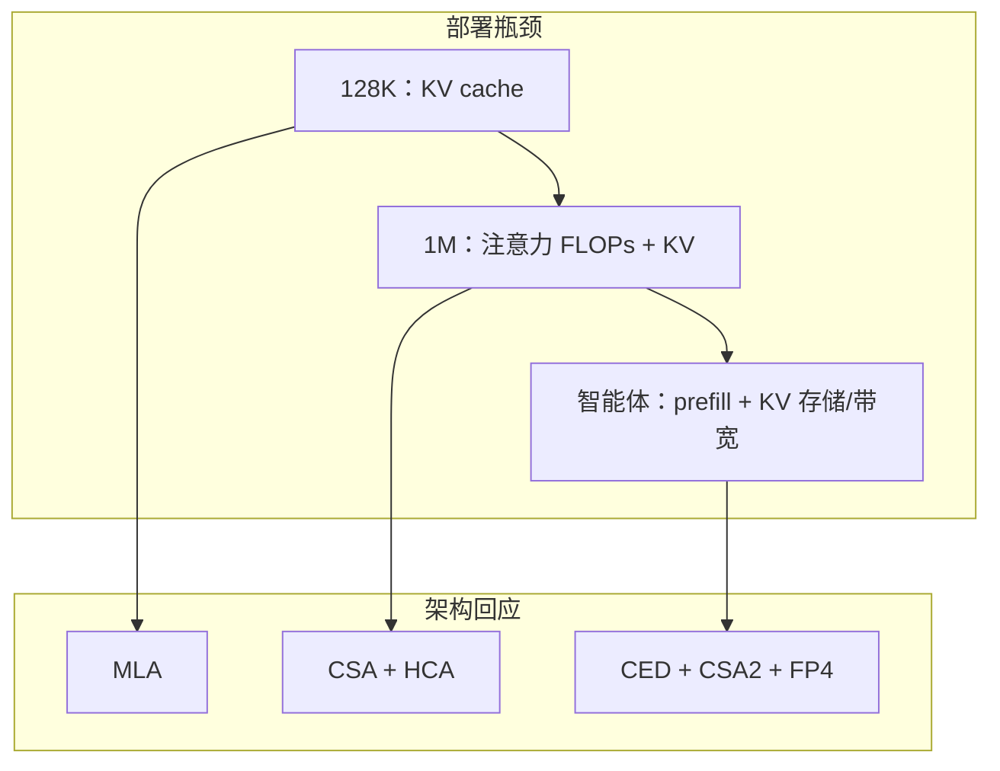

# 第 10 章：三代架构总览：瓶颈迁移与注意力演进

- **难度**：★★★ | **预估学时**：5 小时 | **前置**：论文篇第 6–9 章

## 学习目标

学完本章，你能：
1. 用一张表对比 V3、R1、V4、V4.1 的架构与规模。
2. 说出每一代被哪个部署瓶颈逼着改架构。
3. 画出注意力从 MHA 到 MLA、CSA/HCA、CSA2 的演进线，并说明每步解决了什么、放弃了什么。
4. 解释为什么 R1 不算一次“架构升级”。

## 一句话核心

三代架构不是参数越堆越大，而是瓶颈不断迁移：从 KV cache，到注意力 FLOPs，再到 prefill 计算与 KV 存储/带宽；每一代都在替上一代还债。

## 零基础讲解

### 概念 1：先把“架构”和“后训练”分开（难度：基础）

很多人把 R1 当成“新一代架构”，这是错的。R1 的模型结构和 DeepSeek-V3 完全一样：同样是 671B 总参数、37B 激活、61 层、MLA 注意力、DeepSeekMoE、MTP。R1 改的是**后训练**：在 V3-Base 上用 GRPO 做强化学习，把推理能力激发出来。

架构回答“模型长什么样、怎么算”；后训练回答“用什麼数据、什么目标、什么奖励去调它”。两者可以独立变化。R1 是后训练的革命，不是架构的革命。

### 概念 2：一张表看三代（难度：基础）

| 项目 | V3（2024.12） | R1（2025.01） | V4-Pro（2026.04） | V4-Flash（2026.04） | V4.1-Flash（2026.09） |
|---|---|---|---|---|---|
| 总参数 | 671B | 671B | 1.6T | 284B | 552B + 196B Engram |
| 激活参数 | 37B | 37B | 49B | 13B | prefill 8B / decode 16B |
| 层数 | 61 | 61 | 61 | 43 | 40（20 编码 + 20 解码） |
| 注意力 | MLA | MLA | CSA + HCA 交错 | CSA + HCA 交错 | CSA2（纯） |
| 残差 | 标准 | 标准 | mHC | mHC | Single-Pass mHC |
| 优化器 | AdamW | AdamW | Muon 为主 | Muon 为主 | Muon 为主 |
| 上下文 | 128K | 128K | 1M | 1M | 1M |
| 预训练 token | 14.8T | 继承 V3 | 33T | 32T | 45T（多模态） |

读表先看两个反直觉的地方：
- V4-Flash 的总参数 284B 比 V3 的 671B 小，但论文说 V4-Flash-Base 在多数基准上超过 V3.2-Base。参数少不等于能力弱，架构和数据效率更重要。
- V4.1-Flash 主干 552B，比 V4-Flash 大，但 prefill 只激活 8B。它不是“更大的模型”，是“更会分配计算的模型”。

### 概念 3：瓶颈迁移：每一代在还什么债（难度：进阶）

**V3 时代（128K 上下文）**：主要矛盾是 KV cache。上下文一长，每个 token 的 K/V 缓存线性增长，显存先撑不住。MLA 的答案是把 K/V 压成低维潜向量，缓存降一个数量级。

**V4 时代（1M 上下文）**：光压 KV 不够了。1M token 的注意力计算是平方级，FLOPs 成为新瓶颈；同时 KV cache 仍然很大。CSA 用 4:1 压缩 + top-k 稀疏砍计算，HCA 用 128:1 压缩砍全局候选，两者交错覆盖不同视野。

**V4.1 时代（智能体、输入密集）**：请求变成“读 100 万 token、写几千 token”。prefill 计算和 KV 的存储/带宽成为主矛盾。CED 让 prefill 只算一半层，CSA2 跨层复用 KV，FP4 压位宽，SWA Bounded Replay 把持久缓存里的 SWA 部分去掉。

这条线说明：架构创新不是“想到一个好结构”，而是“部署时哪笔账最疼，就改哪里”。

### 概念 4：注意力演进线（难度：高难）

每一步解决什么、放弃什么：

| 方法 | 压缩维度 | 解决什么 | 代价 |
|---|---|---|---|
| MHA | 无 | 表达能力强，基线 | KV cache 最大 |
| GQA | KV 头数 | 减少 KV 头，省缓存 | 表达多样性下降 |
| MLA | 表示维度 | 潜向量压缩，缓存大降 | 计算图复杂，需解耦 RoPE |
| CSA | 序列 + 稀疏 | 4:1 压缩 + top-k，砍 FLOPs | 索引器成本，局部细节需 SWA 补 |
| HCA | 序列（重压缩） | 128:1，全局粗览 | 细节丢失，只适合粗粒度 |
| CSA2 | 层 + 序列 + 位宽 | 跨层复用 + FP4，缓存极限 | 结构复杂，训练工程难 |

一个容易忽略的点：这些方法不是替代关系。V4 同时用 CSA、HCA、SWA；V4.1 用 CSA2 + SWA。它们是不同视野、不同压缩维度的组合，不是“新一代一定淘汰旧一代”。

### 概念 5：为什么 V4.1 敢做“非对称”（难度：高难）

标准 Transformer 每层都做同样的事，prefill 和 decode 的计算路径基本一致。V4.1 把 40 层分成编码器和解码器，让 prefill 只跑前 20 层，decode 跑完整 40 层。

这背后是一个部署观察：智能体请求的输入/输出比例严重不对称。如果 prefill 和 decode 用同样的计算路径，读输入的成本就无法单独优化。CED 把“读”和“写”拆开，让计算匹配负载。

风险：编码器末端的 $H_{20}$ 要承载全部全局信息，表达能力受压；SWA 回放有额外成本；训练流水线更复杂。V4.1 用每层独立投影、Bounded Replay 和工程优化来补偿。

### 概念 6：架构评价的三个问题（难度：进阶）

看到任何一个架构改动，问三件事：
1. **它替哪笔账还债？** 是 KV cache、FLOPs、prefill、带宽，还是训练稳定性？
2. **代价是什么？** 精度、显存、工程复杂度、训练难度，总有一项要付。
3. **有没有被实验验证？** 论文给的是 FLOPs 估算、benchmark，还是端到端延迟？三者不是一回事。

这三个问题，比背“CSA 压缩 4 倍、HCA 压缩 128 倍”有用得多。

## 图示

看图说明：瓶颈和架构是一一对应的。不要把三代看成“参数增长史”，它是“还债史”。

## 类比与实例

- **类比**：一家快递公司。第一代问题是仓库放不下（KV cache），于是把包裹压缩（MLA）；第二代问题是分拣太慢（FLOPs），于是先粗分再精选（CSA/HCA）；第三代问题是每天大量进货、少量出货（prefill 重），于是把进货和出货分成两条线（CED）。
- **实例**：V4-Pro 在 1M 上下文下，单 token FLOPs 是 V3.2 的 27%，KV cache 是 10%。这两个数字不是“模型变小了”，是“同样长度的上下文，算得更省、存得更少”。

## 常见误解

- **别以为 R1 是新架构**——R1 的模型结构就是 V3，变的是后训练。
- **别以为 V4.1 一定比 V4-Pro 强**——V4.1 目前只有 Flash，论文对标的是 V4-Flash；不同规模不能直接横比。
- **别以为压缩率越高越好**——HCA 128:1 只适合全局粗览，细节还得靠 SWA 和 CSA。
- **别以为 FLOPs 降了延迟就一定降**——还要看带宽、kernel、批大小。

## 自测题（答案）

1.（单选）R1 相对于 V3 的主要变化是什么？
A. 注意力结构 B. 后训练方法 C. 层数 D. 词表大小
**答案：B**；解析：R1 的模型结构与 V3 相同，变化在 RL 后训练。

2.（填空）V4 的 CSA 压缩率是 ______，HCA 压缩率是 ______。
**答案：4:1，128:1**；解析：论文配置明确。

3.（简答）V4.1 为什么要把 40 层分成编码器和解码器？
**答案要点**：智能体输入密集，prefill 成本高；CED 让 prefill 只跑前 20 层，解码器全局 KV 从 H20 投影，prefill 计算近似减半。

## 复习锚点

- 架构与后训练分开看：R1 是后训练革命，不是架构革命。
- 瓶颈迁移：KV cache → 注意力 FLOPs → prefill + KV 存储/带宽。
- 注意力演进：MHA → GQA → MLA → CSA/HCA → CSA2，压缩维度越来越多。
- 评价架构三问：替谁还债、代价是什么、实验验证了什么。
