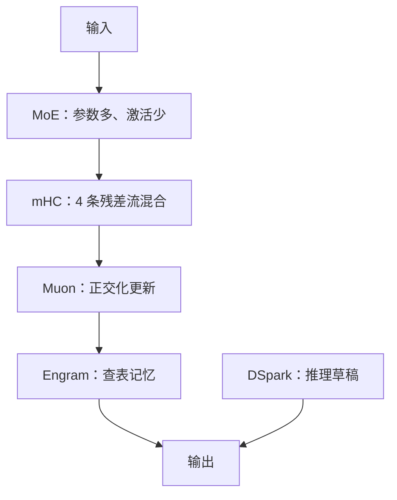

# 第 11 章：效率组件：MoE、mHC、Muon、Engram、DSpark

- **难度**：★★★ | **预估学时**：5 小时 | **前置**：第 10 章

## 学习目标

学完本章，你能：
1. 对每个效率组件说出“它替哪笔账还债、代价是什么”。
2. 区分 MoE 的“总参数”和“激活参数”，并解释共享专家的作用。
3. 说清 MTP 与 DSpark 的分工：一个偏训练，一个偏推理。
4. 解释 mHC 的双随机约束和 Muon 的正交化为什麼能提升训练稳定性。
5. 说出 Engram 为什么能在增加参数的同时不增加矩阵计算。

## 一句话核心

这些组件不是“堆料”，而是三种设计策略：把记忆和计算解耦、把压缩做到多个维度、用数学约束换训练稳定。

## 零基础讲解

### 概念 1：MoE：参数做大，计算不跟着涨（难度：进阶）

普通 FFN 每个 token 都过全部参数。MoE 把 FFN 拆成很多专家，每个 token 只过其中几个，于是总参数可以很大，单 token 计算只按激活参数算。

三代配置：

| 模型 | 共享专家 | 路由专家 | 激活路由专家 | 专家中间维度 |
|---|---|---|---|---|
| V3 | 1 | 256 | 8 | 2048 |
| V4-Flash | 1 | 256 | 6 | 2048 |
| V4-Pro | 1 | 384 | 6 | 3072 |
| V4.1-Flash | 1 | 384 | 6 | 2304 |

两个细节：
- **前 3 个 MoE 层用 Hash 路由**（V4/V4.1）：训练早期路由网络还不稳，先用固定哈希分配，避免专家塌缩。
- **无辅助损失负载均衡**：给每个专家一个偏置，按负载调，不往主损失里加辅助项。

MoE 的代价：专家并行带来跨卡通信；路由不稳会导致训练尖峰；显存要装下所有专家，即使当前 token 只用几个。

### 概念 2：MTP 与 DSpark：一个管训练，一个管推理（难度：进阶）

**MTP** 挂在主干上，训练时让每个位置多预测一个未来 token，增加信号密度。V3/V4 都保留 MTP，深度 1。推理时 MTP 头可以当投机解码草稿。

**DSpark** 是 V4.1 独立训练的 drafter，3 个 Transformer 块、窗口 128，一次并行给出 5 个草稿位置，再用置信度调度验证。V4.1 主干预训练时不用 MTP，把投机解码完全交给 DSpark。

为什么分开：
- MTP 和主干预训练绑在一起，改动会影响主干训练。
- DSpark 单独训练，可以独立优化草稿接受率，不干扰主干。
- 两者目标不同：MTP 提升训练信号，DSpark 提升 decode 速度。

### 概念 3：mHC：用矩阵混合替代简单相加（难度：高难）

标准残差是一条流：$y=x+F(x)$。mHC 把残差扩成 4 条，层间用 $4\times4$ 双随机矩阵 $M$ 混合：

$$X_{\text{out}}=M X_{\text{in}}+F(X_{\text{in}})$$

双随机约束（行和 1、列和 1、非负）保证混合不放大信号。训练时用 Sinkhorn-Knopp 迭代 20 次，把学到的矩阵投影回约束流形。

为什么有效：多条流给不同层更多“写入通道”，矩阵混合让模型学“哪些流该合并”，双随机约束防止数值爆炸。

代价：4 倍激活存储和跨层通信。V4 用融合核、重计算、DualPipe 调整，把开销压到流水线阶段的 6.7%；V4.1 的 Single-Pass mHC 把多个 kernel 合成一个，激活访存减半。

### 概念 4：Muon：把梯度矩阵正交化（难度：高难）

AdamW 逐元素更新，Muon 把参数矩阵的梯度当成整体，做 Newton-Schulz 迭代，把奇异值拉到接近 1：

$$G_{k+1}=aG_k+bG_kG_k^TG_k+c(G_kG_k^T)^2G_k$$

V4 的配置：前 8 步快速收敛，后 2 步稳定奇异值；动量 0.95，权重衰减 0.1，更新 RMS 缩放到 0.18。Embedding、输出头、RMSNorm 仍用 AdamW。

为什么有效：正交化让不同方向的更新不互相干扰，收敛更快、训练更稳。代价：需要完整梯度矩阵，和 ZeRO 分片冲突，V4 用混合 ZeRO 解决。

### 概念 5：Engram：把“记住”从计算里拆出来（难度：进阶）

Engram 是 V4.1 的条件记忆模块，196B 参数，放在第 1、14 层。它把输入 token 做 N-gram（2、3、4 阶）组合，用 8 个哈希头查表，每张表约 1600 万条目，查到嵌入后门控注入主干。

为什么省算力：查表是内存访问，不是矩阵乘法。模型把“固定搭配、事实、术语”存进 Engram，把矩阵计算留给推理。

代价：196B 参数要占存储；哈希碰撞会带来噪声；推理时要从主机内存预取，带宽是瓶颈。V4.1 用 FP8 存表、确定性寻址、后台 RDMA 预取来缓解。

### 概念 6：精度也是架构的一部分（难度：进阶）

- **FP8 训练**：V3 开始用，矩阵乘法用 FP8，master 权重保持高精度。
- **FP4 QAT**：V4 后训练对 MoE 专家权重和索引器 QK 路径做量化感知训练；V4.1 把主 KV 也压到 FP4。
- **混合 KV 存储**：V4 的 RoPE 维度用 BF16，其余用 FP8，缓存减半。

精度策略不是“越省越好”，而是“哪里能错、哪里不能错”。RoPE 维度对位置敏感，保留 BF16；专家权重数量大、容错高，可以 FP4。

### 概念 7：三条设计原则（难度：进阶）

**解耦**：把混在一起的两笔账拆开。Engram 把记忆和计算拆开，CED 把 prefill 和 decode 拆开，MoE 把参数和计算拆开。

**多维压缩**：KV cache 可以从条目大小、序列长度、层数、位宽四个维度压。V4 用了前两个，V4.1 四个一起用，才有 890 B/token。

**约束换稳定**：mHC 用双随机约束，Muon 用正交化约束，SwiGLU 用 clamp 约束。大模型训练不稳定，靠“加约束”比“调超参”更可靠。

这三条原则，比记住每个组件的缩写更有用。遇到新架构，先看它在这三条上做了什么。

## 图示

看图说明：MoE、mHC、Muon 在训练和推理的主干上；Engram 是旁路记忆；DSpark 只在 decode 阶段接进来。它们解决的不是同一个问题。

## 类比与实例

- **类比**：一家公司。MoE 是“几百个顾问，每个项目只请 6 个”；mHC 是“四条并行汇报线，用固定比例汇总”；Muon 是“每次调整都先对齐方向，避免互相打架”；Engram 是“查档案，不用重新算”；DSpark 是“先写草稿，再让主编校对”。
- **实例**：V4-Flash 总参数 284B，激活 13B。如果按稠密模型算，单 token 要过 284B 参数；MoE 只过 13B，计算量约 1/22。但显存仍要装 284B 的权重，这就是“省算力不省显存”。

## 常见误解

- **别以为 MoE 省显存**——它省的是计算，所有权重仍要加载。
- **别以为 mHC 只是“多几条残差”**——关键是双随机约束和 Sinkhorn 投影。
- **别以为 Muon 能完全替代 AdamW**——V4 仍对 embedding、输出头、RMSNorm 用 AdamW。
- **别以为 Engram 是外挂知识库**——它是模型参数的一部分，随训练更新。
- **别以为 FP4 到处都能用**——关键位置仍保留 BF16/FP8。

## 自测题（答案）

1.（单选）MoE 主要省的是哪一项？
A. 显存占用 B. 单 token 计算量 C. 通信量 D. 词表大小
**答案：B**；解析：MoE 只激活部分专家，计算按激活参数算，但所有权重仍要存储。

2.（填空）mHC 的混合矩阵被约束为 ______ 矩阵，用 ______ 迭代投影。
**答案：双随机，Sinkhorn-Knopp**；解析：行和、列和为 1，非负。

3.（简答）Engram 为什么能在增加参数的同时不增加矩阵计算？
**答案要点**：它用哈希查表代替矩阵乘法，查表是内存访问，计算复杂度 $O(1)$。

## 复习锚点

- MoE：总参数大，激活参数小；共享专家 + 细粒度路由 + 无辅助损失均衡。
- MTP 管训练信号，DSpark 管推理草稿。
- mHC 用双随机矩阵混合 4 条残差流；Muon 正交化梯度矩阵。
- Engram 查表记忆；FP4/FP8 是精度维度的压缩。
- 三条原则：解耦、多维压缩、约束换稳定。
