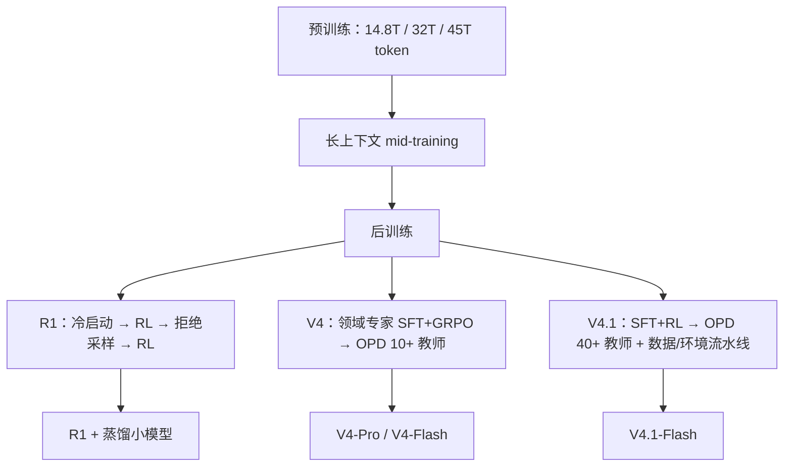

# 第 12 章：训练与后训练：预训练、RL、蒸馏、数据工程

- **难度**：★★★ | **预估学时**：5 小时 | **前置**：第 11 章、论文篇第 6–7 章

## 学习目标

学完本章，你能：
1. 对比 R1 的 RL 后训练与 V4/V4.1 的 OPD 后训练。
2. 说清预训练规模、数据质量、长上下文 mid-training 各自影响什么。
3. 解释“专家训练 + 在线策略蒸馏”为什么能替代混合 RL。
4. 说出 V4.1 为什么把主要精力放在数据与环境流水线，而不是新算法。

## 一句话核心

预训练决定模型的知识底座，后训练决定它会不会用这些知识；R1 用 RL 激发推理，V4/V4.1 用“领域专家 + OPD”把多种能力合并进一个模型。

## 零基础讲解

### 概念 1：预训练在做什么（难度：基础）

预训练就是“拿海量文本，让模型反复预测下一个 token”。损失是交叉熵，数据是万亿级 token。它学到的不是具体任务，而是语言规律、世界知识、代码语法等底座能力。

规模：
- V3：14.8T token。
- V4-Flash：32T；V4-Pro：33T。
- V4.1-Flash：45T 多模态 token。

预训练数据不是“越多越好”，还要看质量、去重、配比、课程。V4 论文提到数据经过严格清洗和配比；V4.1 把多模态数据从预训练一开始就混入，而不是后期补。

长上下文能力也不是天然就有。V4 在预训练后做长上下文 mid-training，用合成 1M 序列和真实长文档继续训，才让模型适应 1M 窗口。

### 概念 2：R1 的后训练：四阶段 RL（难度：进阶）

R1 的路径：
1. 冷启动 SFT：几千条人工长链推理，定格式。
2. 推理 RL：GRPO + 规则奖励（答案对错 + 格式 + 语言一致性）。
3. 拒绝采样 SFT：筛出约 80 万条高质量回答（60 万推理 + 20 万通用）。
4. 第二轮 RL：推理 RL + 通用 RL（通用任务用奖励模型）。

核心是“用 RL 探索，再把探索成果固化成 SFT 数据”。这条路径适合“有明确答案、可规则判分”的任务。

### 概念 3：V4 的后训练：专家 + OPD（难度：高难）

V4 走的是另一条路：
1. **领域专家训练**：数学、代码、智能体、指令遵循等领域各训一个专家。每个专家先 SFT，再用 GRPO + 领域奖励模型做 RL。
2. **在线策略蒸馏（OPD）**：十多个教师模型，把能力合并到一个学生模型。学生在自己的轨迹上采样，教师给全词表 logits，学生最小化反向 KL：

$$\mathcal{L}_{\text{OPD}}(\theta)=\sum_{i=1}^{N}w_i D_{\text{KL}}(\pi_\theta\|\pi_{E_i})$$

关键在“在线”：学生自己生成轨迹，教师在这些轨迹上打分，而不是拿固定数据集做离线蒸馏。这样学生能纠正自己的错误分布。

为什么替代混合 RL：把多个专家的能力直接混在一个 RL 里，容易出现任务冲突、奖励尺度不一致、训练不稳。OPD 在 logits 层面合并，绕过权重合并的精度损失。

V4 还引入**生成式奖励模型**（GRM）：让模型自己当裁判，给难以规则判分的任务打分，并把 RL 直接作用在 GRM 上。这比传统标量奖励模型更灵活，但也更容易出现奖励黑客，需要配合人工标注和规则。

### 概念 4：V4.1 的后训练：数据与环境是主角（难度：高难）

V4.1 的后训练在算法上没有新东西：SFT → RL → OPD，和 V4 一样。变化在数据：
- **大规模智能体任务合成**：把任务写成（问题、环境、验证系统）三元组，用难度和正确性当奖励，训练模型自己造任务。
- **环境构建**：通用智能体环境（模拟真实 SaaS、企业后台接口）、编程智能体环境（从 GitHub 仓库构建可运行、可验证的容器）。
- **DSec 沙箱**：大规模并发跑智能体，支持抢占、容错、轨迹记录。
- **可控推理力度**：用 1–100 的 effort 标量控制输出长度，API 暴露 max/high/low 三档。
- **OPD 合并**：四十多个教师模型，全词表蒸馏。

论文的结论很直接：在当前阶段，数据与环境工程的边际收益，超过后训练算法的创新。这句话值得记住，它解释了为什么 V4.1 的架构创新很多，但后训练算法“没有新东西”。

### 概念 5：三条训练路线的对比（难度：进阶）

| 项目 | R1 | V4 | V4.1 |
|---|---|---|---|
| 基座 | V3-Base | V4-Base | V4.1-Base（多模态） |
| 后训练主线 | 冷启动 + RL + 拒绝采样 + RL | 专家 SFT+GRPO → OPD | SFT+RL → OPD |
| 奖励 | 规则奖励 + 通用奖励模型 | 领域奖励模型 + 生成式奖励模型 | 任务验证 + 规则/奖励模型 |
| 教师数量 | 无（蒸馏另算） | 10+ | 40+ |
| 数据重点 | 可验证推理题 | 领域专家数据 | 合成任务 + 智能体环境 |
| 产出 | 671B R1 + 蒸馏小模型 | Pro / Flash | Flash 多模态 |

三条路线的共同点：都依赖“可验证的奖励”和“高质量数据”。不同点是合并方式：R1 靠 SFT 固化，V4/V4.1 靠 OPD 在 logits 层面合并。

### 概念 6：训练稳定性为什么单独拿出来讲（难度：进阶）

大模型训练会出现损失尖峰（loss spike），严重时前功尽弃。V4 论文把稳定性单列一节，给了两个手段：
- **Anticipatory Routing**：把主干和路由网络的更新解耦，提前一步取数据、缓存路由索引，打破路由异常值的恶性循环。
- **SwiGLU Clamping**：把 SwiGLU 的线性部分限制在 $[-10,10]$，门控上界截到 10，消除异常值。

加上 mHC 的双随机约束、Muon 的正交化，V4 的训练稳定性是“结构约束 + 路由调度 + 数值裁剪”三管齐下。这些手段的原理，论文自己承认还没有完全理解，但实验有效。

### 概念 7：读训练章节要问的三个问题（难度：进阶）

1. **数据从哪来、怎么筛？** 规模大不等于质量高；合成数据要看验证系统。
2. **奖励怎么定义、会不会被 hack？** 规则奖励有盲区，奖励模型有偏好，GRM 也会自评偏差。
3. **多专家怎么合并？** 权重平均、混合 RL、OPD 各有代价；OPD 的关键是教师质量和学生覆盖。

## 图示

看图说明：预训练是共同底座，后训练分三条路线。R1 的重点在“激发”，V4 的重点在“合并专家”，V4.1 的重点在“造数据与环境”。

## 类比与实例

- **类比**：预训练是“读万卷书”，后训练是“分科补课”。R1 是“先做大量模拟题，再把好解法抄成笔记”；V4 是“请十个专科老师分别教，最后让一个学生把十位老师的思路融会贯通”；V4.1 是“自己出题、自己建实验室，让模型在真实环境里练”。
- **实例**：V4 的 OPD 有 10 多个教师，V4.1 有 40 多个。教师越多，合并越复杂，需要全词表 logits 和高效调度。V4 论文提到，把全词表 KL 简化为 token 级估计会增大梯度方差，所以他们坚持全词表蒸馏。

## 常见误解

- **别以为 OPD 是“离线蒸馏”**——它要求学生自己采样轨迹，教师在这些轨迹上打分，是在线策略。
- **别以为数据工程是“脏活”**——V4.1 明确说，数据与环境的边际收益超过算法创新。
- **别以为 RL 一定比 SFT 强**——R1 的失败尝试里，纯 SFT 在泛化上不如 RL，但 RL 也不是所有任务都适用。
- **别以为训练稳定只靠调学习率**——结构约束、路由调度、数值裁剪都参与。

## 自测题（答案）

1.（单选）V4 的后训练用什么方法合并多个领域专家？
A. 权重平均 B. 混合 RL C. 在线策略蒸馏 D. 直接 SFT
**答案：C**；解析：V4 用多教师 OPD，在 logits 层面合并。

2.（填空）V4.1 的后训练算法是 SFT → ______ → OPD。
**答案：RL**；解析：论文明确说算法无新意，标准 SFT+RL+OPD。

3.（简答）为什么 V4 用全词表 OPD，而不是 token 级 KL 估计？
**答案要点**：token 级估计梯度方差大、训练不稳；全词表 logits 更稳定，能忠实蒸馏教师知识。

## 复习锚点

- 预训练规模：V3 14.8T、V4 32/33T、V4.1 45T 多模态。
- R1 后训练：冷启动 → RL → 拒绝采样 → RL → 蒸馏。
- V4 后训练：领域专家 → 10+ 教师 OPD；V4.1：SFT+RL+OPD，40+ 教师。
- 稳定性手段：Anticipatory Routing、SwiGLU Clamping、mHC、Muon。
- 读训练三问：数据、奖励、合并方式。
