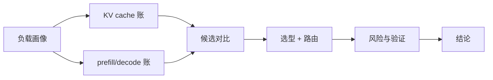

# 第 13 章：综合检验：写一份架构评审报告

- **难度**：★★★ | **预估学时**：3 小时 | **前置**：第 10–12 章

## 学习目标

学完本章，你能：
1. 把一个模糊的部署需求拆成可计算的负载画像。
2. 用 KV cache、FLOPs、prefill/decode 三组数字比较候选模型。
3. 写一份有假设、有数字、有风险清单的架构评审报告。

## 一句话核心

架构选型不是选“最强模型”，而是选“在这个负载画像下，总成本最低且能力够用的模型”。

## 零基础讲解

### 概念 1：先画负载画像（难度：进阶）

假设你在为一款“长文档智能体”选模型，需求如下：

| 维度 | 假设 |
|---|---|
| 上下文 | 单次输入可达 1M token |
| 输入/输出比 | 约 200:1（输入 1M，输出 5K） |
| 日请求量 | 1 万次 |
| 并发 | 峰值 50 个请求同时在线 |
| 模态 | 90% 纯文本，10% 含图片 |
| 能力要求 | 长文档检索、代码修改、工具调用 |
| 成本约束 | 单请求成本尽量低，可接受部分请求走更强模型 |

这张表不是摆设。后面每个数字都要从这里推。

### 概念 2：算 KV cache 的账（难度：进阶）

每个请求的全局 KV cache：

$$\text{单请求 KV}=\text{token 数}\times\text{每 token 字节数}$$

按 1M token 算：

| 模型 | 每 token 字节 | 单请求 KV | 50 并发总 KV |
|---|---|---|---|
| V3.2 | 48,068 B | 约 48 GB | 约 2.4 TB |
| V4-Flash | 3,514 B | 约 3.5 GB | 约 175 GB |
| V4.1-Flash | 890 B | 约 0.89 GB | 约 44.5 GB |

V3.2 的 2.4 TB 已经超出单机 HBM 范围，必须多卡分片或磁盘卸载；V4.1 的 44.5 GB 可以放在几张 HBM 里。这个差距直接决定“能不能低成本并发”。

注意：890 B 是全局 KV；持久 KV、SWA 缓存、Engram 表是另外的账。做容量规划时不能只乘 890。

### 概念 3：算 prefill 与 decode 的账（难度：进阶）

- **prefill**：读 1M token，计算量按输入长度线性增长。V4.1 的 CED 只跑前 20 层，prefill 激活 8B；V4-Flash 没有 CED，prefill 要跑完整 43 层，激活 13B。
- **decode**：生成 5K token，每步都要跑完整层。V4.1 解码激活 16B，V4-Flash 13B。

输入/输出比 200:1 时，prefill 是主要成本。V4.1 的 CED 把 prefill 计算减半，正好命中这个负载。反过来，如果输出很长、输入很短，CED 的收益就没那么大，decode 的 16B 激活反而可能成为负担。

### 概念 4：能力与成本的匹配（难度：进阶）

候选对比：

| 候选 | 优势 | 劣势 | 适用 |
|---|---|---|---|
| V4.1-Flash | prefill 8B、KV 890 B/token、多模态、智能体数据 | 只有 Flash 规模，Terminal-Bench 不如 Opus5 | 输入密集、成本敏感、含图片 |
| V4-Flash | 284B/13B，纯文本效率高 | KV 3.5 KB/token，prefill 未减半 | 纯文本、输入中等 |
| V4-Pro | 1.6T/49B，能力上限最高 | KV、计算都更贵 | 最难推理、代码任务 |
| V3.2 | 生态成熟 | KV 48 KB/token，1M 场景成本高 | 短上下文、已有部署 |

一个务实策略：90% 请求走 V4.1-Flash，10% 最难的代码/推理请求路由到 V4-Pro。这样既控制成本，又不牺牲上限。

### 概念 5：写报告的结构（难度：进阶）

一份合格的架构评审报告，至少包含六节：

1. **负载画像**：输入/输出比、并发、模态、上下文分布、缓存命中率。
2. **瓶颈量化**：KV cache、prefill FLOPs、decode FLOPs、存储带宽、首 token 延迟。
3. **候选对比**：同一组指标下比较，不混用不同口径。
4. **选型建议**：主模型 + 路由策略 + 量化/精度配置。
5. **风险与验证**：精度损失、长文本检索、工具调用、供应商锁定、成本波动。
6. **结论**：一句话说清“选谁、为什么、什么条件下会改选”。

评分要点（20 分）：
- 负载画像有数字，不是形容词（4 分）。
- KV cache 计算正确，区分全局/持久（4 分）。
- 区分 FLOPs 与延迟，不把估算当实测（4 分）。
- 选型有取舍，不是“全都要最强”（4 分）。
- 风险清单具体，有验证计划（4 分）。

### 概念 6：一个示例结论（难度：进阶）

> 以 1M 输入、5K 输出、1 万请求/日、50 并发、10% 含图的负载为例，推荐 V4.1-Flash 作为主模型：全局 KV 约 0.89 GB/请求，50 并发约 44.5 GB，可落在单机多卡 HBM；CED 让 prefill 只激活 8B，匹配 200:1 的输入/输出比；原生多模态省去外挂视觉模型。对终端基准最难的 10% 代码任务，路由到 V4-Pro。若实测长文档检索精度不足，回退到 V4-Pro 或增加检索增强，而不是盲目加大上下文。

## 图示

看图说明：先算账，再选型。跳过负载画像直接问“哪个模型最强”，得到的答案一定不可落地。

## 类比与实例

- **类比**：买车。不是问“哪辆车最快”，而是先看“每天跑多少公里、载几个人、停车位多宽”，再选动力和尺寸。架构选型同理。
- **实例**：50 并发、1M 上下文，V3.2 需要约 2.4 TB KV，V4.1 只要约 44.5 GB。这个数字差，不是“优化一点”，是“能不能上线”的区别。

## 常见误解

- **别以为每 token 字节数就是全部缓存**——全局 KV、持久 KV、SWA、Engram 要分开算。
- **别以为 FLOPs 低就一定便宜**——还要看 GPU 利用率、带宽、批大小、缓存命中。
- **别以为最强模型适合所有请求**——用路由把难请求分流，比全量上最强更划算。

## 自测题（答案）

1.（单选）1M token、每 token 890 B，单请求全局 KV 约多少？
A. 89 MB B. 890 MB C. 8.9 GB D. 89 GB
**答案：B**；解析：$10^6\times890=8.9\times10^8$ 字节，约 890 MB。

2.（填空）V4.1 的 prefill 激活约 ______，decode 激活约 ______。
**答案：8B，16B**；解析：CED 让 prefill 只跑编码器路径。

3.（简答）为什么输入/输出比 200:1 时，CED 的收益比 1:1 时更大？
**答案要点**：CED 省的是 prefill；输入占比越高，prefill 在总成本中越大，收益越明显。

## 复习锚点

- 先画负载画像，再算 KV cache 和 prefill/decode。
- 全局 KV、持久 KV、SWA、Engram 分开算。
- 选型是“够用 + 成本最低”，不是“最强”。
- 报告六节：画像、瓶颈、对比、建议、风险、结论。
