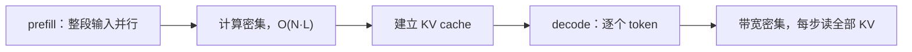

# 推理 FLOPs

- **难度**：高难 | **涉及章节**：第 10 章、第 13 章

## 一句话定义

推理 FLOPs 是生成一个 token 所需的浮点运算次数，分 prefill 和 decode 两阶段，量级和瓶颈完全不同。

## 为什么重要

论文用 FLOPs 证明架构效率，但 FLOPs 不等于延迟。不懂它的算法，就会被“27% FLOPs”这类数字误导。

## 图示

## 详解

**prefill**：输入长度 $N$，层数 $L$，隐藏维度 $d$。主要计算是矩阵乘法，量级约 $O(NLd^2)$，并行度高，GPU 算力容易吃满。

**decode**：每生成一个 token，要读全部历史 KV 做注意力，计算量约 $O(NLd)$，但显存带宽是瓶颈。算术强度低，GPU 算力利用率低。

这解释了为什么长上下文 decode 慢：不是算不动，是搬不动。KV cache 越大，每步搬运越多。

FLOPs 与延迟的关系：

$$\text{延迟}\approx\max\left(\frac{\text{FLOPs}}{\text{算力}},\frac{\text{字节数}}{\text{带宽}}\right)+\text{调度开销}$$

取两者较大的一个。decode 通常卡在带宽项，所以“FLOPs 降 90%”不一定带来 90% 的延迟下降。

## 常见误解

- FLOPs 不是延迟，也不是成本。
- prefill 和 decode 的 FLOPs 不能相加成一个“总推理成本”，它们的瓶颈不同。
- 论文的 FLOPs 估算通常按等效 FP8 计，不同精度不能直接比。

## 在书中出现的脉络

| 章节 | 语境 | 关键结论 |
|---|---|---|
| ch08 | V4 | 1M 上下文 27% FLOPs |
| ch09 | V4.1 | decode FLOPs 几乎不随上下文增长 |
| ch13 | 选型 | 区分 FLOPs 与延迟 |

## 相关概念

- 前置：矩阵乘法、KV cache
- 后续：算术强度、带宽、延迟
