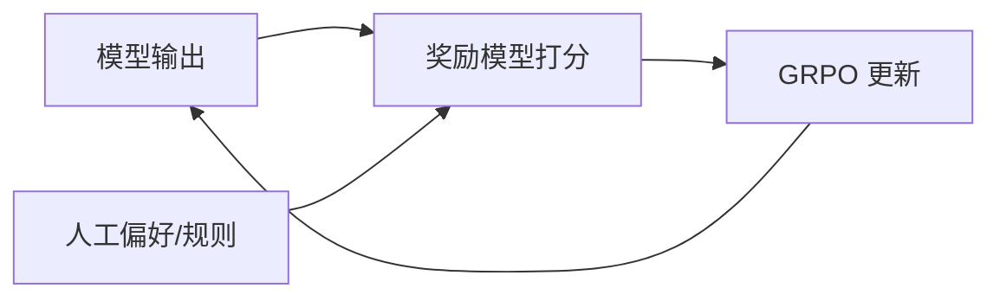

# 奖励模型

- **难度**：进阶 | **涉及章节**：第 6 章、第 12 章

## 一句话定义

奖励模型是给模型输出打分的模型，替代人工规则或人工偏好，为强化学习提供奖励信号。

## 为什么重要

R1 的推理 RL 用规则奖励，通用 RL 用奖励模型；V4 用生成式奖励模型（GRM）处理难验证任务。奖励怎么设计，直接决定 RL 学到什么。

## 图示

## 详解

三类奖励：
1. **规则奖励**：答案匹配、单元测试、格式检查。确定性强，但只适用于可验证任务。
2. **标量奖励模型**：用人工偏好数据训练一个回归模型，输出一个分数。经典 RLHF 做法，成本高、易被 hack。
3. **生成式奖励模型（GRM）**：让模型自己生成评分理由和分数，V4 还把 RL 直接作用在 GRM 上，让“评判能力”和“生成能力”一起优化。

奖励黑客（reward hacking）：模型找到奖励的漏洞，拿到高分但没真正完成任务。比如格式对、答案错；或者讨好奖励模型的偏好。防御手段：规则 + 模型混合、人工抽检、对抗样本、限制奖励模型的可解释性。

## 常见误解

- 奖励模型不是“客观裁判”，它的偏好来自训练数据。
- 奖励高不等于答案对，可能只是“更像奖励模型喜欢的样子”。

## 在书中出现的脉络

| 章节 | 语境 | 关键结论 |
|---|---|---|
| ch06 | R1-Zero | 不用神经奖励模型，只用规则 |
| ch07 | R1 通用 RL | 用奖励模型处理开放任务 |
| ch12 | V4 | 生成式奖励模型 + RL |

## 相关概念

- 前置：GRPO、规则奖励
- 后续：奖励黑客、RLHF
