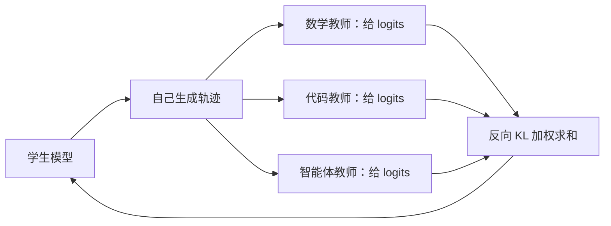

# OPD（在线策略蒸馏）

- **难度**：高难 | **涉及章节**：第 12 章

## 一句话定义

OPD 是学生在自己生成的轨迹上学习多个教师模型的输出分布，用反向 KL 把多个专家的能力合并进一个模型。

## 为什么重要

V4 用 10 多个教师、V4.1 用 40 多个教师做最终合并。它是“专家训练”之后的关键一步，替代了传统的混合 RL 和权重平均。

## 图示

## 详解

目标函数：

$$\mathcal{L}_{\text{OPD}}(\theta)=\sum_{i=1}^{N}w_i D_{\text{KL}}(\pi_\theta\|\pi_{E_i})$$

$N$ 是教师数量，$w_i$ 是教师权重。反向 KL 让学生覆盖教师的输出分布，而不是只挑一个模式。

为什么必须“在线”：轨迹由学生自己生成，教师在这些轨迹上打分。学生遇到自己会犯的错误，教师给出正确分布，学生才能纠正。离线蒸馏用固定数据集，学生没见过的状态学不到。

为什么替代混合 RL：多个领域的 RL 混在一起，奖励尺度、任务分布、优化目标会冲突。OPD 在 logits 层面合并，不依赖奖励尺度，也不会有权重平均的精度损失。

代价：每个教师都要跑前向，教师可能有万亿参数。V4 用教师权重分片、隐藏状态缓存、按教师排序调度；V4.1 支持 40 多个异构教师，用异步生成和动态配置。

## 常见误解

- OPD 不是“把教师权重平均”，它是 logits 层面的蒸馏。
- OPD 不是“离线数据集蒸馏”，轨迹由学生在线生成。
- 教师越多不一定越好，教师质量和覆盖度更关键。

## 在书中出现的脉络

| 章节 | 语境 | 关键结论 |
|---|---|---|
| ch12 | V4 | 10+ 教师，全词表 OPD |
| ch12 | V4.1 | 40+ 教师，数据/环境为主 |
| ch10 | 架构对比 | 后训练合并策略 |

## 相关概念

- 前置：知识蒸馏、KL、GRPO
- 后续：全词表蒸馏、教师调度
