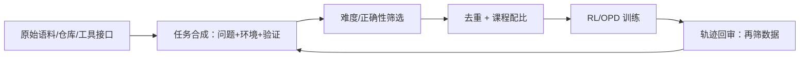

# 数据工程

- **难度**：进阶 | **涉及章节**：第 12 章

## 一句话定义

数据工程是把原始语料、合成任务、智能体环境加工成可训练、可验证、难度可控的数据流水线。

## 为什么重要

V4.1 明确说：后训练算法没有新东西，收益主要来自数据与环境的规模、多样性、可验证性。数据工程已经是模型能力的一部分。

## 图示

## 详解

V4.1 的任务三元组：
1. **问题**：用户要完成什么。
2. **环境**：工具、文件、接口、容器。
3. **验证系统**：怎么判断任务完成，比如单元测试、状态检查、参考答案。

质量两个维度：
- **难度**：不能太简单，否则没有学习信号。
- **正确性**：三个组件都不能有致命缺陷。

数据来源：
- 真实工作流（内部员工、外部伙伴的交互数据）。
- 公开 GitHub 仓库（按 star 阈值筛选）。
- 模型自己合成的任务（用难度和正确性当奖励，迭代训练）。

配套：DSec 沙箱、抢占容错、轨迹记录、去重、难度校准、模态配比。

## 常见误解

- 数据工程不是“多爬点网页”，它包括任务设计、环境构建、验证系统。
- 合成数据不是“模型随便编”，要有验证和难度控制。
- 数据规模不是唯一变量，多样性和可验证性同样重要。

## 在书中出现的脉络

| 章节 | 语境 | 关键结论 |
|---|---|---|
| ch12 | V4.1 | 数据/环境边际收益超过算法 |
| ch07 | R1 | 拒绝采样是数据工程的一种 |
| ch13 | 选型 | 数据质量影响能力上限 |

## 相关概念

- 前置：拒绝采样、RL
- 后续：智能体环境、合成任务
