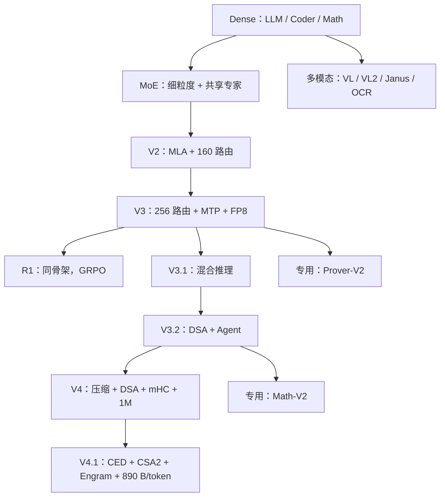

# DeepSeek 模型全谱：从 dense 到 V4.1

## 这册在讲什么

DeepSeek 不是“一个 V3”。它有一条从 dense 到 MoE、从 MLA 到 DSA/CSA、从语言模型到多模态/证明模型的长线。这册按代际拆结构，按家族拆 checkpoint，最后给一张选型表。

核心主张：**每一代真正改的是结构件，不是参数量。** 看懂结构件，才能看懂模型卡上的数字。

## 全书心智模型

## 学习路径（7 步主线）

| 步骤 | 章节 | 主题 | 前置 | 检查点 |
|---|---|---|---|---|
| 01 | ch01–ch02 | 先会读模型卡、稠密模型 | 无 | 六问读四张卡 |
| 02 | ch02 | LLM / Coder / FIM | ch01 | 手画 67B 配置 |
| 03 | ch03 | MoE 与专家 | ch02 | 算激活比例 |
| 04 | ch04 | V2 与 MLA | ch03 | 算 69 KB/token |
| 05 | ch05–ch06 | V3 与 R1 | ch04 | 解释 685B；算 GRPO |
| 06 | ch07–ch09、ch13 | V3.2 / V4 / V4.1 + 手算 | ch05 | 画 CSA/HCA；算 890 MB；跑手算题 |
| 07 | ch10–ch11、ch14 | 多模态、专用、选型、源码 | ch06 | 三场景选型；读 config.json |

完整路径见 `paths/learn.md`。

## 章节索引

- 第 1 章 家族地图（★☆☆）→ `chapters/ch01-family-map.md`
- 第 2 章 Dense 起步：LLM、Coder 与 Math（★☆☆）→ `chapters/ch02-dense-era.md`
- 第 3 章 DeepSeekMoE（★★☆）→ `chapters/ch03-moe.md`
- 第 4 章 V2 代：MLA + MoE（★★★）→ `chapters/ch04-v2-mla.md`
- 第 5 章 V3 代：671B/37B（★★★）→ `chapters/ch05-v3.md`
- 第 6 章 R1 代：换训练目标（★★★）→ `chapters/ch06-r1.md`
- 第 7 章 V3.1 / V3.2（★★★）→ `chapters/ch07-v31-v32.md`
- 第 8 章 V4 代：百万上下文（★★★）→ `chapters/ch08-v4.md`
- 第 9 章 V4.1：890 B/token（★★★）→ `chapters/ch09-v41.md`
- 第 10 章 多模态与专用模型（★★☆）→ `chapters/ch10-multimodal-special.md`
- 第 11 章 全家族对比与选型（★★☆）→ `chapters/ch11-compare.md`
- 附录：105+ 张模型卡索引（★☆☆）→ `chapters/ch12-model-index.md`
- 第 13 章 手算手册：从参数量到 KV 账（★★☆）→ `chapters/ch13-hand-calc.md`
- 第 14 章 源码地图：config.json 与 modeling 文件（★★☆）→ `chapters/ch14-source-map.md`

## 前置知识缺口

| 缺口 | 补讲位置 | 学完标志 |
|---|---|---|
| 矩阵乘法、softmax | `01-foundations` 第 2–3 章 | 能手算 2×2 矩阵乘、3 个数 softmax |
| 注意力 | `01-foundations` 第 4 章 | 能写出 Q/K/V 形状 |
| FFN / 残差 / LayerNorm | `01-foundations` 第 5 章 | 能解释一层 Transformer |
| 概率与梯度下降 | `01-foundations` 第 3、6 章 | 能手算一次梯度更新 |
| Python / PyTorch | `03-architecture` 第 11 章 | 能读懂 config.json |

## 术语 / 模式 / 速查入口

- `glossary.md`：68 条术语
- `patterns.md`：六问读卡法、代际主线、选型决策
- `cheatsheet.md`：配置表、公式、许可证

## 读法

先读第 1 章建立代际框架，再按 7 步走。不要从第 8 章直接跳进去；V4 的 CSA/HCA 需要先懂 MLA 和 DSA。

数学接近零基础时，允许跳过公式先看“一句话核心”和“常见误解”，但第 4、5、8、9 章的形状与字节账要动手算一遍。
